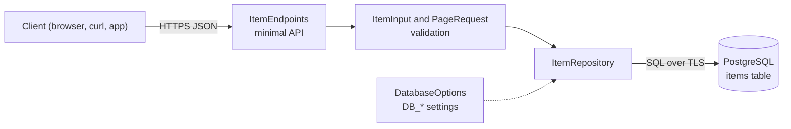

# ASP.NET Core PostgreSQL CRUD API Starter

[](LICENSE) [](https://dotnet.microsoft.com/apps/aspnet) [](https://dotnet.microsoft.com) [](https://www.postgresql.org) [](tests) [](https://github.com/light-cloud-templates/aspnet-core-postgresql-crud-api/generate) [](https://www.light-cloud.com/templates/aspnet-core-postgresql-crud-api)

An ASP.NET Core 10 minimal API CRUD starter in C# that stores one resource, `items`, in PostgreSQL through Npgsql 10 and a pooled `NpgsqlDataSource`. It is a small, tested REST API boilerplate for .NET developers who want a working create, read, update and delete service with validation, JSON errors, a health check and an OpenAPI document, ready to rename and extend. It runs with `dotnet run` anywhere .NET 10 runs, and deploys to Light Cloud with a database in one click.

## Features

- Minimal API endpoints for `items`: list with `limit` and `offset`, get, create, replace and delete
- PostgreSQL through Npgsql 10 with one pooled `NpgsqlDataSource` (up to 5 connections) and plain SQL
- The `items` table is created on start (`CREATE TABLE IF NOT EXISTS`), so there is no migration step
- Validation from the raw JSON: `name` is trimmed and must be 1 to 200 characters, and a number sent as `name` is a `400`
- Every error is JSON `{ "error": "..." }`: `400` for invalid input, `404` for an unknown item or route, `500` for an exception
- `GET /health` answers `200` when the database answers and `503` when it does not
- OpenAPI document at `/openapi/v1.json` from `Microsoft.AspNetCore.OpenApi`
- snake_case JSON (`created_at`, `updated_at`)
- xUnit tests for the settings, validation and paging rules, with no database needed
- TLS to the database by default (`DB_SSLMODE=require`)

## Quick start

You need the .NET 10 SDK and Docker (for a local PostgreSQL).

```bash
git clone https://github.com/light-cloud-templates/aspnet-core-postgresql-crud-api.git
cd aspnet-core-postgresql-crud-api
docker run -d --name items-db -p 5432:5432 -e POSTGRES_PASSWORD=postgres postgres:16
cp .env.example .env
set -a && . ./.env && set +a
dotnet run
```

Open <http://localhost:8080/items> to see the (empty) list of items, or <http://localhost:8080/openapi/v1.json> for the OpenAPI document.

Other ways to start:

- **Use this template**: press [Use this template](https://github.com/light-cloud-templates/aspnet-core-postgresql-crud-api/generate) to create your own repository from this one.
- **Deploy to Light Cloud**: open the [template page](https://www.light-cloud.com/templates/aspnet-core-postgresql-crud-api) and press Deploy to get a running copy with a database.

## Deploy

### Deploy to Light Cloud

[](https://www.light-cloud.com/templates/aspnet-core-postgresql-crud-api)

The Deploy button copies this template into your GitHub account and creates:

- a server app that builds `CrudApi.csproj` and runs it as a container listening on `PORT`
- a PostgreSQL database, with `DB_HOST`, `DB_NAME`, `DB_USER` and `DB_PASSWORD` set on the app

There are no secrets to fill in. Every push to the default branch deploys again. Templates with a database need a paid Light Cloud plan.

### Deploy anywhere else

This is a standard ASP.NET Core app with no Light Cloud code in it. Publish it with `dotnet publish CrudApi.csproj -c Release -o out`, set `PORT` and the `DB_*` variables, and start it with `dotnet out/CrudApi.dll` on any host or container image with the ASP.NET Core 10 runtime that can reach a PostgreSQL database. It serves plain HTTP and expects HTTPS to end at a proxy or load balancer in front of it.

## Project structure

```text
.
├── Program.cs                 # port, JSON, error handling, table creation, endpoint mapping
├── Data/
│   ├── DatabaseOptions.cs     # DB_* settings to an Npgsql connection string
│   ├── DatabaseServiceCollectionExtensions.cs # AddDatabase(): options and NpgsqlDataSource
│   └── ItemRepository.cs      # CREATE TABLE and the item SQL
├── Endpoints/
│   ├── RootEndpoints.cs       # GET / and GET /health
│   └── ItemEndpoints.cs       # /items CRUD
├── Models/                    # Item, ItemInput (validation), PageRequest (limit and offset)
├── tests/CrudApi.Tests/       # xUnit tests, no database needed
├── CrudApi.csproj             # web project, .NET 10 (keeps tests/ out of the build)
├── CrudApi.slnx               # solution: web project and tests
├── appsettings.json           # log levels
└── .env.example               # the variables, for local runs
```

## API endpoints

| Method | Path | Description |
| --- | --- | --- |
| `GET` | `/` | Lists the routes |
| `GET` | `/health` | `200` when the database answers, `503` when it does not |
| `GET` | `/items?limit=20&offset=0` | Lists items, oldest first (`limit` 1 to 100, default 20) |
| `GET` | `/items/{id}` | Gets one item |
| `POST` | `/items` | Creates an item, answers `201` with a `Location` header |
| `PUT` | `/items/{id}` | Replaces an item's `name` and `description` |
| `DELETE` | `/items/{id}` | Deletes an item, answers `204` |
| `GET` | `/openapi/v1.json` | OpenAPI document |

An item is `{ "id", "name", "description", "created_at", "updated_at" }`. `name` is required; `description` is optional, and a `PUT` without it clears it. An id that is not a whole number does not match a route and answers `404`.

```bash
curl -X POST http://localhost:8080/items \
  -H 'content-type: application/json' \
  -d '{"name": "First item", "description": "Hello"}'
```

On Light Cloud, use your app's URL instead of `http://localhost:8080`.

## Environment variables

| Name | Required | Default | What it does |
| --- | --- | --- | --- |
| `PORT` | No | `8080` | Port to listen on. Set by Light Cloud. |
| `DB_HOST` | Yes | `localhost` | Database host, `host` or `host:port` (port defaults to `5432`). Set by Light Cloud. |
| `DB_NAME` | Yes | `postgres` | Database name. Set by Light Cloud. |
| `DB_USER` | Yes | `postgres` | Database user. Set by Light Cloud. |
| `DB_PASSWORD` | Yes | empty | Database password. Set by Light Cloud. |
| `DB_SSLMODE` | No | `require` | `require`: TLS on, certificate not verified. Set `disable` for a local database without TLS. |

ASP.NET Core reads these through its configuration system, so they can also go in `appsettings.json` for local runs. An empty value counts as unset.

## Testing

```bash
dotnet test CrudApi.slnx
```

The xUnit tests cover `DatabaseOptions`, `ItemInput` and `PageRequest`: the TLS default, host and port handling, name and description validation, and the `limit` and `offset` rules. They need no database.

## How it works



On start, `Program.cs` creates the `items` table through the pooled data source. If the database is unreachable the app exits, so a broken connection shows up at deploy time, not on the first request.

## FAQ

### How do I connect to PostgreSQL locally?

Run PostgreSQL in Docker as in the quick start, copy `.env.example` to `.env` (it sets `DB_SSLMODE=disable` for the local database) and load it with `set -a && . ./.env && set +a` before `dotnet run`.

### How do I add a new resource to an ASP.NET Core minimal API?

Add a model in `Models/`, a repository in `Data/` modelled on `ItemRepository.cs` with its `CREATE TABLE`, and an `Endpoints/*Endpoints.cs` file with a `Map...Endpoints` method. Register the repository and call the map method in `Program.cs`.

### How do I add Swagger UI?

The template serves the OpenAPI document at `/openapi/v1.json` but no UI. Add a UI package such as Scalar (`dotnet add package Scalar.AspNetCore`) and map it in `Program.cs` next to `app.MapOpenApi()`.

### Can I deploy it without Light Cloud?

Yes. It is a plain ASP.NET Core app: publish it with `dotnet publish CrudApi.csproj -c Release -o out` and run `dotnet out/CrudApi.dll` with `PORT` and the `DB_*` variables set, on any host with the .NET 10 runtime and a PostgreSQL database.

### Why Npgsql and not Entity Framework Core?

The queries are a few lines of SQL each, which keeps the starter small and shows exactly what runs against the database. You can add EF Core with the Npgsql provider later; the endpoints only talk to `ItemRepository`.

## Related templates

- [aspnet-core-api-starter](https://github.com/light-cloud-templates/aspnet-core-api-starter): ASP.NET Core without a database
- [spring-boot-postgresql-crud-api](https://github.com/light-cloud-templates/spring-boot-postgresql-crud-api): the same items API in Java and Spring Boot
- [gin-postgresql-crud-api](https://github.com/light-cloud-templates/gin-postgresql-crud-api): the same items API in Go and Gin
- [fastapi-postgresql-crud-api](https://github.com/light-cloud-templates/fastapi-postgresql-crud-api): the same items API in Python and FastAPI

## Licence

MIT, see [LICENSE](LICENSE).

---

Maintained by [Light Cloud](https://light-cloud.com): deploy apps, APIs and databases in one click.
