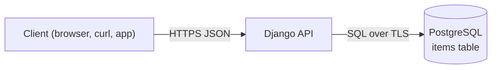

# CRUD API: Django + PostgreSQL

A small REST API for one resource, `items`, built with Django REST framework, served by Gunicorn. Deploy it with a PostgreSQL database in one click, then make it yours.

[](https://www.light-cloud.com/templates/crud-api-django)

## How it works



The app creates the `items` table when it starts, so there is no migration step. On Light Cloud the database connection is set for you; the app listens on `PORT`.

## Routes

| Method | Path | What it does |
| --- | --- | --- |
| `GET` | `/` | Lists the routes |
| `GET` | `/health` | `200` when the database answers, `503` when it does not |
| `GET` | `/items?limit=20&offset=0` | Lists items, oldest first (`limit` 1 to 100, default 20) |
| `GET` | `/items/:id` | Gets one item |
| `POST` | `/items` | Creates an item, answers `201` |
| `PUT` | `/items/:id` | Replaces an item's `name` and `description` |
| `DELETE` | `/items/:id` | Deletes an item, answers `204` |

An item is `{ "id", "name", "description", "created_at", "updated_at" }`. `name` is required (1 to 200 characters); `description` is optional. Errors are JSON `{ "error": "..." }`: `400` for invalid input, `404` for an unknown item.

## Project structure

```text
.
├── config/              # the Django project
│   ├── settings.py      # settings, read from the environment
│   ├── urls.py          # GET /, GET /health, then each app's urls
│   ├── views.py         # index, health check, JSON 404/500 pages
│   ├── exceptions.py    # every API error as {"error": "..."}
│   ├── wsgi.py          # entry point: runs migrations, then serves
│   └── tests.py
├── items/               # the items app
│   ├── models.py
│   ├── serializers.py   # validation
│   ├── views.py         # ItemViewSet: /items CRUD
│   ├── urls.py
│   ├── migrations/
│   └── tests.py
├── manage.py
├── gunicorn.conf.py     # 4 threads per worker
├── requirements.txt     # runtime dependencies (what Light Cloud installs)
├── requirements-dev.txt # adds ruff
├── pyproject.toml       # ruff settings
├── .env.example         # the variables, for local runs
└── .python-version      # Python 3.12
```

## Run locally

You need Python 3.12 and Docker (for the database).

```bash
docker run -d --name items-db -p 5432:5432 -e POSTGRES_PASSWORD=postgres postgres:16
python3 -m venv .venv && . .venv/bin/activate
pip install -r requirements-dev.txt
cp .env.example .env
set -a && . ./.env && set +a
gunicorn config.wsgi:application --bind 0.0.0.0:8080
```

The API is now on http://localhost:8080.

## Run the tests

With the database running and `.env` loaded as above:

```bash
python manage.py test
ruff check .
```

Django creates a separate `test_` database for the run and drops it afterwards.

## Try it

```bash
curl -X POST http://localhost:8080/items -H 'content-type: application/json' -d '{"name": "First item", "description": "Hello"}'
curl 'http://localhost:8080/items?limit=10'
curl http://localhost:8080/items/1
curl -X PUT http://localhost:8080/items/1 -H 'content-type: application/json' -d '{"name": "Renamed"}'
curl -X DELETE http://localhost:8080/items/1
```

On Light Cloud, use your app's URL instead of http://localhost:8080.

## Configuration

| Variable | Set by | Meaning |
| --- | --- | --- |
| `PORT` | Light Cloud | Port to listen on (default `8080`) |
| `DB_HOST` | Light Cloud | Database host, `host` or `host:port` (port defaults to 5432) |
| `DB_NAME` | Light Cloud | Database name |
| `DB_USER` | Light Cloud | Database user |
| `DB_PASSWORD` | Light Cloud | Database password |
| `DJANGO_SECRET_KEY` | you, optional | Django's signing key. Not needed by this API (no sessions or forms); a random one is made at start when unset. |
| `DB_SSLMODE` | you, optional | `require` by default: TLS on, certificate not verified. Set `disable` for a local database without TLS. |

## Make it yours

The model is in `items/models.py`, its validation in `items/serializers.py` and the API in `items/views.py`. A new resource is a new app (`python manage.py startapp`), added to `INSTALLED_APPS` and `config/urls.py`. Add a field, run `python manage.py makemigrations`, commit the new migration and push: migrations run when the app starts, and Light Cloud redeploys on every push.

## License

MIT
