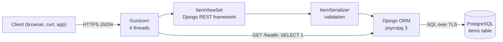

# Django REST Framework PostgreSQL API Starter

[](LICENSE) [](https://www.djangoproject.com) [](https://www.django-rest-framework.org) [](https://www.python.org) [](https://www.postgresql.org) [](items/tests.py) [](https://github.com/light-cloud-templates/django-rest-framework-postgresql-api/generate) [](https://www.light-cloud.com/templates/django-rest-framework-postgresql-api)

A Django 6 and Django REST framework 3.18 CRUD API starter in Python 3.12 that stores one resource, `items`, in PostgreSQL through the Django ORM and psycopg 3, served by Gunicorn. It is a small, tested REST API boilerplate for developers who want a working create, read, update and delete service with a model, a serializer, a `ModelViewSet`, JSON errors and a health check, ready to rename and extend. It runs with `gunicorn config.wsgi:application` anywhere Python runs, and deploys to Light Cloud with a database in one click.

## Features

- REST endpoints for `items`: list with `limit` and `offset`, get, create, replace and delete
- A Django model, a `ModelSerializer` and a `ModelViewSet`, routed by DRF's `SimpleRouter` without trailing slashes
- PostgreSQL through the Django ORM and psycopg 3, with persistent connections (`CONN_MAX_AGE=60`) and health checks
- Migrations run when the app starts, so a fresh database needs no manual step
- Validation in the serializer: `name` is trimmed and must be 1 to 200 characters, numbers are rejected instead of turned into text
- Every error is JSON `{ "error": "..." }`: `400` for invalid input, `404` for an unknown item or route, `405` for an unsupported method
- `GET /health` answers `200` when the database answers and `503` when it does not
- A lean Django project: JSON renderer and parser only, no admin, sessions, auth or templates
- Gunicorn with 4 threads per worker, set in `gunicorn.conf.py`
- Tests with Django's test runner against a real PostgreSQL, and ruff for linting
- TLS to the database by default (`DB_SSLMODE=require`)

## Quick start

You need Python 3.12 and Docker (for a local PostgreSQL).

```bash
git clone https://github.com/light-cloud-templates/django-rest-framework-postgresql-api.git
cd django-rest-framework-postgresql-api
docker run -d --name items-db -p 5432:5432 -e POSTGRES_PASSWORD=postgres postgres:16
python3 -m venv .venv && . .venv/bin/activate
pip install -r requirements-dev.txt
cp .env.example .env
set -a && . ./.env && set +a
gunicorn config.wsgi:application --bind 0.0.0.0:8080
```

Open <http://localhost:8080/items> to see the (empty) list.

Other ways to start:

- **Use this template**: press [Use this template](https://github.com/light-cloud-templates/django-rest-framework-postgresql-api/generate) to create your own repository from this one.
- **Deploy to Light Cloud**: open the [template page](https://www.light-cloud.com/templates/django-rest-framework-postgresql-api) and press Deploy to get a running copy with a database.

## Deploy

### Deploy to Light Cloud

[](https://www.light-cloud.com/templates/django-rest-framework-postgresql-api)

The Deploy button copies this template into your GitHub account and creates:

- a server app that runs `gunicorn config.wsgi:application` on the port in `PORT`
- a PostgreSQL database, with `DB_HOST`, `DB_NAME`, `DB_USER` and `DB_PASSWORD` set on the app

There are no secrets to fill in. Every push to the default branch deploys again. Templates with a database need a paid Light Cloud plan.

### Deploy anywhere else

This is a standard Django project with no Light Cloud code in it. Any host that runs Python 3.12 and can reach a PostgreSQL database runs it: install `requirements.txt`, set the `DB_*` variables and start `gunicorn config.wsgi:application --bind 0.0.0.0:$PORT`. Migrations run on start, so there is no release step.

## Project structure

```text
.
├── config/              # the Django project
│   ├── settings.py      # settings, read from the environment
│   ├── urls.py          # GET /, GET /health, then the items routes
│   ├── views.py         # index, health check, JSON 404 and 500 pages
│   ├── exceptions.py    # every API error as {"error": "..."}
│   ├── wsgi.py          # entry point: runs migrations, then serves
│   └── tests.py         # index, health and 404 tests
├── items/               # the items app
│   ├── models.py        # the Item model, table items
│   ├── serializers.py   # validation
│   ├── views.py         # ItemViewSet: /items CRUD
│   ├── urls.py          # SimpleRouter, no trailing slash
│   ├── migrations/      # 0001_initial creates the table
│   └── tests.py         # CRUD, paging and validation tests
├── manage.py
├── gunicorn.conf.py     # 4 threads per worker
├── requirements.txt     # runtime dependencies
├── requirements-dev.txt # adds ruff
├── pyproject.toml       # ruff settings
├── .env.example         # the variables, for local runs
└── .python-version      # Python 3.12
```

## API endpoints

| Method | Path | Description |
| --- | --- | --- |
| `GET` | `/` | Lists the routes |
| `GET` | `/health` | `200` when the database answers, `503` when it does not |
| `GET` | `/items?limit=20&offset=0` | Lists items, oldest first (`limit` 1 to 100, default 20) |
| `GET` | `/items/<id>` | Gets one item |
| `POST` | `/items` | Creates an item, answers `201` |
| `PUT` | `/items/<id>` | Replaces an item's `name` and `description` |
| `DELETE` | `/items/<id>` | Deletes an item, answers `204` |

An item is `{ "id", "name", "description", "created_at", "updated_at" }`. `name` is required; `description` is optional, and a `PUT` without it clears it. The API answers JSON only: DRF's browsable API and schema views are not enabled.

```bash
curl -X POST http://localhost:8080/items \
  -H 'content-type: application/json' \
  -d '{"name": "First item", "description": "Hello"}'
```

On Light Cloud, use your app's URL instead of `http://localhost:8080`.

## Environment variables

| Name | Required | Default | What it does |
| --- | --- | --- | --- |
| `PORT` | No | `8000` | Port Gunicorn listens on (Gunicorn reads it; without it, Gunicorn binds `127.0.0.1:8000`). Set by Light Cloud. |
| `DB_HOST` | Yes | `localhost` | Database host, `host` or `host:port` (port defaults to `5432`). Set by Light Cloud. |
| `DB_NAME` | Yes | `postgres` | Database name. Set by Light Cloud. |
| `DB_USER` | Yes | `postgres` | Database user. Set by Light Cloud. |
| `DB_PASSWORD` | Yes | empty | Database password. Set by Light Cloud. |
| `DB_SSLMODE` | No | `require` | `require`: TLS on, certificate not verified. Set `disable` for a local database without TLS. |
| `DJANGO_SECRET_KEY` | No | random per start | Django's signing key. This API has no sessions, forms or signed cookies, so a random key made at start is enough. |

## Testing

With the database running and `.env` loaded as in the quick start:

```bash
python manage.py test
ruff check .
```

Django creates a separate `test_` database for the run and drops it afterwards, so the database user needs permission to create databases (the local `postgres` user has it).

## How it works



On start, `config/wsgi.py` runs `migrate`, which creates the `items` table on a fresh database. If the database is unreachable the app does not start, so a broken connection shows up at deploy time, not on the first request. `config/exceptions.py` turns every DRF error into `{ "error": "..." }`.

## FAQ

### How do I connect to PostgreSQL locally?

Run PostgreSQL in Docker as in the quick start, copy `.env.example` to `.env` (it sets `DB_SSLMODE=disable` for the local database) and load it with `set -a && . ./.env && set +a` before starting Gunicorn or running `manage.py`.

### How do I add a new resource in Django REST framework?

Create an app with `python manage.py startapp things`, give it a model, a serializer and a viewset modelled on `items/`, add it to `INSTALLED_APPS` in `config/settings.py` and include its urls in `config/urls.py`. Then run `python manage.py makemigrations` and commit the migration.

### How do I add a field to items?

Add it to `Item` in `items/models.py` and to `fields` in `items/serializers.py`, then run `python manage.py makemigrations` and commit the new migration. It is applied the next time the app starts, locally and on deploy.

### Can I deploy it without Light Cloud?

Yes. It is a plain Django project: any host with Python 3.12 and a PostgreSQL database runs it with `gunicorn config.wsgi:application --bind 0.0.0.0:$PORT`.

### Does it have OpenAPI docs or the browsable API?

No. To stay small it renders JSON only and configures no templates or static files. A package such as drf-spectacular adds an OpenAPI schema and Swagger UI; it and DRF's browsable API both need Django's `TEMPLATES` setting and `django.contrib.staticfiles`, which you would add in `config/settings.py`.

## Related templates

- [fastapi-postgresql-crud-api](https://github.com/light-cloud-templates/fastapi-postgresql-crud-api): the same items API in FastAPI, with OpenAPI docs
- [flask-postgresql-crud-api](https://github.com/light-cloud-templates/flask-postgresql-crud-api): the same items API in Flask
- [flask-api-starter](https://github.com/light-cloud-templates/flask-api-starter): a Python API without a database
- [express-postgresql-crud-api](https://github.com/light-cloud-templates/express-postgresql-crud-api): the same items API in Node.js and Express

## Licence

MIT, see [LICENSE](LICENSE).

---

Maintained by [Light Cloud](https://light-cloud.com): deploy apps, APIs and databases in one click.
