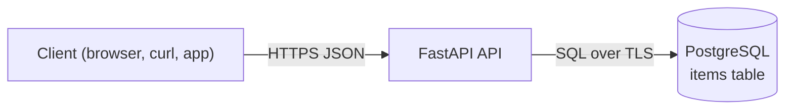

# CRUD API: FastAPI + PostgreSQL

A small REST API for one resource, `items`, built with FastAPI and psycopg 3. Deploy it with a PostgreSQL database in one click, then make it yours.

[](https://www.light-cloud.com/templates/crud-api-fastapi)

## How it works



The app creates the `items` table when it starts, so there is no migration step. On Light Cloud the database connection is set for you; the app listens on `PORT`.

## Routes

| Method | Path | What it does |
| --- | --- | --- |
| `GET` | `/` | Lists the routes |
| `GET` | `/health` | `200` when the database answers, `503` when it does not |
| `GET` | `/items?limit=20&offset=0` | Lists items, oldest first (`limit` 1 to 100, default 20) |
| `GET` | `/items/:id` | Gets one item |
| `POST` | `/items` | Creates an item, answers `201` |
| `PUT` | `/items/:id` | Replaces an item's `name` and `description` |
| `DELETE` | `/items/:id` | Deletes an item, answers `204` |
| `GET` | `/docs` | OpenAPI docs |

An item is `{ "id", "name", "description", "created_at", "updated_at" }`. `name` is required (1 to 200 characters); `description` is optional. Errors are JSON `{ "error": "..." }`: `400` for invalid input, `404` for an unknown item.

## Project structure

```text
.
├── app/
│   ├── main.py          # creates the app: lifespan, error handlers, routers
│   ├── config.py        # settings read from the environment
│   ├── db.py            # connection pool and CREATE TABLE
│   ├── errors.py        # every error as {"error": "..."}
│   ├── schemas.py       # request validation (pydantic)
│   └── routers/
│       ├── health.py    # GET / and GET /health
│       └── items.py     # /items CRUD
├── tests/               # pytest, against a real PostgreSQL
├── main.py              # entry point: uvicorn main:app
├── requirements.txt     # runtime dependencies (what Light Cloud installs)
├── requirements-dev.txt # adds pytest, httpx2 and ruff
├── pyproject.toml       # pytest and ruff settings
├── .env.example         # the variables, for local runs
└── .python-version      # Python 3.12
```

## Run locally

You need Python 3.12 and Docker (for the database).

```bash
docker run -d --name items-db -p 5432:5432 -e POSTGRES_PASSWORD=postgres postgres:16
python3 -m venv .venv && . .venv/bin/activate
pip install -r requirements-dev.txt
cp .env.example .env
set -a && . ./.env && set +a
uvicorn main:app --port 8080 --reload
```

The API is now on http://localhost:8080.

## Run the tests

With the database running and `.env` loaded as above:

```bash
pytest
ruff check .
```

The tests use the database in `DB_*`. They create their own items and delete them afterwards.

## Try it

```bash
curl -X POST http://localhost:8080/items -H 'content-type: application/json' -d '{"name": "First item", "description": "Hello"}'
curl 'http://localhost:8080/items?limit=10'
curl http://localhost:8080/items/1
curl -X PUT http://localhost:8080/items/1 -H 'content-type: application/json' -d '{"name": "Renamed"}'
curl -X DELETE http://localhost:8080/items/1
```

On Light Cloud, use your app's URL instead of http://localhost:8080.

## Configuration

| Variable | Set by | Meaning |
| --- | --- | --- |
| `PORT` | Light Cloud | Port to listen on (default `8080`) |
| `DB_HOST` | Light Cloud | Database host, `host` or `host:port` (port defaults to 5432) |
| `DB_NAME` | Light Cloud | Database name |
| `DB_USER` | Light Cloud | Database user |
| `DB_PASSWORD` | Light Cloud | Database password |
| `DB_SSLMODE` | you, optional | `require` by default: TLS on, certificate not verified. Set `disable` for a local database without TLS. |

## Make it yours

Rename `items`, add columns to the `CREATE TABLE` statement in `app/db.py`, to `ItemIn` in `app/schemas.py` and to the queries in `app/routers/items.py`, and push: Light Cloud redeploys on every push. A new resource is a new module in `app/routers/`, included in `app/main.py`.

## License

MIT
