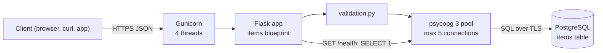

# Flask PostgreSQL CRUD API Starter

[](LICENSE) [](https://flask.palletsprojects.com) [](https://www.python.org) [](https://www.postgresql.org) [](tests) [](https://github.com/light-cloud-templates/flask-postgresql-crud-api/generate) [](https://www.light-cloud.com/templates/flask-postgresql-crud-api)

A Flask 3 CRUD API starter in Python 3.12 that stores one resource, `items`, in PostgreSQL through psycopg 3 and a connection pool, served by Gunicorn. It is a small, tested REST API boilerplate for developers who want a working create, read, update and delete service with validation, JSON errors and a health check, built with an application factory and blueprints and ready to rename and extend. It runs with `gunicorn main:app` anywhere Python runs, and deploys to Light Cloud with a database in one click.

## Features

- REST endpoints for `items`: list with `limit` and `offset`, get, create, replace and delete
- An application factory (`create_app`) with one blueprint per area: `health` and `items`
- PostgreSQL through psycopg 3 with a `psycopg-pool` connection pool (1 to 5 connections, 5 second timeout)
- The `items` table is created on start (`CREATE TABLE IF NOT EXISTS`), so there is no migration step
- Request validation without a library: `name` is trimmed and must be 1 to 200 characters, `description` must be a string or absent
- Every error is JSON `{ "error": "..." }`: `400` for invalid input, `404` for an unknown item or route
- `GET /health` answers `200` when the database answers and `503` when it does not
- Timestamps in ISO 8601, not Flask's default HTTP-date format
- Gunicorn with 4 threads per worker, set in `gunicorn.conf.py`
- pytest tests against a real PostgreSQL, and ruff for linting
- TLS to the database by default (`DB_SSLMODE=require`)

## Quick start

You need Python 3.12 and Docker (for a local PostgreSQL).

```bash
git clone https://github.com/light-cloud-templates/flask-postgresql-crud-api.git
cd flask-postgresql-crud-api
docker run -d --name items-db -p 5432:5432 -e POSTGRES_PASSWORD=postgres postgres:16
python3 -m venv .venv && . .venv/bin/activate
pip install -r requirements-dev.txt
cp .env.example .env
set -a && . ./.env && set +a
gunicorn main:app --bind 0.0.0.0:8080
```

Open <http://localhost:8080/items> to see the (empty) list.

Other ways to start:

- **Use this template**: press [Use this template](https://github.com/light-cloud-templates/flask-postgresql-crud-api/generate) to create your own repository from this one.
- **Deploy to Light Cloud**: open the [template page](https://www.light-cloud.com/templates/flask-postgresql-crud-api) and press Deploy to get a running copy with a database.

## Deploy

### Deploy to Light Cloud

[](https://www.light-cloud.com/templates/flask-postgresql-crud-api)

The Deploy button copies this template into your GitHub account and creates:

- a server app that runs `gunicorn main:app` on the port in `PORT`
- a PostgreSQL database, with `DB_HOST`, `DB_NAME`, `DB_USER` and `DB_PASSWORD` set on the app

There are no secrets to fill in. Every push to the default branch deploys again. Templates with a database need a paid Light Cloud plan.

### Deploy anywhere else

This is a standard Flask app with no Light Cloud code in it. Any host that runs Python 3.12 and can reach a PostgreSQL database runs it: install `requirements.txt`, set the `DB_*` variables and start `gunicorn main:app --bind 0.0.0.0:$PORT`.

## Project structure

```text
.
├── app/
│   ├── __init__.py      # create_app(): opens the database, registers blueprints
│   ├── config.py        # settings read from the environment
│   ├── db.py            # connection pool and CREATE TABLE
│   ├── errors.py        # every error as {"error": "..."}
│   ├── validation.py    # request body and query checks
│   └── routes/
│       ├── health.py    # GET / and GET /health
│       └── items.py     # /items CRUD blueprint
├── tests/               # pytest, against a real PostgreSQL
├── main.py              # entry point: gunicorn main:app
├── gunicorn.conf.py     # 4 threads per worker
├── requirements.txt     # runtime dependencies
├── requirements-dev.txt # adds pytest and ruff
├── pyproject.toml       # pytest and ruff settings
├── .env.example         # the variables, for local runs
└── .python-version      # Python 3.12
```

## API endpoints

| Method | Path | Description |
| --- | --- | --- |
| `GET` | `/` | Lists the routes |
| `GET` | `/health` | `200` when the database answers, `503` when it does not |
| `GET` | `/items?limit=20&offset=0` | Lists items, oldest first (`limit` 1 to 100, default 20) |
| `GET` | `/items/<id>` | Gets one item |
| `POST` | `/items` | Creates an item, answers `201` |
| `PUT` | `/items/<id>` | Replaces an item's `name` and `description` |
| `DELETE` | `/items/<id>` | Deletes an item, answers `204` |

An item is `{ "id", "name", "description", "created_at", "updated_at" }`. `name` is required; `description` is optional, and a `PUT` without it clears it.

```bash
curl -X POST http://localhost:8080/items \
  -H 'content-type: application/json' \
  -d '{"name": "First item", "description": "Hello"}'
```

On Light Cloud, use your app's URL instead of `http://localhost:8080`.

## Environment variables

| Name | Required | Default | What it does |
| --- | --- | --- | --- |
| `PORT` | No | `8000` | Port Gunicorn listens on (Gunicorn reads it; without it, Gunicorn binds `127.0.0.1:8000`). Set by Light Cloud. |
| `DB_HOST` | Yes | `localhost` | Database host, `host` or `host:port` (port defaults to `5432`). Set by Light Cloud. |
| `DB_NAME` | Yes | `postgres` | Database name. Set by Light Cloud. |
| `DB_USER` | Yes | `postgres` | Database user. Set by Light Cloud. |
| `DB_PASSWORD` | Yes | empty | Database password. Set by Light Cloud. |
| `DB_SSLMODE` | No | `require` | `require`: TLS on, certificate not verified. Set `disable` for a local database without TLS. |

## Testing

With the database running and `.env` loaded as in the quick start:

```bash
pytest
ruff check .
```

The tests use the database in `DB_*`. They create their own items and delete them afterwards.

## How it works



On start, `create_app` opens the pool and creates the `items` table. If the database is unreachable the app does not start, so a broken connection shows up at deploy time, not on the first request. The threads share the one pool, so there are never more than 5 connections per process.

## FAQ

### How do I connect to PostgreSQL locally?

Run PostgreSQL in Docker as in the quick start, copy `.env.example` to `.env` (it sets `DB_SSLMODE=disable` for the local database) and load it with `set -a && . ./.env && set +a` before starting Gunicorn.

### How do I add a new resource in Flask?

Add a blueprint in `app/routes/` modelled on `items.py` and its `CREATE TABLE` in `app/db.py`, then register the blueprint in `create_app` in `app/__init__.py`.

### How do I add a column to items?

Add it to the `CREATE TABLE` statement in `app/db.py`, to `parse_item` in `app/validation.py` and to the queries in `app/routes/items.py`. `CREATE TABLE IF NOT EXISTS` does not change an existing table, so on a database that already has `items`, run an `ALTER TABLE` once.

### Can I deploy it without Light Cloud?

Yes. It is a plain Flask app: any host with Python 3.12 and a PostgreSQL database runs it with `gunicorn main:app --bind 0.0.0.0:$PORT`.

### Why psycopg 3 and not Flask-SQLAlchemy?

The queries are a few lines of SQL each, which keeps the starter small and easy to read. You can add Flask-SQLAlchemy later without changing the blueprints' routes.

## Related templates

- [fastapi-postgresql-crud-api](https://github.com/light-cloud-templates/fastapi-postgresql-crud-api): the same items API in FastAPI, with OpenAPI docs
- [django-rest-framework-postgresql-api](https://github.com/light-cloud-templates/django-rest-framework-postgresql-api): the same items API in Django REST framework
- [flask-api-starter](https://github.com/light-cloud-templates/flask-api-starter): Flask without a database
- [express-postgresql-crud-api](https://github.com/light-cloud-templates/express-postgresql-crud-api): the same items API in Node.js and Express

## Licence

MIT, see [LICENSE](LICENSE).

---

Maintained by [Light Cloud](https://light-cloud.com): deploy apps, APIs and databases in one click.
