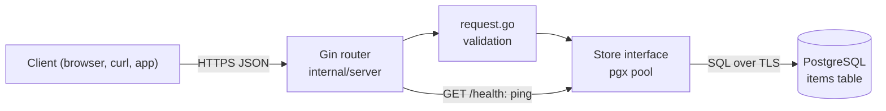

# Go Gin PostgreSQL CRUD API Starter

[](LICENSE) [](https://gin-gonic.com) [](https://go.dev) [](https://www.postgresql.org) [](internal) [](https://github.com/light-cloud-templates/gin-postgresql-crud-api/generate) [](https://www.light-cloud.com/templates/gin-postgresql-crud-api)

A Go CRUD API starter built with Gin 1.12 and Go 1.25 that stores one resource, `items`, in PostgreSQL through pgx v5 and its connection pool. It is a small, tested REST API boilerplate for Go developers who want a working create, read, update and delete service with validation, JSON errors, a health check, structured logs and graceful shutdown, ready to rename and extend. It compiles to a single binary that runs anywhere Go runs, and deploys to Light Cloud with a database in one click.

## Features

- REST endpoints for `items`: list with `limit` and `offset`, get, create, replace and delete
- PostgreSQL through pgx v5 with a `pgxpool` connection pool (up to 5 connections)
- The `items` table is created on start (`CREATE TABLE IF NOT EXISTS`), so there is no migration step
- Request validation: `name` is trimmed and must be 1 to 200 characters, `description` must be a string
- Every error is JSON `{ "error": "..." }`: `400` for invalid input, `404` for an unknown item or route, `500` for a panic
- `GET /health` answers `200` when the database answers and `503` when it does not (3 second timeout)
- Handlers depend on a small `Store` interface, so the tests use an in-memory store and need no database
- Structured JSON logs with `log/slog`, one line per request
- Graceful shutdown on `SIGTERM`, with a 10 second drain
- TLS to the database by default (`DB_SSLMODE=require`)

## Quick start

You need Go 1.25 or newer and Docker (for a local PostgreSQL).

```bash
git clone https://github.com/light-cloud-templates/gin-postgresql-crud-api.git
cd gin-postgresql-crud-api
docker run -d --name items-db -p 5432:5432 -e POSTGRES_PASSWORD=postgres postgres:16
cp .env.example .env
make run
```

`make run` loads `.env` and runs `go run .`. Open <http://localhost:8080/items> to see the (empty) list of items.

Other ways to start:

- **Use this template**: press [Use this template](https://github.com/light-cloud-templates/gin-postgresql-crud-api/generate) to create your own repository from this one.
- **Deploy to Light Cloud**: open the [template page](https://www.light-cloud.com/templates/gin-postgresql-crud-api) and press Deploy to get a running copy with a database.

## Deploy

### Deploy to Light Cloud

[](https://www.light-cloud.com/templates/gin-postgresql-crud-api)

The Deploy button copies this template into your GitHub account and creates:

- a server app that builds the Go module and runs it as a container listening on `PORT`
- a PostgreSQL database, with `DB_HOST`, `DB_NAME`, `DB_USER` and `DB_PASSWORD` set on the app

There are no secrets to fill in. Every push to the default branch deploys again. Templates with a database need a paid Light Cloud plan.

### Deploy anywhere else

This is a standard Go module with no Light Cloud code in it. Build a static binary with `make build` (it runs `CGO_ENABLED=0 go build -trimpath -o bin/server .`), set `PORT` and the `DB_*` variables, and start `./bin/server` on any host or container image that can reach a PostgreSQL database.

## Project structure

```text
.
├── main.go                  # entry point: config, logger, database, server, graceful shutdown
├── internal/
│   ├── config/              # PORT, GIN_MODE and DB_* settings, builds the database URL (with tests)
│   ├── server/
│   │   ├── server.go        # router, routes and the Store interface
│   │   ├── handlers.go      # GET /, /health and /items handlers
│   │   ├── request.go       # body and query validation
│   │   ├── middleware.go    # request logger and JSON panic recovery
│   │   └── server_test.go   # table-driven route tests with an in-memory store
│   └── store/               # Item type, CREATE TABLE and SQL queries (pgx)
├── Makefile                 # make run, make test, make build
├── .env.example             # the variables, for local runs
└── go.mod                   # Go 1.25, Gin and pgx
```

## API endpoints

| Method | Path | Description |
| --- | --- | --- |
| `GET` | `/` | Lists the routes |
| `GET` | `/health` | `200` when the database answers, `503` when it does not |
| `GET` | `/items?limit=20&offset=0` | Lists items, oldest first (`limit` 1 to 100, default 20) |
| `GET` | `/items/:id` | Gets one item |
| `POST` | `/items` | Creates an item, answers `201` |
| `PUT` | `/items/:id` | Replaces an item's `name` and `description` |
| `DELETE` | `/items/:id` | Deletes an item, answers `204` |

An item is `{ "id", "name", "description", "created_at", "updated_at" }`. `name` is required; `description` is optional, and a `PUT` without it clears it. An id that is not a positive whole number answers `404`.

```bash
curl -X POST http://localhost:8080/items \
  -H 'content-type: application/json' \
  -d '{"name": "First item", "description": "Hello"}'
```

On Light Cloud, use your app's URL instead of `http://localhost:8080`.

## Environment variables

| Name | Required | Default | What it does |
| --- | --- | --- | --- |
| `PORT` | No | `8080` | Port to listen on. Set by Light Cloud. |
| `GIN_MODE` | No | `release` | Gin mode: `release`, `debug` or `test`. `.env.example` sets `debug` for local runs. |
| `DB_HOST` | Yes | `localhost` | Database host, `host` or `host:port` (port defaults to `5432`). Set by Light Cloud. |
| `DB_NAME` | Yes | `postgres` | Database name. Set by Light Cloud. |
| `DB_USER` | Yes | `postgres` | Database user. Set by Light Cloud. |
| `DB_PASSWORD` | Yes | empty | Database password. Set by Light Cloud. |
| `DB_SSLMODE` | No | `require` | `require`: TLS on, certificate not verified. Set `disable` for a local database without TLS. |

## Testing

```bash
make test
```

`make test` runs `go vet ./...` and `go test ./...`. The route tests in `internal/server` use an in-memory store and the URL tests in `internal/config` read no database, so no PostgreSQL is needed.

## How it works



On start, `main.go` builds the database URL from the `DB_*` variables, opens the pool and creates the `items` table. If the database is unreachable the app does not start, so a broken connection shows up at deploy time, not on the first request.

## FAQ

### How do I connect to PostgreSQL locally?

Run PostgreSQL in Docker as in the quick start and copy `.env.example` to `.env`: it points at that database and sets `DB_SSLMODE=disable`. `make run` loads `.env` for you.

### How do I add a new resource to a Gin API?

Add its queries to a store in `internal/store` modelled on `store.go`, add the methods to the `Store` interface in `internal/server/server.go`, write handlers and validation next to the item ones, and register the routes in `server.New`.

### How do I add a column to items?

Add it to the `CREATE TABLE` statement, the `Item` struct and the queries in `internal/store/store.go`, then to `parseItem` in `internal/server/request.go`. `CREATE TABLE IF NOT EXISTS` does not change an existing table, so on a database that already has `items`, run an `ALTER TABLE` once.

### Can I deploy it without Light Cloud?

Yes. It is a plain Go module: build it with `make build` and run `./bin/server` with `PORT` and the `DB_*` variables set, on any server or container platform with a PostgreSQL database.

### Why pgx and not an ORM like GORM?

The queries are a few lines of SQL each, which keeps the starter small and easy to read, and pgx is a widely used, actively maintained PostgreSQL driver for Go. You can add GORM or sqlc later; the handlers only see the `Store` interface.

## Related templates

- [spring-boot-postgresql-crud-api](https://github.com/light-cloud-templates/spring-boot-postgresql-crud-api): the same items API in Java and Spring Boot
- [aspnet-core-postgresql-crud-api](https://github.com/light-cloud-templates/aspnet-core-postgresql-crud-api): the same items API in C# and ASP.NET Core
- [fastapi-postgresql-crud-api](https://github.com/light-cloud-templates/fastapi-postgresql-crud-api): the same items API in Python and FastAPI
- [gin-api-starter](https://github.com/light-cloud-templates/gin-api-starter): Gin without a database
- [go-api-starter](https://github.com/light-cloud-templates/go-api-starter): a Go API on the standard library only

## Licence

MIT, see [LICENSE](LICENSE).

---

Maintained by [Light Cloud](https://light-cloud.com): deploy apps, APIs and databases in one click.
