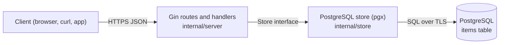

# CRUD API: Gin + PostgreSQL

A small REST API for one resource, `items`, built with Gin and pgx. Deploy it with a PostgreSQL database in one click, then make it yours.

[](https://www.light-cloud.com/templates/crud-api-gin)

## How it works



The app creates the `items` table when it starts, so there is no migration step. On Light Cloud the database connection is set for you; the app listens on `PORT`.

## Routes

| Method | Path | What it does |
| --- | --- | --- |
| `GET` | `/` | Lists the routes |
| `GET` | `/health` | `200` when the database answers, `503` when it does not |
| `GET` | `/items?limit=20&offset=0` | Lists items, oldest first (`limit` 1 to 100, default 20) |
| `GET` | `/items/:id` | Gets one item |
| `POST` | `/items` | Creates an item, answers `201` |
| `PUT` | `/items/:id` | Replaces an item's `name` and `description` |
| `DELETE` | `/items/:id` | Deletes an item, answers `204` |

An item is `{ "id", "name", "description", "created_at", "updated_at" }`. `name` is required (1 to 200 characters); `description` is optional. Errors are JSON `{ "error": "..." }`: `400` for invalid input, `404` for an unknown item.

## Run locally

You need Go 1.25 or newer and Docker (for the database).

```bash
docker run -d --name items-db -p 5432:5432 -e POSTGRES_PASSWORD=postgres postgres:16
cp .env.example .env   # points at that database, with DB_SSLMODE=disable
make run               # or: export the variables in .env and run go run .
```

The API is now on http://localhost:8080.

## Test

```bash
make test   # go vet ./... and go test ./...
```

The handler tests run against an in-memory store, so they need no database.

## Try it

```bash
curl -X POST http://localhost:8080/items -H 'content-type: application/json' -d '{"name": "First item", "description": "Hello"}'
curl 'http://localhost:8080/items?limit=10'
curl http://localhost:8080/items/1
curl -X PUT http://localhost:8080/items/1 -H 'content-type: application/json' -d '{"name": "Renamed"}'
curl -X DELETE http://localhost:8080/items/1
```

On Light Cloud, use your app's URL instead of http://localhost:8080.

## Configuration

| Variable | Set by | Meaning |
| --- | --- | --- |
| `PORT` | Light Cloud | Port to listen on (default `8080`) |
| `DB_HOST` | Light Cloud | Database host, `host` or `host:port` (port defaults to 5432) |
| `DB_NAME` | Light Cloud | Database name |
| `DB_USER` | Light Cloud | Database user |
| `DB_PASSWORD` | Light Cloud | Database password |
| `DB_SSLMODE` | you, optional | `require` by default: TLS on, certificate not verified. Set `disable` for a local database without TLS. |

## Project structure

```text
.
├── main.go                  # Entry point: config, logger, database, server, graceful shutdown
├── internal/
│   ├── config/              # PORT and DB_* settings, builds the database URL
│   ├── server/              # Routes, handlers, request validation, middleware, tests
│   └── store/               # Item type, CREATE TABLE and SQL queries (pgx)
├── .env.example             # Local settings, copy to .env
├── Makefile                 # make run, make test, make build
└── go.mod
```

The handlers depend on the small `Store` interface in `internal/server`, not on PostgreSQL, so you can test them without a database.

## Make it yours

Rename `items`, add columns to the `CREATE TABLE` statement and the queries in `internal/store`, update the validation in `internal/server/request.go`, and push: Light Cloud redeploys on every push.

## License

MIT
