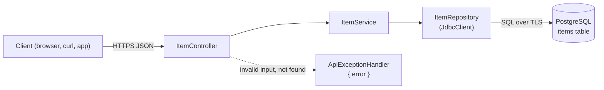

# CRUD API: Spring Boot + PostgreSQL

A small REST API for one resource, `items`, built with Spring Boot 4 and Spring JDBC. Deploy it with a PostgreSQL database in one click, then make it yours.

[](https://www.light-cloud.com/templates/crud-api-spring-boot)

## How it works



The app creates the `items` table when it starts, so there is no migration step. On Light Cloud the database connection is set for you; the app listens on `PORT`.

## Routes

| Method | Path | What it does |
| --- | --- | --- |
| `GET` | `/` | Lists the routes |
| `GET` | `/health` | `200` when the database answers, `503` when it does not |
| `GET` | `/items?limit=20&offset=0` | Lists items, oldest first (`limit` 1 to 100, default 20) |
| `GET` | `/items/:id` | Gets one item |
| `POST` | `/items` | Creates an item, answers `201` |
| `PUT` | `/items/:id` | Replaces an item's `name` and `description` |
| `DELETE` | `/items/:id` | Deletes an item, answers `204` |
| `GET` | `/docs` | OpenAPI docs |

An item is `{ "id", "name", "description", "created_at", "updated_at" }`. `name` is required (1 to 200 characters); `description` is optional. Errors are JSON `{ "error": "..." }`: `400` for invalid input, `404` for an unknown item.

## Project structure

```
.
├── pom.xml
├── mvnw, mvnw.cmd, .mvn/               Maven wrapper
└── src
    ├── main
    │   ├── java/com/example/items
    │   │   ├── ItemsApplication.java
    │   │   ├── item/                   ItemController, ItemService, ItemRepository,
    │   │   │                           Item, ItemRequest (validated), ItemNotFoundException
    │   │   ├── system/                 SystemController: GET / and GET /health
    │   │   ├── common/                 ApiExceptionHandler: every error as { "error": "..." }
    │   │   └── config/                 JsonConfig: numbers are not accepted as strings
    │   └── resources
    │       ├── application.properties  database, port and JSON settings (from the environment)
    │       └── schema.sql              CREATE TABLE IF NOT EXISTS, run on every start
    └── test/java/com/example/items
        └── item/ItemControllerTest.java   @WebMvcTest, no database needed
```

## Run locally

You need Java 21 and Docker (for the database).

```bash
docker run -d --name items-db -p 5432:5432 -e POSTGRES_PASSWORD=postgres postgres:16
export DB_HOST=localhost DB_NAME=postgres DB_USER=postgres DB_PASSWORD=postgres DB_SSLMODE=disable
./mvnw spring-boot:run
```

The API is now on http://localhost:8080. `.env.example` lists the same variables.

Run the tests (they mock the service, so no database is needed):

```bash
./mvnw test
```

## Try it

```bash
curl -X POST http://localhost:8080/items -H 'content-type: application/json' -d '{"name": "First item", "description": "Hello"}'
curl 'http://localhost:8080/items?limit=10'
curl http://localhost:8080/items/1
curl -X PUT http://localhost:8080/items/1 -H 'content-type: application/json' -d '{"name": "Renamed"}'
curl -X DELETE http://localhost:8080/items/1
```

On Light Cloud, use your app's URL instead of http://localhost:8080.

## Configuration

| Variable | Set by | Meaning |
| --- | --- | --- |
| `PORT` | Light Cloud | Port to listen on (default `8080`) |
| `DB_HOST` | Light Cloud | Database host, `host` or `host:port` (port defaults to 5432) |
| `DB_NAME` | Light Cloud | Database name |
| `DB_USER` | Light Cloud | Database user |
| `DB_PASSWORD` | Light Cloud | Database password |
| `DB_SSLMODE` | you, optional | `require` by default: TLS on, certificate not verified. Set `disable` for a local database without TLS. |

## Make it yours

Each resource is a package under `src/main/java/com/example/items/`: copy `item/` to add another. To add a column, change `schema.sql`, the `Item` and `ItemRequest` records and the SQL in `ItemRepository`, then push: Light Cloud redeploys on every push.

## License

MIT
