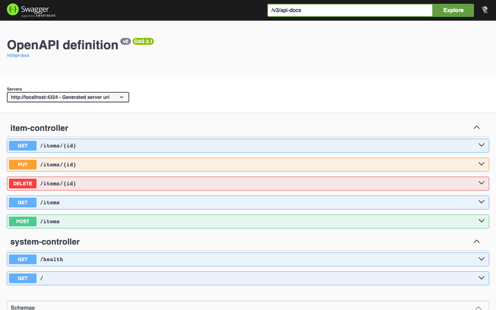
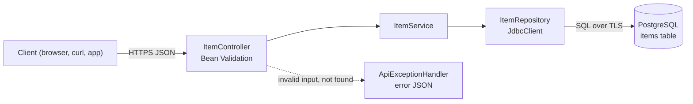

# Spring Boot PostgreSQL CRUD API Starter

[](LICENSE) [](https://spring.io/projects/spring-boot) [](https://openjdk.org) [](https://www.postgresql.org) [](src/test) [](https://github.com/light-cloud-templates/spring-boot-postgresql-crud-api/generate) [](https://www.light-cloud.com/templates/spring-boot-postgresql-crud-api)

A Spring Boot 4 CRUD API starter in Java 21 that stores one resource, `items`, in PostgreSQL through Spring JDBC's `JdbcClient` and a HikariCP connection pool. It is a small, tested REST API boilerplate for Java developers who want a working create, read, update and delete service with Bean Validation, JSON errors, a health check and Swagger UI docs, ready to rename and extend. It builds with the included Maven wrapper into one runnable jar, and deploys to Light Cloud with a database in one click.

## Screenshot



## Features

- REST endpoints for `items`: list with `limit` and `offset`, get, create, replace and delete
- Controller, service and repository layers, with plain SQL through `JdbcClient` (no JPA)
- HikariCP connection pool, up to 5 connections
- `schema.sql` creates the `items` table on every start (`CREATE TABLE IF NOT EXISTS`), so there is no migration step
- Bean Validation: `name` is trimmed and must be 1 to 200 characters
- Strict JSON: a number or boolean sent as `name` or `description` is a `400`, not a string
- Every error is JSON `{ "error": "..." }` from one `@RestControllerAdvice`: `400`, `404`, `405`, `415` and `500`
- `GET /health` answers `200` when the database answers and `503` when it does not
- Swagger UI at `/docs` from springdoc-openapi 3, with the OpenAPI schema at `/v3/api-docs`
- snake_case JSON (`created_at`, `updated_at`)
- `@WebMvcTest` controller tests with a mocked service, so they need no database
- TLS to the database by default (`DB_SSLMODE=require`)

## Quick start

You need Java 21 and Docker (for a local PostgreSQL). Maven comes with the project as `./mvnw`.

```bash
git clone https://github.com/light-cloud-templates/spring-boot-postgresql-crud-api.git
cd spring-boot-postgresql-crud-api
docker run -d --name items-db -p 5432:5432 -e POSTGRES_PASSWORD=postgres postgres:16
cp .env.example .env
set -a && . ./.env && set +a
./mvnw spring-boot:run
```

Open <http://localhost:8080/docs> to try the API in the browser.

Other ways to start:

- **Use this template**: press [Use this template](https://github.com/light-cloud-templates/spring-boot-postgresql-crud-api/generate) to create your own repository from this one.
- **Deploy to Light Cloud**: open the [template page](https://www.light-cloud.com/templates/spring-boot-postgresql-crud-api) and press Deploy to get a running copy with a database.

## Deploy

### Deploy to Light Cloud

[](https://www.light-cloud.com/templates/spring-boot-postgresql-crud-api)

The Deploy button copies this template into your GitHub account and creates:

- a server app that builds the Maven project and runs it as a container listening on `PORT`
- a PostgreSQL database, with `DB_HOST`, `DB_NAME`, `DB_USER` and `DB_PASSWORD` set on the app

There are no secrets to fill in. Every push to the default branch deploys again. Templates with a database need a paid Light Cloud plan.

### Deploy anywhere else

This is a standard Spring Boot app with no Light Cloud code in it. Build the jar with `./mvnw package`, set `PORT` and the `DB_*` variables, and start it with `java -jar target/items-1.0.0.jar` on any host or container image with Java 21 that can reach a PostgreSQL database.

## Project structure

```text
.
├── src/main/java/com/example/items/
│   ├── ItemsApplication.java          # entry point
│   ├── item/                          # ItemController, ItemService, ItemRepository, Item, ItemRequest
│   ├── system/SystemController.java   # GET / and GET /health
│   ├── common/ApiExceptionHandler.java # every error as {"error": "..."}
│   └── config/JsonConfig.java         # numbers are not accepted as strings
├── src/main/resources/
│   ├── application.properties         # database, port, JSON and /docs settings
│   └── schema.sql                     # CREATE TABLE IF NOT EXISTS, run on every start
├── src/test/java/com/example/items/   # @WebMvcTest controller tests, no database
├── pom.xml                            # Spring Boot 4.1, Java 21, springdoc
├── mvnw, mvnw.cmd, .mvn/              # Maven wrapper
└── .env.example                       # the variables, for local runs
```

## API endpoints

| Method | Path | Description |
| --- | --- | --- |
| `GET` | `/` | Lists the routes |
| `GET` | `/health` | `200` when the database answers, `503` when it does not |
| `GET` | `/items?limit=20&offset=0` | Lists items, oldest first (`limit` 1 to 100, default 20) |
| `GET` | `/items/{id}` | Gets one item |
| `POST` | `/items` | Creates an item, answers `201` |
| `PUT` | `/items/{id}` | Replaces an item's `name` and `description` |
| `DELETE` | `/items/{id}` | Deletes an item, answers `204` |
| `GET` | `/docs` | Swagger UI (the schema is at `/v3/api-docs`) |

An item is `{ "id", "name", "description", "created_at", "updated_at" }`. `name` is required; `description` is optional, and a `PUT` without it clears it. An id that is not a positive whole number answers `404`.

```bash
curl -X POST http://localhost:8080/items \
  -H 'content-type: application/json' \
  -d '{"name": "First item", "description": "Hello"}'
```

On Light Cloud, use your app's URL instead of `http://localhost:8080`.

## Environment variables

| Name | Required | Default | What it does |
| --- | --- | --- | --- |
| `PORT` | No | `8080` | Port to listen on. Set by Light Cloud. |
| `DB_HOST` | Yes | `localhost` | Database host, `host` or `host:port` (port defaults to `5432`). Set by Light Cloud. |
| `DB_NAME` | Yes | `postgres` | Database name. Set by Light Cloud. |
| `DB_USER` | Yes | `postgres` | Database user. Set by Light Cloud. |
| `DB_PASSWORD` | Yes | empty | Database password. Set by Light Cloud. |
| `DB_SSLMODE` | No | `require` | `require`: TLS on, certificate not verified. Set `disable` for a local database without TLS. |

## Testing

```bash
./mvnw test
```

The tests in `ItemControllerTest` load only the web layer with `@WebMvcTest` and mock `ItemService`, so they need no database.

## How it works



On start, Spring Boot opens the HikariCP pool and runs `schema.sql`. If the database is unreachable the app does not start, so a broken connection shows up at deploy time, not on the first request.

## FAQ

### How do I connect to PostgreSQL locally?

Run PostgreSQL in Docker as in the quick start, copy `.env.example` to `.env` (it sets `DB_SSLMODE=disable` for the local database) and load it with `set -a && . ./.env && set +a` before `./mvnw spring-boot:run`. `application.properties` reads the `DB_*` variables into the JDBC URL.

### How do I add a new resource to a Spring Boot API?

Copy the `item/` package, rename the record, controller, service and repository, and add its `CREATE TABLE IF NOT EXISTS` to `schema.sql`. Spring picks up the new controller by component scanning; nothing else needs registering.

### How do I add a column to items?

Add it to `schema.sql`, the `Item` and `ItemRequest` records and the SQL in `ItemRepository`. `CREATE TABLE IF NOT EXISTS` does not change an existing table, so on a database that already has `items`, run an `ALTER TABLE` once, or add Flyway when you need real migrations.

### Can I deploy it without Light Cloud?

Yes. It is a plain Spring Boot app: build it with `./mvnw package` and run `java -jar target/items-1.0.0.jar` with `PORT` and the `DB_*` variables set, on any host with Java 21 and a PostgreSQL database.

### Why JdbcClient and not Spring Data JPA?

The queries are a few lines of SQL each, which keeps the starter small and shows exactly what runs against the database. You can add Spring Data JPA later; the controller only talks to `ItemService`.

## Related templates

- [spring-boot-api-starter](https://github.com/light-cloud-templates/spring-boot-api-starter): Spring Boot without a database
- [quarkus-api-starter](https://github.com/light-cloud-templates/quarkus-api-starter): a Java REST API on Quarkus
- [aspnet-core-postgresql-crud-api](https://github.com/light-cloud-templates/aspnet-core-postgresql-crud-api): the same items API in C# and ASP.NET Core
- [gin-postgresql-crud-api](https://github.com/light-cloud-templates/gin-postgresql-crud-api): the same items API in Go and Gin
- [fastapi-postgresql-crud-api](https://github.com/light-cloud-templates/fastapi-postgresql-crud-api): the same items API in Python and FastAPI

## Licence

MIT, see [LICENSE](LICENSE).

---

Maintained by [Light Cloud](https://light-cloud.com): deploy apps, APIs and databases in one click.
