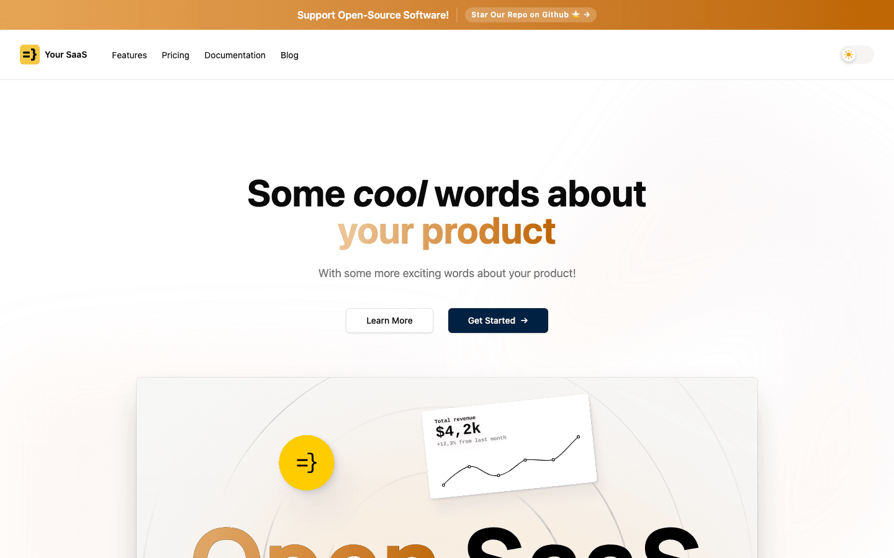
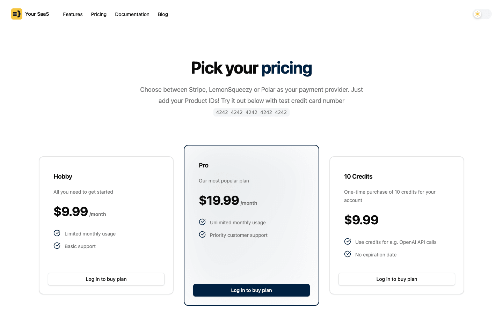
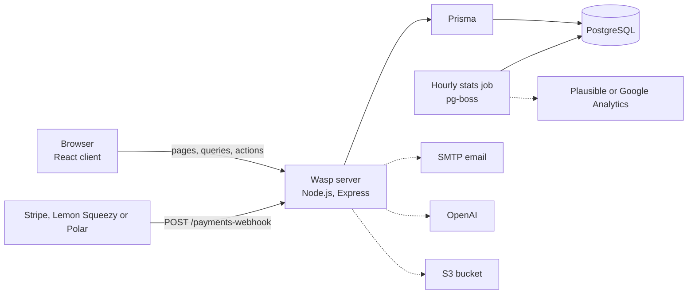

# Open SaaS Starter (Wasp, React, Node.js)

[](LICENSE) [](https://wasp.sh) [](https://react.dev) [](https://www.typescriptlang.org) [](https://www.postgresql.org) [](https://github.com/light-cloud-templates/open-saas-starter/generate) [](https://www.light-cloud.com/templates/open-saas-starter)

A free, open-source SaaS starter based on [Open SaaS](https://opensaas.sh) by [Wasp](https://wasp.sh) ([upstream repository](https://github.com/wasp-lang/open-saas)): a full-stack React 19 and Node.js app in TypeScript with Prisma and PostgreSQL. It includes email sign-up with verification, Stripe payments (with Lemon Squeezy and Polar as alternatives), an admin dashboard, an OpenAI demo app, S3 file uploads and an hourly analytics job. This copy adds a Light Cloud deploy setup, so the app boots in one container with a database before you have any of those accounts.

## Screenshots

<picture><source media="(prefers-color-scheme: dark)" srcset="docs/screenshots/home-dark.png"></picture>
<picture><source media="(prefers-color-scheme: dark)" srcset="docs/screenshots/pricing-dark.png"></picture>

## Features

- **Auth**: email and password sign-up with email verification and password reset (Wasp auth). Google, GitHub and Discord sign-in are prepared in `src/auth/auth.wasp.ts`, ready to switch on.
- **Payments**: Stripe by default, with Lemon Squeezy and Polar as drop-in alternatives (`src/payment/paymentProcessor.ts`). Plans: Hobby and Pro subscriptions and a 10-credit pack, with a webhook at `/payments-webhook` and an account page.
- **Admin dashboard** at `/admin`: revenue and traffic stats, a users table, and example settings, calendar and messages pages. Accounts in `ADMIN_EMAILS` become admins on sign-up.
- **AI demo app** at `/demo-app`: an OpenAI-powered day planner that uses credits or a subscription.
- **File uploads** at `/file-upload`: presigned uploads to an S3 bucket.
- **Analytics job**: an hourly pg-boss job that collects daily stats from Plausible or Google Analytics for the admin dashboard.
- **Marketing pages**: a landing page and a pricing page, both prerendered at build time, a cookie consent banner and dark mode.
- **UI**: Tailwind CSS 4 and shadcn/ui components.
- **Database**: Prisma models in `schema.prisma` and mock users through `wasp db seed`.

## Quick start

You need Node.js 24.14 or newer, Docker (for `wasp start db`) and the Wasp CLI 0.25, which this app pins in `main.wasp.ts`.

```bash
npm i -g @wasp.sh/wasp-cli@0.25
git clone https://github.com/light-cloud-templates/open-saas-starter.git
cd open-saas-starter
cp .env.server.example .env.server
cp .env.client.example .env.client
wasp start db                  # PostgreSQL in Docker; leave this terminal open
```

Then, in a second terminal in the same folder:

```bash
wasp db migrate-dev            # creates the tables
wasp start                     # installs dependencies when needed, then starts the client and server
```

Open <http://localhost:3000> (the server runs on port 3001). The email sender is SMTP, so add `SMTP_HOST`, `SMTP_PORT`, `SMTP_USERNAME` and `SMTP_PASSWORD` to `.env.server` (real values from any provider, or placeholders), and set `SKIP_EMAIL_VERIFICATION_IN_DEV=true` there to sign up without receiving the verification email. The [Open SaaS getting started guide](https://docs.opensaas.sh/start/getting-started/) covers the rest.

Other ways to start:

- **Use this template**: press [Use this template](https://github.com/light-cloud-templates/open-saas-starter/generate) to create your own repository from this one.
- **Deploy to Light Cloud**: open the [template page](https://www.light-cloud.com/templates/open-saas-starter) and press Deploy to get a running copy with a database.

## Deploy

### Deploy to Light Cloud

[](https://www.light-cloud.com/templates/open-saas-starter)

The Deploy button copies this template into your GitHub account and creates:

- one container with the Wasp server and the client, served from the same domain, with 1 GiB of memory and exactly 1 instance (minimum and maximum), so the hourly pg-boss stats job always has CPU and never runs twice
- a PostgreSQL database, with `DATABASE_URL` set on the app
- `JWT_SECRET`, generated when the app is created, and `WASP_SERVER_URL` and `WASP_WEB_CLIENT_URL` set to the app's URL
- placeholder values for SMTP, Stripe, OpenAI, S3, analytics and the other providers, because the server validates them at start and would not boot without them

The schema is applied on each deploy: `prisma migrate deploy` when a `migrations/` folder exists, `prisma db push` otherwise, so committing migrations made with `wasp db migrate-dev` is all it takes to switch to real migrations. Every push to the default branch deploys again. Templates with a database need a paid Light Cloud plan.

**Set SMTP first.** Email verification is required before login, and no email leaves the app while the SMTP values are placeholders. Set the four `SMTP_*` variables for any provider (Resend, SendGrid, Mailgun, Postmark) and change `defaultFrom` in `src/server/emailSender.wasp.ts` and `fromField` in `src/auth/auth.wasp.ts` to an address you can send from. Adding a custom domain later? Update `WASP_SERVER_URL` and `WASP_WEB_CLIENT_URL` and redeploy.

### Deploy anywhere else

Nothing in the app code depends on Light Cloud. Wasp's own `wasp build` produces a Node.js server with a Dockerfile and a static client, and the [Wasp docs](https://wasp.sh/docs) and [Open SaaS docs](https://docs.opensaas.sh) cover deploying them elsewhere.

## Project structure

```text
.
├── main.wasp.ts             # the app definition: routes, auth, jobs, email (Wasp TypeScript spec)
├── schema.prisma            # database models
├── src/
│   ├── admin/               # admin dashboard pages
│   ├── analytics/           # hourly stats job, Plausible and Google Analytics
│   ├── auth/                # login, sign-up, verification, password reset
│   ├── client/              # app shell, nav bar, cookie consent, shadcn/ui components
│   ├── demo-ai-app/         # OpenAI demo app
│   ├── file-upload/         # S3 uploads
│   ├── landing-page/        # landing page sections
│   ├── payment/             # pricing, checkout, Stripe, Lemon Squeezy and Polar
│   ├── server/              # email sender, seed scripts, validation
│   ├── user/                # account page
│   └── env.ts               # server environment validation
├── public/                  # favicon, banner, robots.txt, llms.txt
├── .env.server.example      # server variables for local development
└── .env.client.example      # client variables (REACT_APP_*)
```

## Pages

| Route | What it is |
| --- | --- |
| `/` | Landing page, prerendered |
| `/pricing` | Plans and checkout, prerendered |
| `/signup`, `/login`, `/request-password-reset` | Email auth |
| `/demo-app` | AI demo app (signed in) |
| `/file-upload` | S3 file uploads (signed in) |
| `/account` | Plan, credits and the customer portal (signed in) |
| `/admin`, `/admin/users` | Admin dashboard and users (admins) |

The only HTTP API route is `POST /payments-webhook`, for the payment provider. Everything else goes through Wasp queries and actions, declared in the `*.wasp.ts` files.

## Environment variables

| Name | Required | Default | What it does |
| --- | --- | --- | --- |
| `DATABASE_URL` | Yes | from `wasp start db` | PostgreSQL connection URL. Set by Light Cloud. |
| `JWT_SECRET` | In production | none | Signs auth tokens. Set by Light Cloud (generated). |
| `WASP_SERVER_URL`, `WASP_WEB_CLIENT_URL` | In production | localhost | The app's public URL. Set by Light Cloud. |
| `PORT` | No | `3001` | Server port. Set by Light Cloud. |
| `SMTP_HOST`, `SMTP_PORT`, `SMTP_USERNAME`, `SMTP_PASSWORD` | Yes | none | Sends verification and reset emails. Placeholders set by Light Cloud; replace them. |
| `ADMIN_EMAILS` | No | empty | Comma-separated emails that become admins on sign-up. |
| `STRIPE_API_KEY`, `STRIPE_WEBHOOK_SECRET` | Yes | none | Stripe payments. Placeholders set by Light Cloud. |
| `PAYMENTS_HOBBY_SUBSCRIPTION_PLAN_ID`, `PAYMENTS_PRO_SUBSCRIPTION_PLAN_ID`, `PAYMENTS_CREDITS_10_PLAN_ID` | Yes | none | Price or product ids for the three plans. Placeholders set by Light Cloud. |
| `LEMONSQUEEZY_*`, `POLAR_*` | Yes | none | Alternative payment providers. Placeholders set by Light Cloud. |
| `OPENAI_API_KEY` | Yes | none | AI demo app. Placeholder set by Light Cloud. |
| `AWS_S3_REGION`, `AWS_S3_IAM_ACCESS_KEY`, `AWS_S3_IAM_SECRET_KEY`, `AWS_S3_FILES_BUCKET` | Yes | none | File uploads. Placeholders set by Light Cloud. |
| `PLAUSIBLE_*`, `GOOGLE_ANALYTICS_*` | Yes | none | Stats for the admin dashboard. Placeholders set by Light Cloud. |
| `REACT_APP_GOOGLE_ANALYTICS_ID` | No | none | Client-side Google Analytics id, read at build time. |

"Yes" means the server validates the variable at start (`src/env.ts` and Wasp's own checks): a placeholder is enough to boot, a real value turns the feature on. If you remove a feature, also remove its schema from `src/env.ts`.

## Turn features on

- **Stripe**: create the products in the [Stripe dashboard](https://dashboard.stripe.com), set the key, the three plan ids and a webhook to `https://<your app>/payments-webhook`. Locally, `stripe listen --forward-to localhost:3001/payments-webhook` prints the signing secret.
- **Lemon Squeezy or Polar**: switch `paymentProcessor` in `src/payment/paymentProcessor.ts` and follow the [Open SaaS payments guide](https://docs.opensaas.sh/guides/payments-integration/).
- **Social sign-in**: uncomment Google, GitHub or Discord in `authConfig` in `src/auth/auth.wasp.ts` and add their client ids (see `.env.server.example`).
- **File uploads**: point the `AWS_S3_*` variables at a bucket. Store uploads there: the container's own disk does not survive a restart.

## Testing

This copy has no test suite. Check that the app compiles and builds with:

```bash
wasp build
```

## How it works



`main.wasp.ts` declares the routes, auth, jobs and email sender, and Wasp generates the React client and the Node.js server from it. On Light Cloud both run in one container on one domain, and the pg-boss job runs inside the server process, which is why the app keeps exactly one instance.

## FAQ

### Why can I not log in after signing up?

Open SaaS requires email verification. Until the `SMTP_*` variables are real, the verification email is not sent. Set them on the app and redeploy; locally you can set `SKIP_EMAIL_VERIFICATION_IN_DEV=true` in `.env.server` instead.

### How do I make myself an admin?

Put your email in `ADMIN_EMAILS` before you sign up. Admin rights are granted when the account is created.

### Which Wasp version does this use?

Wasp 0.25, declared in `main.wasp.ts` as `^0.25.0`. Install the matching CLI with `npm i -g @wasp.sh/wasp-cli@0.25`.

### Do the Open SaaS docs apply to this repository?

Yes. Only the deployment setup differs, so the [Open SaaS docs](https://docs.opensaas.sh) guides for auth, payments, email, analytics and file uploads apply as they stand.

### Can I deploy it without Light Cloud?

Yes. It is a standard Wasp app: `wasp build` gives you a server and a client to run on any host with Node.js and PostgreSQL.

## Related templates

- [nextjs-saas-starter](https://github.com/light-cloud-templates/nextjs-saas-starter): a SaaS starter with teams, Stripe and an API, in Next.js 16
- [react-node-saas-starter](https://github.com/light-cloud-templates/react-node-saas-starter): the same SaaS features with React, Vite and Express
- [react-vite-starter](https://github.com/light-cloud-templates/react-vite-starter): a plain React and Vite app
- [express-postgresql-crud-api](https://github.com/light-cloud-templates/express-postgresql-crud-api): a small Node.js REST API with PostgreSQL

## Licence

MIT, see [LICENSE](LICENSE). Based on [Open SaaS](https://opensaas.sh) by [Wasp](https://wasp.sh) ([wasp-lang/open-saas](https://github.com/wasp-lang/open-saas)), copyright wasp-lang. The Light Cloud deploy setup in this copy is MIT too.

---

Maintained by [Light Cloud](https://light-cloud.com): deploy apps, APIs and databases in one click.
