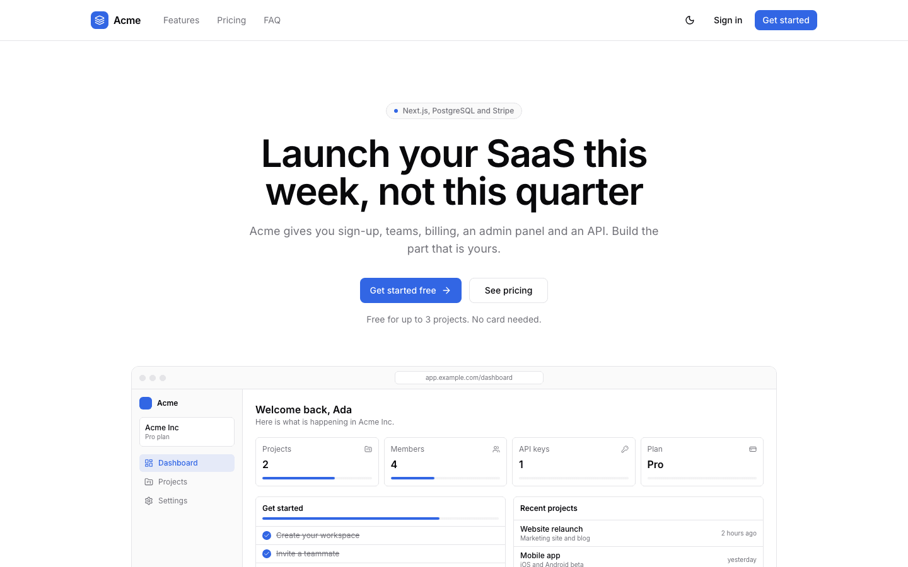
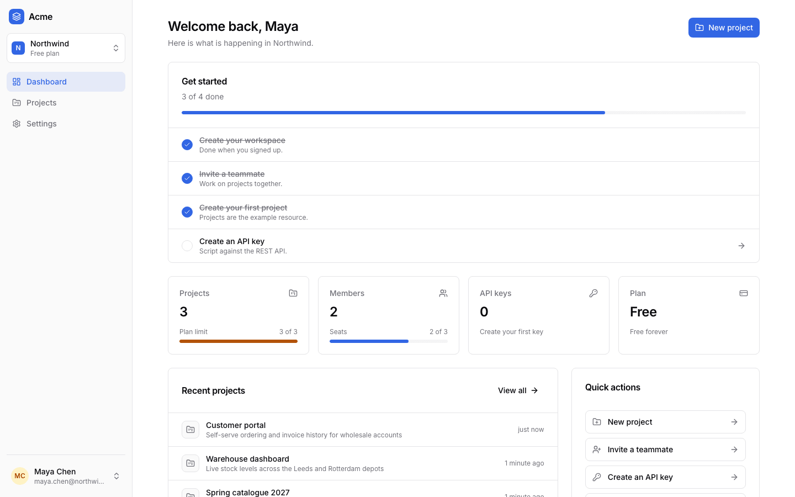
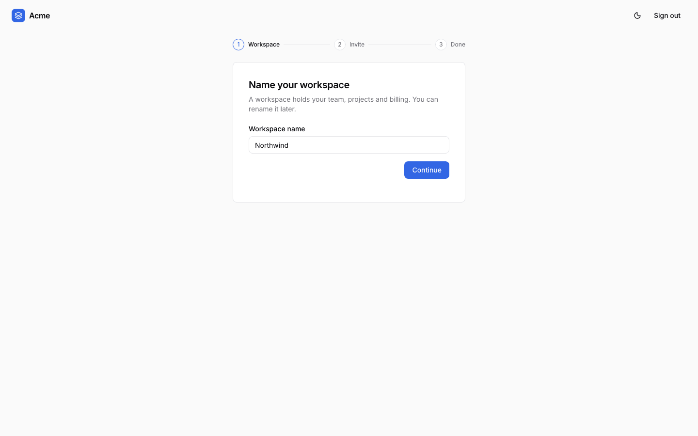
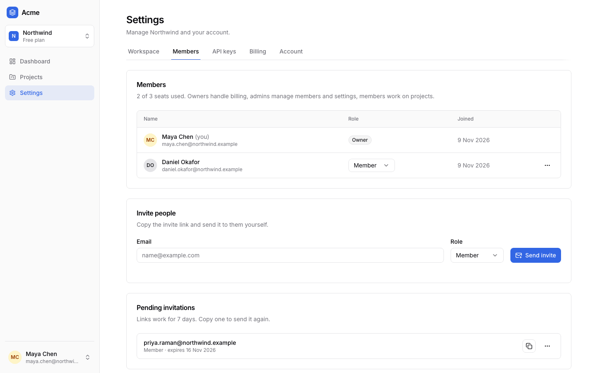
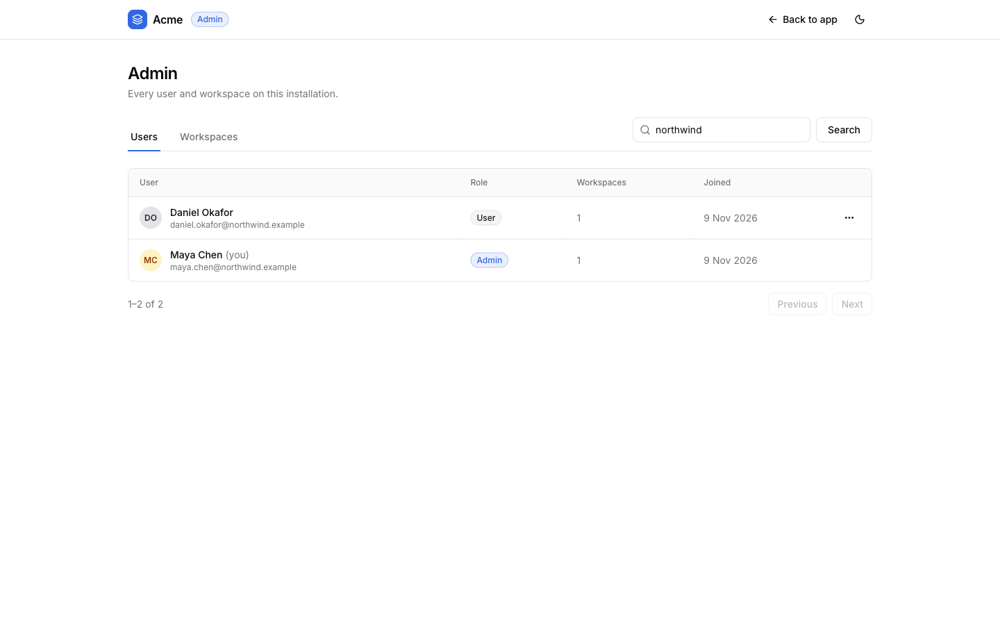
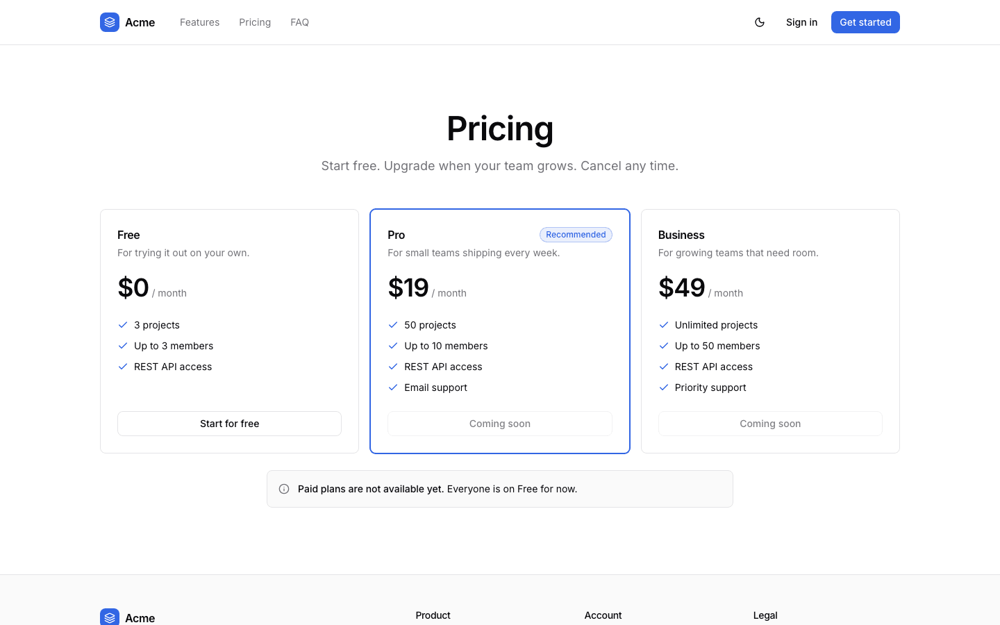
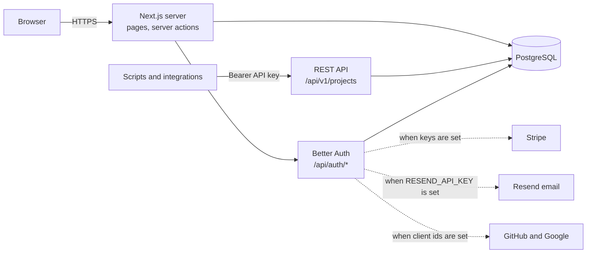

# Next.js SaaS Starter Kit

[](LICENSE) [](https://nextjs.org) [](https://react.dev) [](https://www.typescriptlang.org) [](https://www.postgresql.org) [](test) [](https://github.com/light-cloud-templates/nextjs-saas-starter/generate) [](https://www.light-cloud.com/templates/nextjs-saas-starter)

A Next.js 16 SaaS starter kit in TypeScript with PostgreSQL, Better Auth, Drizzle ORM, Tailwind CSS and shadcn/ui. It is a free, MIT-licensed SaaS boilerplate for developers who want sign-up and sign-in, teams with roles, onboarding, Stripe subscriptions, an admin panel, API keys and a REST API already built. It runs with no third-party keys: email, billing and social sign-in switch on when you add their variables.

## Screenshots

<picture><source media="(prefers-color-scheme: dark)" srcset="docs/screenshots/landing-dark.png"></picture>
<picture><source media="(prefers-color-scheme: dark)" srcset="docs/screenshots/dashboard-dark.png"></picture>

<table>
  <tr>
    <td width="50%"><br>Onboarding</td>
    <td width="50%"><br>Members and roles</td>
  </tr>
  <tr>
    <td width="50%"><br>Admin panel</td>
    <td width="50%"><br>Pricing</td>
  </tr>
</table>

## Features

- **Accounts**: email and password sign-up, sign-in, sign-out and password reset; email verification once an email provider is set; GitHub and Google sign-in when their keys are set. Sessions live in the database.
- **Teams**: workspaces with owner, admin and member roles, a workspace switcher, invitations by email or by a copyable link.
- **Onboarding**: a stepper after the first sign-up to name the workspace, invite teammates and pick a plan. A plan chosen on the pricing page (`/sign-up?plan=pro`) carries through.
- **Billing**: Stripe Checkout to upgrade, the Stripe customer portal to manage, and a webhook that keeps the plan in sync. Plans, prices and limits live in one file, `src/lib/plans.ts`.
- **Admin panel** at `/admin`: search users and workspaces, see plans, disable or re-enable users, sign in as a user.
- **Example resource**: Projects (create, edit, delete) with plan limits (Free allows 3), shared by the app and the REST API.
- **API keys and REST API**: per-workspace keys, shown once and stored as a hash, for `/api/v1/projects`.
- **Emails**: verification, password reset, invitation and welcome emails through Resend, or printed to the server log when no key is set.
- **UI**: marketing pages (landing, pricing, terms, privacy), light and dark theme, phone layouts, field-level form errors, toasts, confirmation dialogs and loading skeletons.
- **Operations**: SQL migrations applied on every start, a `GET /api/health` check, rate limits on the sign-in and password forms.

## Quick start

You need Node.js 22.12 or newer and Docker (for a local PostgreSQL).

```bash
git clone https://github.com/light-cloud-templates/nextjs-saas-starter.git
cd nextjs-saas-starter
docker run -d --name saas-db -p 5432:5432 -e POSTGRES_PASSWORD=postgres postgres:16
cp .env.example .env.local     # then set AUTH_SECRET, e.g. to the output of: openssl rand -hex 32
npm install
npm run dev                    # applies migrations, then starts Next.js
```

Open <http://localhost:3000> and sign up: the first account is the admin. Until you set `RESEND_API_KEY`, emails (verification, reset, invites) are printed in the terminal.

Other ways to start:

- **Use this template**: press [Use this template](https://github.com/light-cloud-templates/nextjs-saas-starter/generate) to create your own repository from this one.
- **Deploy to Light Cloud**: open the [template page](https://www.light-cloud.com/templates/nextjs-saas-starter) and press Deploy to get a running copy with a database.

## Deploy

### Deploy to Light Cloud

[](https://www.light-cloud.com/templates/nextjs-saas-starter)

The Deploy button copies this template into your GitHub account and creates:

- a server app that runs `npm run build`, then `npm start` (migrations, then `next start` on `PORT`)
- a PostgreSQL database, with `DATABASE_URL` set on the app
- a random `AUTH_SECRET`, generated at deploy

Open the URL and sign up: it works with no other keys. The app works out its public URL from each request, so auth callbacks and email links work before you add a domain. Every push to the default branch deploys again. Templates with a database need a paid Light Cloud plan.

### Deploy anywhere else

This is a standard Next.js app with no Light Cloud code in it. Any host that runs Node.js 22.12 and can reach PostgreSQL runs it: set `DATABASE_URL` and `AUTH_SECRET`, run `npm ci && npm run build`, then `npm start`.

## Project structure

```text
.
├── src/
│   ├── app/
│   │   ├── (marketing)/       # /, /pricing, /terms, /privacy
│   │   ├── (auth)/            # /sign-in, /sign-up, /forgot-password, /reset-password, /invite/[id]
│   │   ├── (app)/             # /dashboard, /projects, /settings/*, /workspaces/new
│   │   ├── onboarding/        # first-time setup stepper
│   │   ├── admin/             # /admin, platform admins only
│   │   └── api/               # auth/[...all] (Better Auth, Stripe webhook), health, v1/projects
│   ├── components/            # app shell, forms, dialogs; ui/ holds shadcn/ui components
│   └── lib/                   # auth, config, plans, permissions, billing, email, api-keys, projects, db/
├── drizzle/                   # SQL migrations (committed)
├── scripts/                   # migrate.mjs (run by npm start) and smoke.mjs
├── test/                      # Vitest unit and integration tests
└── .env.example               # every environment variable, explained
```

## Pages

| Route | What it is |
| --- | --- |
| `/`, `/pricing`, `/terms`, `/privacy` | Marketing pages |
| `/sign-up`, `/sign-in`, `/forgot-password` | Accounts, plus GitHub and Google buttons when configured |
| `/onboarding` | Name the workspace, invite teammates, pick a plan |
| `/dashboard` | Getting-started checklist, usage, recent projects |
| `/projects` | The example resource, with plan limits |
| `/settings/workspace`, `/settings/members`, `/settings/api-keys`, `/settings/billing`, `/settings/account` | Workspace and account settings |
| `/admin` | Users and workspaces, for platform admins |

## API usage

Create a key under **Settings → API keys** (owners and admins). The key is shown once and only its hash is stored. Each request acts on the key's workspace.

| Method | Path | Description |
| --- | --- | --- |
| `GET` | `/api/health` | `200` when the database answers, `503` when it does not |
| `GET` | `/api/v1/projects` | Lists the workspace's projects, newest first |
| `POST` | `/api/v1/projects` | Creates a project from `{"name", "description"}`, answers `201` |
| `GET` | `/api/v1/projects/:id` | Gets one project |
| `PATCH` | `/api/v1/projects/:id` | Changes `name` and/or `description` |
| `DELETE` | `/api/v1/projects/:id` | Deletes a project, answers `204` |

Errors are JSON `{ "error": "..." }`: `400` invalid input, `401` missing or wrong key, `402` plan limit reached, `404` not found.

```bash
curl -X POST http://localhost:3000/api/v1/projects \
  -H "Authorization: Bearer $API_KEY" \
  -H "content-type: application/json" \
  -d '{"name": "Website", "description": "Marketing site"}'
```

## Environment variables

| Name | Required | Default | What it does |
| --- | --- | --- | --- |
| `DATABASE_URL` | Yes | none | PostgreSQL connection URL. Set by Light Cloud. |
| `AUTH_SECRET` | Yes | none | Signs sessions and email tokens. Generated by Light Cloud at deploy. |
| `PORT` | No | `3000` | Port to listen on. Set by Light Cloud. |
| `APP_URL` | No | from each request | Public URL. Set it when you add a custom domain. |
| `APP_NAME` | No | `Acme` | Product name in the header, titles and emails. |
| `ADMIN_EMAILS` | No | empty | Comma-separated emails that are admins, on top of the first user. |
| `RESEND_API_KEY` | No | empty | Sends email through Resend and turns on email verification. |
| `EMAIL_FROM` | No | `Acme <onboarding@resend.dev>` | Sender, on a domain verified in Resend. |
| `GITHUB_CLIENT_ID`, `GITHUB_CLIENT_SECRET` | No | empty | Turn on GitHub sign-in (both needed). |
| `GOOGLE_CLIENT_ID`, `GOOGLE_CLIENT_SECRET` | No | empty | Turn on Google sign-in (both needed). |
| `STRIPE_SECRET_KEY`, `STRIPE_WEBHOOK_SECRET`, `STRIPE_PRICE_PRO`, `STRIPE_PRICE_BUSINESS` | No | empty | Turn on billing (all four needed): API key, webhook signing secret, monthly price ids. |

None of these reach the browser. Change a variable on Light Cloud, then redeploy. Set `APP_URL` once you know your domain, so email links never depend on request headers.

## Turn on email, billing and social sign-in

**Email.** Create a [Resend](https://resend.com) account, verify your domain, set `RESEND_API_KEY` and `EMAIL_FROM` and redeploy. New users then confirm their email before they can sign in.

**Stripe billing.** In Stripe, create two products with a monthly price each, Pro and Business, and copy the price ids into `STRIPE_PRICE_PRO` and `STRIPE_PRICE_BUSINESS`. Set `STRIPE_SECRET_KEY`. Add a webhook endpoint `https://<your app>/api/auth/stripe/webhook` for `checkout.session.completed`, `customer.subscription.created`, `customer.subscription.updated` and `customer.subscription.deleted`, and set its signing secret as `STRIPE_WEBHOOK_SECRET`. Turn on the customer portal in Stripe and redeploy. Subscriptions belong to the workspace; only owners can upgrade.

**GitHub or Google sign-in.** Create a GitHub OAuth app with the callback URL `https://<your app>/api/auth/callback/github`, or a Google OAuth client (web application) with the redirect URI `https://<your app>/api/auth/callback/google`. Set the client id and secret and redeploy; the button appears on the sign-in and sign-up pages.

**How admin works.** The first account ever created is an admin, and so is anyone in `ADMIN_EMAILS`. Admins see **Admin panel** in the user menu; everyone else gets a 404 at `/admin`. Workspace roles are separate: members create and edit projects, admins also delete them and manage members and API keys, owners also handle billing and delete the workspace (`src/lib/permissions.ts`).

## Testing

```bash
npm run lint
npm run typecheck
npm test                       # unit tests, plus the integration test when DATABASE_URL is set
npm run build && npm start     # then, in another terminal:
npm run smoke                  # checks a running app, BASE_URL=http://localhost:3000 by default
```

The integration test signs up two users, creates their workspaces and API keys, and drives the REST API: create, read, update, delete, workspace isolation, plan limit and bad keys.

## How it works



`npm start` applies the SQL migrations in `drizzle/` first (one instance at a time, through a PostgreSQL advisory lock), then starts `next start`. Every feature is driven by `src/lib/config.ts`: it switches on only when all of its variables are set.

## FAQ

### Does it work without Stripe or an email provider?

Yes. With only `DATABASE_URL` and `AUTH_SECRET`, sign-up, teams, projects, the admin panel and the API all work. Everyone is on the Free plan and emails go to the server log.

### How do I change the plans and prices?

Edit `src/lib/plans.ts`: it drives the pricing page, the plan limits and Stripe Checkout. The prices there are for display; Stripe charges what the price ids say.

### How do I add my own resource instead of Projects?

Add a table to `src/lib/db/schema.ts`, run `npm run db:generate` and commit the new file in `drizzle/`. Copy the pattern of `src/lib/projects.ts`, the pages in `src/app/(app)/projects` and the API in `src/app/api/v1`.

### How do I make someone an admin?

Add their email to `ADMIN_EMAILS` and redeploy. The first account ever created is always an admin.

### Can I deploy it without Light Cloud?

Yes. It is a plain Next.js app: any Node.js 22.12 host with PostgreSQL runs it with `npm run build` and `npm start`, once `DATABASE_URL` and `AUTH_SECRET` are set.

## Related templates

- [react-node-saas-starter](https://github.com/light-cloud-templates/react-node-saas-starter): the same SaaS features with React, Vite and Express
- [open-saas-starter](https://github.com/light-cloud-templates/open-saas-starter): Open SaaS by Wasp, with an AI demo app and file uploads
- [nextjs-app-router-starter](https://github.com/light-cloud-templates/nextjs-app-router-starter): a plain Next.js App Router app
- [express-postgresql-crud-api](https://github.com/light-cloud-templates/express-postgresql-crud-api): a small Node.js REST API with PostgreSQL

## Licence

MIT, see [LICENSE](LICENSE).

---

Maintained by [Light Cloud](https://light-cloud.com): deploy apps, APIs and databases in one click.
