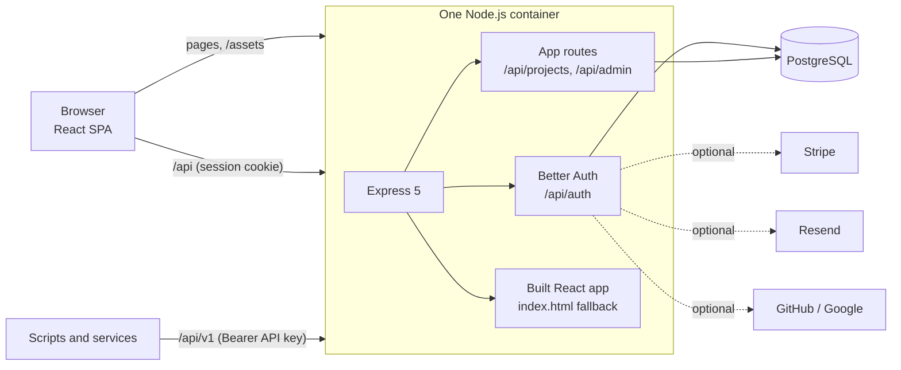

# SaaS Starter: React + Node.js + PostgreSQL

A complete SaaS starter built with React 19, Vite, an Express 5 API on Node.js, PostgreSQL, Better Auth, Drizzle ORM, Tailwind CSS and shadcn/ui, all in TypeScript. It has sign-up, teams with roles, onboarding, Stripe subscriptions, an admin panel, API keys and a REST API. Deploy it with a database in one click: open the URL, sign up, and it works with no keys.

[](https://www.light-cloud.com/templates/saas-starter-react-node)

## Features

- **Accounts**: email and password sign-up and sign-in, sign-out, password reset by email, and email verification (only when an email provider is set). GitHub and Google sign-in appear when you add their keys. Sessions live in the database, in httpOnly cookies.
- **Teams**: workspaces with owner, admin and member roles. Switch between workspaces, invite people by email (the invite link can also be copied in the app), accept or decline invites. Inviting the same address again resends the invitation, and pending invitations count towards the plan's member limit.
- **Onboarding**: after the first sign-up, name your workspace, invite teammates (optional) and pick a plan (when billing is on), then land on a dashboard with a getting-started checklist.
- **Marketing pages**: landing page with a product preview, features, pricing and FAQ, a pricing page driven by one plans file (the chosen plan carries through sign-up), terms and privacy placeholders. Light and dark theme, works at phone width, keyboard and screen reader friendly.
- **App**: a flat, professional UI (Inter, one indigo accent, zinc neutrals) with a sidebar shell, workspace switcher and user menu, a dashboard with a getting-started checklist, a workspace-scoped example resource (Projects) with plan limits, account settings and workspace settings (members, invites, roles, API keys, billing, danger zone). Every destructive action asks first, forms show errors under each field, lists load with skeletons and failed requests offer a retry.
- **Billing**: Stripe Checkout to upgrade, the Customer Portal to manage, a webhook to keep subscriptions in sync. Off until you add Stripe keys; everyone is on Free until then.
- **Admin panel**: `/admin` lists users and workspaces with search, plan and subscription, and bans users.
- **Emails**: verify, reset, invite and welcome through Resend. Without a key they are written to the server log, link included.
- **API keys and REST API**: per-workspace keys, stored hashed and shown once, for `/api/v1/projects`.
- **Health check**: `GET /api/health` answers `200` when the database does and `503` when it does not.

## How it works



One server does everything: `npm run build` compiles the React app into `dist/client` and the server into `dist/server`, and `npm start` serves both on `PORT`. Client routes such as `/settings/members` get `index.html`, so refreshing any page works. Database migrations in `server/drizzle` run on start, before the server accepts traffic, and are safe to run on every start and from several instances at once.

The public URL is not fixed in advance. Unless `APP_URL` is set, the server works out its address from each request (`x-forwarded-host` and `x-forwarded-proto` behind a proxy), so links in emails, OAuth callbacks and Stripe redirects use whatever domain the app is reached on. Only same-origin requests and redirect targets are accepted.

On Light Cloud this is detected as an **Express** app (Node.js, container): `express` is a production dependency in the root `package.json`, which outranks React, so it is built with `npm ci`, `npm run build` and started with `npm start`.

## Project structure

```text
.
├── client/                      # React app (Vite root)
│   ├── index.html
│   ├── public/                  # favicon, theme script (no flash of the wrong theme)
│   └── src/
│       ├── app.tsx              # Route table
│       ├── components/          # App shell, menus, plan cards; ui/ holds shadcn/ui components
│       ├── features/            # Pieces used by several pages (project form, invite form)
│       ├── lib/                 # auth-client, api (fetch), queries (TanStack Query), theme
│       └── pages/               # marketing/, auth/, app/ and app/settings/
├── server/
│   ├── drizzle/                 # SQL migrations, committed, applied on start
│   ├── src/
│   │   ├── index.ts             # Migrate, then listen; graceful shutdown
│   │   ├── app.ts               # Express app: headers, auth, routes, SPA fallback, errors
│   │   ├── config.ts            # Every environment variable, in one place
│   │   ├── db/                  # Pool, Drizzle schema (auth-schema.ts is generated), migrator
│   │   ├── lib/                 # auth, billing, email, projects, url
│   │   ├── middleware/auth.ts   # Session, workspace role, platform admin, API key checks
│   │   └── routes/              # meta (health, config), projects, workspace, admin, v1
│   └── test/                    # Vitest: unit, smoke and integration tests
├── shared/                      # Used by client and server: plans, roles and permissions, zod schemas
├── components.json              # shadcn/ui settings
├── drizzle.config.ts
├── vite.config.ts
├── .env.example
└── package.json
```

## Environment variables

| Variable | Needed | Meaning |
| --- | --- | --- |
| `DATABASE_URL` | Set by the platform | PostgreSQL connection URL. On Light Cloud it ends with `sslmode=require` (TLS on, certificate not verified). Leave `sslmode` out for a local database without TLS. |
| `AUTH_SECRET` | Set by the platform | Signs sessions and tokens. Light Cloud generates a random one. Required in production. |
| `PORT` | Set by the platform | Port to listen on (default `8080`). |
| `APP_URL` | Optional | Public URL, e.g. `https://app.example.com`. Set it once you have a domain; without it the URL comes from each request. |
| `APP_NAME` | Optional | Product name in the UI and emails (default `Acme`). |
| `ADMIN_EMAILS` | Optional | Comma-separated emails that are platform admins. |
| `RESEND_API_KEY`, `EMAIL_FROM` | Switches on email | Send emails through Resend. Turns on email verification. |
| `GITHUB_CLIENT_ID`, `GITHUB_CLIENT_SECRET` | Switches on GitHub sign-in | Both needed. |
| `GOOGLE_CLIENT_ID`, `GOOGLE_CLIENT_SECRET` | Switches on Google sign-in | Both needed. |
| `STRIPE_SECRET_KEY`, `STRIPE_WEBHOOK_SECRET`, `STRIPE_PRICE_PRO`, `STRIPE_PRICE_BUSINESS` | Switches on billing | All four needed. |

The browser only receives on/off flags for these (`GET /api/config`), never their values.

## Run locally

You need Node.js 22.22 or newer and Docker (for the database).

```bash
docker run -d --name saas-db -p 5432:5432 -e POSTGRES_PASSWORD=postgres postgres:16
cp .env.example .env        # then set AUTH_SECRET to any long random string
npm install
npm run dev
```

`npm run dev` starts the API on http://localhost:8080 (restarting when a file changes) and Vite on http://localhost:5173, which proxies `/api` to the API. Open http://localhost:5173. On Windows, run `npm run dev:server` and `npm run dev:client` in two terminals.

To run it the way production does:

```bash
npm run build
node --env-file=.env dist/server/src/index.js   # then open http://localhost:8080
```

## Testing

```bash
npm run lint
npm run typecheck
npm test
```

Unit tests cover roles and permissions, plan limits, API key hashing and URL handling. The smoke test boots the app against an unreachable database (health must say `503`). With `DATABASE_URL` set, the integration tests sign up, create a workspace and an API key, create projects through `/api/v1` up to the Free limit, check the admin lists' workspace counts and plans, the member limit with pending invitations, resent invitations, that members cannot delete projects, and the name and email checks. They create their own users, so point `DATABASE_URL` at a scratch database.

## Turn on email

1. Create a [Resend](https://resend.com) account, verify your domain and create an API key.
2. Set `RESEND_API_KEY` and `EMAIL_FROM` (for example `Acme <hello@yourdomain.com>`) and redeploy.

New accounts now confirm their email before the first sign-in. Until then, every email is printed in the server log with its link, and invitation links can be copied from **Settings → Members**.

## Turn on Stripe billing

1. In Stripe, create two products with monthly prices, Pro and Business. Copy their price ids into `STRIPE_PRICE_PRO` and `STRIPE_PRICE_BUSINESS`.
2. Add a webhook endpoint at `https://<your-app>/api/auth/stripe/webhook` for the `checkout.session.completed`, `customer.subscription.created`, `customer.subscription.updated` and `customer.subscription.deleted` events, and copy its signing secret into `STRIPE_WEBHOOK_SECRET`.
3. Set `STRIPE_SECRET_KEY` and redeploy.

Subscriptions belong to workspaces. Only the owner can upgrade or open the Customer Portal. Plan names, prices shown and limits live in `shared/plans.ts`; Stripe charges what the price ids say.

## Turn on GitHub or Google sign-in

- **GitHub**: create an OAuth app with the callback URL `https://<your-app>/api/auth/callback/github`, then set `GITHUB_CLIENT_ID` and `GITHUB_CLIENT_SECRET`.
- **Google**: create an OAuth client (web application) with the redirect URI `https://<your-app>/api/auth/callback/google`, then set `GOOGLE_CLIENT_ID` and `GOOGLE_CLIENT_SECRET`.

The buttons appear on the sign-in and sign-up pages once both values are set.

## How admin works

The first account ever created on a deployment is a platform admin, and so is anyone whose email is in `ADMIN_EMAILS` (they are promoted on their next sign-in). Admins see **Admin** in the sidebar: users and workspaces with search, each workspace's plan and subscription, and a ban button. Banned users are signed out and cannot sign in. Everyone else gets a 404 page, and `/api/admin` answers `403`.

Workspace roles are separate: **owner** (billing, delete the workspace), **admin** (members, invites, settings, API keys, delete projects), **member** (create and edit projects). They are defined once in `shared/permissions.ts` and checked on every API route; the UI hides what a role cannot do.

## API

Create a key in **Settings → API keys** (owners and admins). It is shown once and stored as a SHA-256 hash. Each key belongs to one workspace and allows 120 requests a minute.

```bash
export KEY=sk_...           # your key
export APP=https://<your-app>

curl -H "Authorization: Bearer $KEY" $APP/api/v1/projects
curl -X POST -H "Authorization: Bearer $KEY" -H "content-type: application/json" \
  -d '{"name": "Website relaunch", "description": "Q3"}' $APP/api/v1/projects
curl -H "Authorization: Bearer $KEY" $APP/api/v1/projects/<id>
curl -X PATCH -H "Authorization: Bearer $KEY" -H "content-type: application/json" \
  -d '{"name": "Renamed"}' $APP/api/v1/projects/<id>
curl -X DELETE -H "Authorization: Bearer $KEY" $APP/api/v1/projects/<id>
```

| Method | Path | Answers |
| --- | --- | --- |
| `GET` | `/api/v1/projects` | `200 {"data": [...]}`, newest first |
| `POST` | `/api/v1/projects` | `201 {"data": {...}}`; `402` over the plan limit |
| `GET` | `/api/v1/projects/:id` | `200 {"data": {...}}` or `404` |
| `PATCH` | `/api/v1/projects/:id` | `200 {"data": {...}}` or `404` |
| `DELETE` | `/api/v1/projects/:id` | `204` or `404` |

Errors are JSON `{"error": "..."}`: `400` invalid input, `401` missing or wrong key, `429` too many requests.

## Make it yours

Projects is the example resource: its table is in `server/src/db/schema.ts`, its rules in `server/src/lib/projects.ts`, its validation in `shared/schemas.ts` and its pages in `client/src/pages/app/`. Rename it, add columns, then run `npm run db:generate` to write a new migration and commit it. After changing Better Auth plugins, regenerate `server/src/db/auth-schema.ts` with `npx auth@1.7.18 generate --config server/src/lib/auth.ts --output server/src/db/auth-schema.ts` (set `DATABASE_URL`, and the four Stripe variables to any value so the billing tables are included). Add shadcn/ui components with `npx shadcn@4.23.0 add <name>` from the project root (they land in `client/src/components/ui`). Colours, radius and font are tokens at the top of `client/src/index.css`; change the accent there to rebrand. Push, and Light Cloud redeploys.

With no `APP_URL`, a forged `x-forwarded-host` header can change the domain in a password reset email that someone requests for another person. Set `APP_URL` as soon as you know your domain.

## License

MIT, see [LICENSE](./LICENSE).
