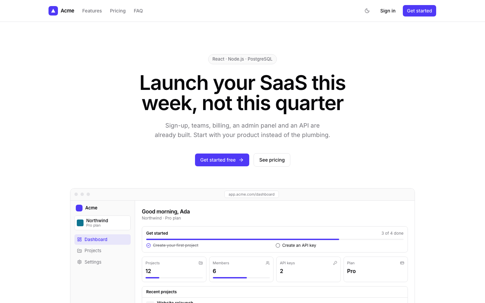
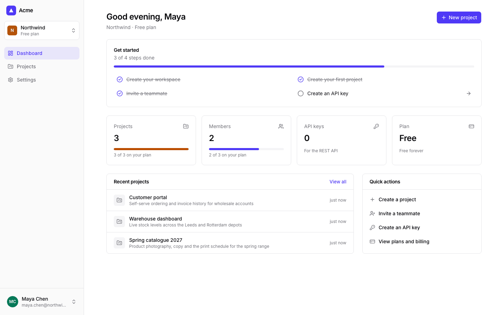
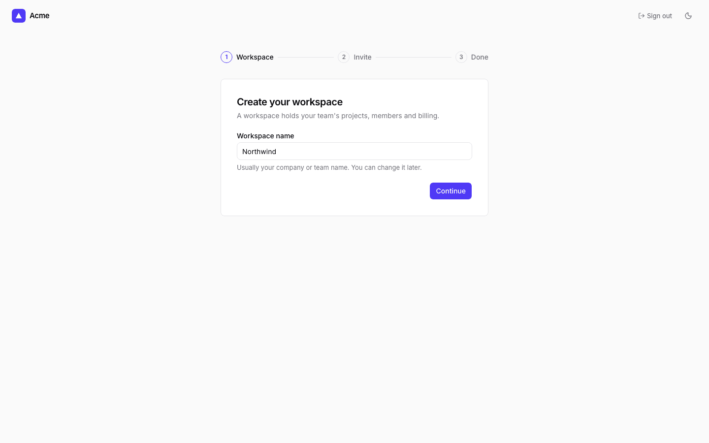
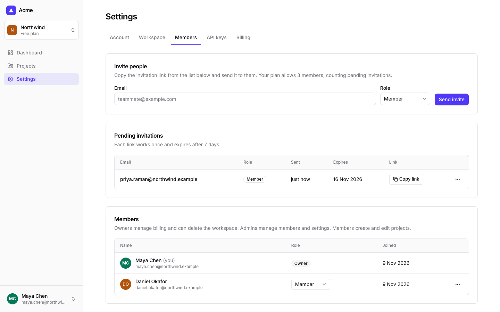
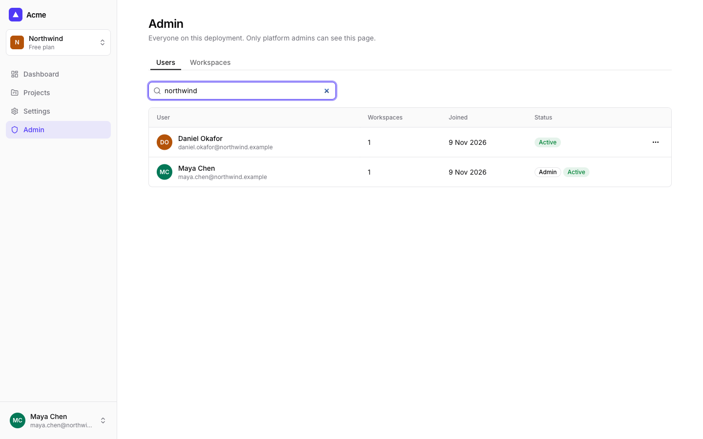
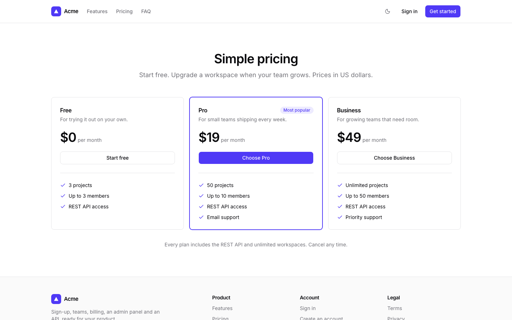
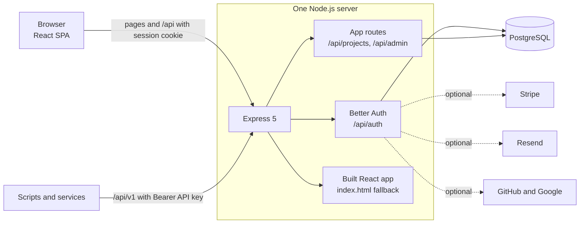

# React and Node.js SaaS Starter Kit

[](LICENSE) [](https://react.dev) [](https://expressjs.com) [](https://www.typescriptlang.org) [](https://www.postgresql.org) [](server/test) [](https://github.com/light-cloud-templates/react-node-saas-starter/generate) [](https://www.light-cloud.com/templates/react-node-saas-starter)

A React and Node.js SaaS starter kit in TypeScript: a React 19 single-page app built with Vite, an Express 5 API, PostgreSQL, Better Auth, Drizzle ORM, Tailwind CSS and shadcn/ui, served by one Node.js server. It is a free, MIT-licensed SaaS boilerplate for developers who want sign-up, teams with roles, onboarding, Stripe subscriptions, an admin panel, API keys and a REST API already built. It runs with no third-party keys: email, billing and social sign-in switch on when you add their variables.

## Screenshots

<picture><source media="(prefers-color-scheme: dark)" srcset="docs/screenshots/landing-dark.png"></picture>
<picture><source media="(prefers-color-scheme: dark)" srcset="docs/screenshots/dashboard-dark.png"></picture>

<table>
  <tr>
    <td width="50%"><br>Onboarding</td>
    <td width="50%"><br>Members and roles</td>
  </tr>
  <tr>
    <td width="50%"><br>Admin</td>
    <td width="50%"><br>Pricing</td>
  </tr>
</table>

## Features

- **Accounts**: email and password sign-up, sign-in, sign-out and password reset; email verification once an email provider is set; GitHub and Google sign-in when their keys are set. Sessions live in the database, in httpOnly cookies.
- **Teams**: workspaces with owner, admin and member roles, a workspace switcher, invitations by email or a copied link. Inviting the same address again resends the invitation, and pending invitations count towards the member limit.
- **Onboarding**: name the workspace, invite teammates and pick a plan, then land on a dashboard with a getting-started checklist. A plan chosen on the pricing page carries through sign-up.
- **Billing**: Stripe Checkout to upgrade, the Customer Portal to manage, a webhook to keep subscriptions in sync. Plans and limits live in `shared/plans.ts`, used by both client and server.
- **Admin** at `/admin`: users and workspaces with search, each workspace's plan and subscription, and a ban button.
- **Example resource**: Projects, scoped to the workspace, with plan limits.
- **API keys and REST API**: per-workspace keys, stored as a SHA-256 hash and shown once, for `/api/v1/projects`, limited to 120 requests a minute per key.
- **Emails**: verify, reset, invite and welcome through Resend. Without a key they are written to the server log, link included.
- **UI**: landing, pricing, terms and privacy pages, light and dark theme, phone layouts, per-field form errors, confirmations before destructive actions, skeletons and retry on failed requests.
- **One server**: Express serves the API and the built React app on one port, with migrations applied on start and a `GET /api/health` check.

## Quick start

You need Node.js 22.22 or newer and Docker (for a local PostgreSQL).

```bash
git clone https://github.com/light-cloud-templates/react-node-saas-starter.git
cd react-node-saas-starter
docker run -d --name saas-db -p 5432:5432 -e POSTGRES_PASSWORD=postgres postgres:16
cp .env.example .env           # then set AUTH_SECRET, e.g. to the output of: openssl rand -base64 32
npm install
npm run dev
```

`npm run dev` starts the API on port 8080 (restarting when a file changes) and Vite on port 5173, which proxies `/api` to the API. Open <http://localhost:5173> and sign up: the first account is the admin. On Windows, run `npm run dev:server` and `npm run dev:client` in two terminals.

Other ways to start:

- **Use this template**: press [Use this template](https://github.com/light-cloud-templates/react-node-saas-starter/generate) to create your own repository from this one.
- **Deploy to Light Cloud**: open the [template page](https://www.light-cloud.com/templates/react-node-saas-starter) and press Deploy to get a running copy with a database.

## Deploy

### Deploy to Light Cloud

[](https://www.light-cloud.com/templates/react-node-saas-starter)

The Deploy button copies this template into your GitHub account and creates:

- a server app (detected as Express) that runs `npm ci`, `npm run build` and `npm start` on `PORT`
- a PostgreSQL database, with `DATABASE_URL` set on the app
- a random `AUTH_SECRET`, generated at deploy

Open the URL and sign up: it works with no other keys. The server works out its public URL from each request, so links in emails, OAuth callbacks and Stripe redirects use whatever domain the app is reached on. Every push to the default branch deploys again. Templates with a database need a paid Light Cloud plan.

### Deploy anywhere else

There is no Light Cloud code in it. Any host that runs Node.js 22.22 and can reach PostgreSQL runs it: set `DATABASE_URL` and `AUTH_SECRET` (and `NODE_ENV=production`), run `npm ci && npm run build`, then `npm start`.

## Project structure

```text
.
├── client/                 # React app (Vite root)
│   └── src/
│       ├── app.tsx         # route table
│       ├── components/     # app shell, menus, plan cards; ui/ holds shadcn/ui components
│       ├── lib/            # auth client, fetch helpers, TanStack Query queries, theme
│       └── pages/          # marketing/, auth/, app/ and app/settings/
├── server/
│   ├── drizzle/            # SQL migrations, committed, applied on start
│   ├── src/
│   │   ├── index.ts        # migrate, then listen; graceful shutdown
│   │   ├── app.ts          # Express app: headers, auth, routes, SPA fallback, errors
│   │   ├── config.ts       # every environment variable, in one place
│   │   ├── lib/            # auth, billing, email, projects, url
│   │   ├── middleware/     # session, workspace role, platform admin and API key checks
│   │   └── routes/         # meta (health, config), projects, workspace, admin, v1
│   └── test/               # Vitest unit, smoke and integration tests
├── shared/                 # plans, roles and permissions, zod schemas
├── vite.config.ts          # builds the client into dist/client
└── .env.example            # every environment variable, explained
```

## Pages

| Route | What it is |
| --- | --- |
| `/`, `/pricing`, `/terms`, `/privacy` | Marketing pages |
| `/sign-up`, `/sign-in`, `/forgot-password` | Accounts, plus GitHub and Google buttons when configured |
| `/onboarding` | Name the workspace, invite teammates, pick a plan |
| `/dashboard` | Getting-started checklist |
| `/projects` | The example resource, with plan limits |
| `/settings/account`, `/settings/workspace`, `/settings/members`, `/settings/api-keys`, `/settings/billing` | Account and workspace settings |
| `/admin` | Users and workspaces, for platform admins |

## API usage

Create a key in **Settings → API keys** (owners and admins). It is shown once. Each key belongs to one workspace.

| Method | Path | Description |
| --- | --- | --- |
| `GET` | `/api/health` | `200` when the database answers, `503` when it does not |
| `GET` | `/api/v1/projects` | `200 {"data": [...]}`, newest first |
| `POST` | `/api/v1/projects` | `201 {"data": {...}}`; `402` over the plan limit |
| `GET` | `/api/v1/projects/:id` | `200 {"data": {...}}` or `404` |
| `PATCH` | `/api/v1/projects/:id` | `200 {"data": {...}}` or `404` |
| `DELETE` | `/api/v1/projects/:id` | `204` or `404` |

Errors are JSON `{"error": "..."}`: `400` invalid input, `401` missing or wrong key, `429` too many requests.

```bash
curl -X POST http://localhost:8080/api/v1/projects \
  -H "Authorization: Bearer $API_KEY" \
  -H "content-type: application/json" \
  -d '{"name": "Website relaunch", "description": "Q3"}'
```

## Environment variables

| Name | Required | Default | What it does |
| --- | --- | --- | --- |
| `DATABASE_URL` | Yes | none | PostgreSQL connection URL. Set by Light Cloud. |
| `AUTH_SECRET` | In production | a dev-only value | Signs sessions and tokens. Generated by Light Cloud at deploy. |
| `PORT` | No | `8080` | Port to listen on. Set by Light Cloud. |
| `APP_URL` | No | from each request | Public URL. Set it once you have a domain. |
| `APP_NAME` | No | `Acme` | Product name in the UI and emails. |
| `ADMIN_EMAILS` | No | empty | Comma-separated emails that are platform admins. |
| `RESEND_API_KEY` | No | empty | Sends email through Resend and turns on email verification. |
| `EMAIL_FROM` | No | `Acme <onboarding@resend.dev>` | Sender, on a domain verified in Resend. |
| `GITHUB_CLIENT_ID`, `GITHUB_CLIENT_SECRET` | No | empty | Turn on GitHub sign-in (both needed). |
| `GOOGLE_CLIENT_ID`, `GOOGLE_CLIENT_SECRET` | No | empty | Turn on Google sign-in (both needed). |
| `STRIPE_SECRET_KEY`, `STRIPE_WEBHOOK_SECRET`, `STRIPE_PRICE_PRO`, `STRIPE_PRICE_BUSINESS` | No | empty | Turn on billing (all four needed). |

The browser only receives on/off flags for these (`GET /api/config`), never their values. Set `APP_URL` as soon as you know your domain: without it, a forged `x-forwarded-host` header can change the domain in a password reset email.

## Turn on email, billing and social sign-in

**Email.** Create a [Resend](https://resend.com) account, verify your domain and create an API key. Set `RESEND_API_KEY` and `EMAIL_FROM` and redeploy. New accounts then confirm their email before the first sign-in.

**Stripe billing.** In Stripe, create two products with monthly prices, Pro and Business, and copy their price ids into `STRIPE_PRICE_PRO` and `STRIPE_PRICE_BUSINESS`. Add a webhook endpoint at `https://<your-app>/api/auth/stripe/webhook` for `checkout.session.completed`, `customer.subscription.created`, `customer.subscription.updated` and `customer.subscription.deleted`, and copy its signing secret into `STRIPE_WEBHOOK_SECRET`. Set `STRIPE_SECRET_KEY` and redeploy. Only the workspace owner can upgrade or open the Customer Portal.

**GitHub or Google sign-in.** Create a GitHub OAuth app with the callback URL `https://<your-app>/api/auth/callback/github`, or a Google OAuth client (web application) with the redirect URI `https://<your-app>/api/auth/callback/google`. Set the client id and secret; the buttons appear once both values are set.

**How admin works.** The first account ever created on a deployment is a platform admin, and so is anyone in `ADMIN_EMAILS` (promoted on their next sign-in). Admins see **Admin** in the sidebar; everyone else gets a 404 page, and `/api/admin` answers `403`. Workspace roles are separate: owner (billing, delete the workspace), admin (members, invites, settings, API keys, delete projects) and member (create and edit projects), defined once in `shared/permissions.ts` and checked on every API route.

## Testing

```bash
npm run lint
npm run typecheck
npm test
```

Unit tests cover roles and permissions, plan limits, API key hashing and URL handling. The smoke test boots the app against an unreachable database (health must answer `503`). With `DATABASE_URL` set, the integration tests sign up, create a workspace and an API key, create projects through `/api/v1` up to the Free limit and check member limits, invitations and role rules. They create their own users, so point `DATABASE_URL` at a scratch database.

## How it works



`npm run build` compiles the React app into `dist/client` and the server into `dist/server`, and `npm start` serves both. Client routes such as `/settings/members` get `index.html`, so refreshing any page works. Migrations in `server/drizzle` run before the server accepts traffic and are safe to run from several instances at once.

## FAQ

### Does it work without Stripe or an email provider?

Yes. With only `DATABASE_URL` and `AUTH_SECRET`, sign-up, teams, projects, admin and the API all work. Everyone is on Free, and emails with their links are printed in the server log.

### How do I add my own resource instead of Projects?

The table is in `server/src/db/schema.ts`, the rules in `server/src/lib/projects.ts`, validation in `shared/schemas.ts` and the pages in `client/src/pages/app/`. Rename or copy them, then run `npm run db:generate` and commit the new migration.

### How do I add a shadcn/ui component?

Run `npx shadcn@4.23.0 add <name>` from the project root; components land in `client/src/components/ui`. Colours, radius and font are tokens at the top of `client/src/index.css`.

### Why one server instead of a separate frontend and API?

One origin means session cookies work without CORS, and there is one thing to deploy. Vite still runs separately in development, proxying `/api` to Express.

### Can I deploy it without Light Cloud?

Yes. Any Node.js 22.22 host with PostgreSQL runs it with `npm run build` and `npm start`, once `DATABASE_URL` and `AUTH_SECRET` are set.

## Related templates

- [nextjs-saas-starter](https://github.com/light-cloud-templates/nextjs-saas-starter): the same SaaS features in Next.js 16
- [open-saas-starter](https://github.com/light-cloud-templates/open-saas-starter): Open SaaS by Wasp, with an AI demo app and file uploads
- [react-vite-starter](https://github.com/light-cloud-templates/react-vite-starter): a plain React and Vite app
- [express-postgresql-crud-api](https://github.com/light-cloud-templates/express-postgresql-crud-api): a small Express REST API with PostgreSQL

## Licence

MIT, see [LICENSE](LICENSE).

---

Maintained by [Light Cloud](https://light-cloud.com): deploy apps, APIs and databases in one click.
