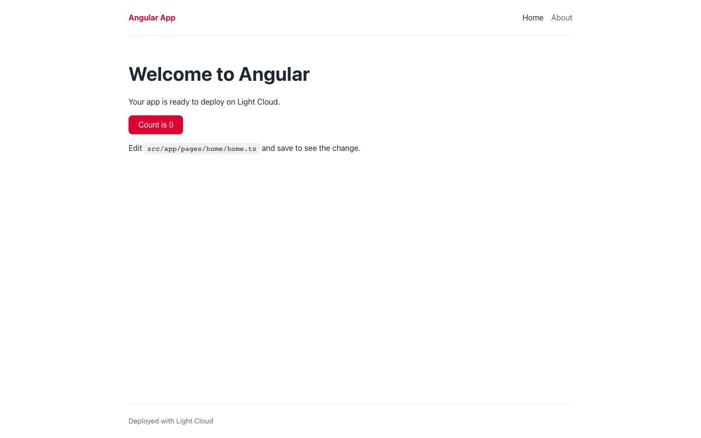
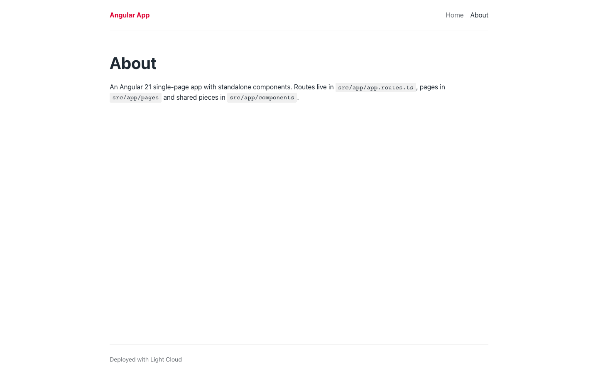
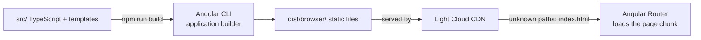

# Angular 21 Starter

[](LICENSE) [](https://angular.dev) [](https://www.typescriptlang.org) [](src/app) [](https://github.com/light-cloud-templates/angular-starter/generate) [](https://www.light-cloud.com/templates/angular-starter)

An Angular 21 starter built with the Angular CLI: a single-page app with standalone components, signals and the Angular Router, with a home page, an about page and a 404 page. It is a small TypeScript boilerplate for developers who want a clean Angular project with lazy-loaded routes, strict type checking, Prettier and Vitest unit tests already set up. It builds to static files that any static host serves, and deploys to Light Cloud in one click.

## Screenshot




## Features

- Angular 21 with standalone components (no NgModules) and signals
- The Angular CLI application builder (`@angular/build`) for `ng serve` and `ng build`
- Angular Router with every page lazy-loaded through `loadComponent`, and page titles per route
- A layout shell in `App` (header, navigation, footer) around `<router-outlet />`
- Component styles next to each component, design tokens in `src/styles.css`
- Unit tests with Vitest through `ng test`, for the app shell and the counter
- TypeScript strict mode and strict Angular template checks, Prettier config
- Production budgets: a warning at 500 kB initial bundle, an error at 1 MB

## Quick start

You need Node.js 20.19, 22.12 or later (Angular 21 requires it) and npm.

```bash
git clone https://github.com/light-cloud-templates/angular-starter.git
cd angular-starter
npm install
npm start
```

Open <http://localhost:4200>. Edit `src/app/pages/home/home.ts` and the page reloads as you save.

Other ways to start:

- **Use this template**: press [Use this template](https://github.com/light-cloud-templates/angular-starter/generate) to create your own repository from this one.
- **Deploy to Light Cloud**: open the [template page](https://www.light-cloud.com/templates/angular-starter) and press Deploy to get a running copy.

## Deploy

### Deploy to Light Cloud

[](https://www.light-cloud.com/templates/angular-starter)

The Deploy button copies this template into your GitHub account and creates a static site: Light Cloud runs `npm run build` and serves the `dist/browser/` folder from a CDN. Paths that are not files, such as `/about`, fall back to `index.html`, so the Angular Router handles them.

There are no secrets to fill in. Every push to the default branch deploys again. Static sites run on the Free plan.

### Deploy anywhere else

This is a standard Angular CLI app with no Light Cloud code in it. Run `npm run build` and upload `dist/browser/` to any static file host (Netlify, Cloudflare Pages, Firebase Hosting, S3 with CloudFront, nginx). Because the app uses client-side routing, configure the host to serve `index.html` for paths that do not match a file, or `/about` returns a 404 on reload.

## Project structure

```text
.
├── angular.json                # CLI workspace: build into dist/, budgets, test builder
├── public/                     # favicon and static assets, copied as is
├── src/
│   ├── index.html              # HTML entry with <app-root>
│   ├── main.ts                 # bootstraps App with appConfig
│   ├── styles.css              # design tokens and base styles
│   └── app/
│       ├── app.ts              # layout shell component
│       ├── app.html            # header, navigation, router outlet, footer
│       ├── app.css             # shell styles
│       ├── app.spec.ts         # tests the shell renders the navigation
│       ├── app.config.ts       # providers: router, global error listeners
│       ├── app.routes.ts       # route table, pages loaded lazily
│       ├── components/counter/ # signal counter and its test
│       └── pages/              # home, about, not-found
├── tsconfig.json               # strict TypeScript and Angular compiler options
├── tsconfig.app.json           # app build
├── tsconfig.spec.json          # unit tests
└── .prettierrc                 # Prettier settings
```

## Pages

| Path | File | What it shows |
| --- | --- | --- |
| `/` | `src/app/pages/home/home.ts` | Welcome text and a click counter |
| `/about` | `src/app/pages/about/about.ts` | Where routes, pages and components live |
| any other path | `src/app/pages/not-found/not-found.ts` | "Page not found" with a link home |

Routes and their browser tab titles are declared in `src/app/app.routes.ts`; links in the header are in `src/app/app.html`.

## Environment variables

This template reads no environment variables. The app title is the `title` field in `src/app/app.ts`.

## Testing

```bash
npm test -- --watch=false   # Vitest through ng test, runs once
npm run build               # production build into dist/browser/, checks the budgets
```

`npm test` on its own can stay in watch mode in a terminal. The tests run in jsdom, so no browser is needed. There is no lint script; add one with `ng add angular-eslint`.

## How it works



The CLI compiles the app ahead of time into `dist/browser/`. The browser loads `index.html` and the main bundle once; each route's component is its own chunk, fetched when the route is first visited.

## FAQ

### How do I add a new page in Angular?

Run `npx ng generate component pages/contact`, then add `{ path: 'contact', title: 'Contact', loadComponent: () => import('./pages/contact/contact').then((m) => m.Contact) }` to `src/app/app.routes.ts` and a `<a routerLink="/contact">` link in `src/app/app.html`.

### Why does my Angular route show a 404 after a refresh?

The host is looking for a file called `/about` and has none. Configure it to serve `index.html` for unknown paths (a rewrite or SPA fallback). Light Cloud does this for you.

### How do I add environment settings to an Angular app?

Run `npx ng generate environments` to create `src/environments/` with a development and a production file, then import from `environments/environment`. Values are compiled into the bundle, so never put secrets in them.

### Can I deploy it without Light Cloud?

Yes. Run `npm run build` and serve `dist/browser/` from any static file host, with a fallback to `index.html` for client-side routes.

### Does it use NgModules or Karma?

Neither. Every component is standalone, and `ng test` runs the specs with Vitest, the default test runner for new Angular CLI projects.

## Related templates

- [react-vite-starter](https://github.com/light-cloud-templates/react-vite-starter): the same app in React and Vite
- [vue-vite-starter](https://github.com/light-cloud-templates/vue-vite-starter): the same app in Vue 3 and Vite
- [solidjs-vite-starter](https://github.com/light-cloud-templates/solidjs-vite-starter): the same app in SolidJS and TypeScript
- [nestjs-api-starter](https://github.com/light-cloud-templates/nestjs-api-starter): a TypeScript API with Angular-style modules and decorators

## Licence

MIT, see [LICENSE](LICENSE).

---

Maintained by [Light Cloud](https://light-cloud.com): deploy apps, APIs and databases in one click.
