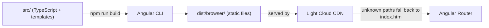

<p align="center">
  
</p>

<h1 align="center">Angular Boilerplate</h1>

<p align="center">
  An Angular application with standalone components, ready to deploy on Light Cloud.
</p>

<p align="center">
  <a href="https://console.light-cloud.com/new?repo=https://github.com/light-cloud-com/starter-angular"></a>
</p>

---

## Features

- Angular 21 with standalone components and signals, scaffolded with `ng new`
- Router with lazy-loaded pages (Home, About, 404) and a shared layout shell
- Component styles next to each component, global tokens in `src/styles.css`
- Unit tests with Vitest through the Angular CLI (`ng test`)
- TypeScript strict mode and Prettier

## How it works



## Project structure

```text
.
├── angular.json                # CLI workspace config (builds into dist/browser)
├── public/                     # Static assets, copied as is
└── src/
    ├── index.html
    ├── main.ts                 # Bootstraps App with appConfig
    ├── styles.css              # Design tokens and base styles
    └── app/
        ├── app.ts|html|css     # Layout shell: header, nav, router outlet, footer
        ├── app.config.ts       # Providers (router, error listeners)
        ├── app.routes.ts       # Route table, pages loaded lazily
        ├── components/counter/ # Shared component and its test
        └── pages/              # home, about, not-found
```

## Local development

```bash
npm install                 # install dependencies
npm start                   # dev server on http://localhost:4200
npm test -- --watch=false   # unit tests (Vitest), once
npm run build               # production build into dist/browser
```

## Deploy to Light Cloud

### 1. Create an Account

Visit [console.light-cloud.com](https://console.light-cloud.com) and sign up with GitHub or Google.

### 2. Create New Application

1. Click **"New Application"** in the dashboard
2. Select **"Static Site"** as the deployment type
3. Choose **"Angular"** as the framework

### 3. Connect Repository

- **Option A:** Fork this repository and connect it via GitHub
- **Option B:** Push this code to your own GitHub repository and connect it

### 4. Configure Build Settings

Light Cloud will auto-detect your settings, but you can verify:

| Setting | Value |
|---------|-------|
| Build Command | `npm run build` |
| Output Directory | `dist/browser` |

### 5. Deploy

Click **"Deploy"** and your app will be live in seconds!

Your app will be available at `https://your-app.light-cloud.io`

## Learn More

This starter began as the output of `ng new`, with routing and pages added following the [Angular style guide](https://angular.dev/style-guide).

- [Angular documentation](https://angular.dev)
- [Angular CLI reference](https://angular.dev/tools/cli)
- [Light Cloud documentation](https://docs.light-cloud.com)

## License

[MIT](./LICENSE)

---

<p align="center">
  <a href="https://light-cloud.com">Website</a> •
  <a href="https://docs.light-cloud.com">Documentation</a> •
  <a href="https://console.light-cloud.com">Console</a>
</p>

<p align="center">
  Made with ☁️ by <a href="https://light-cloud.com">Light Cloud</a>
</p>
