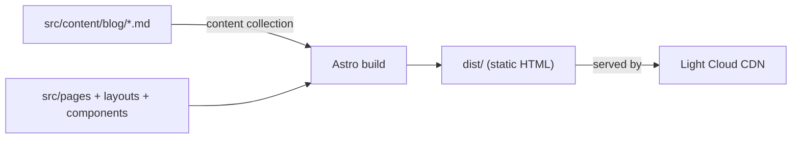

<p align="center">
  
</p>

<h1 align="center">Astro Boilerplate</h1>

<p align="center">
  An Astro site prerendered to static files, ready to deploy on Light Cloud.
</p>

<p align="center">
  <a href="https://www.light-cloud.com/templates/starter-astro"></a>
</p>

---

## Features

- Astro 7, prerendered to static HTML, no server needed
- Zero JavaScript shipped by default
- Blog powered by a content collection, with a typed frontmatter schema
- Shared layout, header and footer components, global styles in one file
- Home, About, Blog index, one page per post, and a 404 page

## How it works



## Project structure

```text
.
├── public/                    # Favicons, copied as is
├── astro.config.mjs           # Static output (the default)
└── src/
    ├── content.config.ts      # Blog collection and its frontmatter schema
    ├── content/blog/          # Posts in Markdown
    ├── layouts/BaseLayout.astro
    ├── components/            # Header, Footer, PostList, FormattedDate
    ├── lib/posts.ts           # Published posts, newest first
    ├── pages/
    │   ├── index.astro        # Home with the latest posts
    │   ├── about.astro
    │   ├── 404.astro
    │   └── blog/              # index.astro and [id].astro
    ├── styles/global.css
    └── consts.ts              # Site title and description
```

## Local development

```bash
npm install       # install dependencies
npm run dev       # dev server on http://localhost:4321
npm run build     # static build into dist/
npm run preview   # serve the build locally
```

To add a post, create a Markdown file in `src/content/blog/` with a `title`, `description` and `pubDate`. Set `draft: true` to leave it out of the build.

## Deploy to Light Cloud

### 1. Create an Account

Visit [console.light-cloud.com](https://console.light-cloud.com) and sign up with GitHub or Google.

### 2. Create New Application

1. Click **"New Application"** in the dashboard
2. Select **"Static Site"** as the deployment type
3. Choose **"Astro"** as the framework

### 3. Connect Repository

- **Option A:** Fork this repository and connect it via GitHub
- **Option B:** Push this code to your own GitHub repository and connect it

### 4. Configure Build Settings

Light Cloud will auto-detect your settings, but you can verify:

| Setting | Value |
|---------|-------|
| Build Command | `npm run build` |
| Output Directory | `dist` |

### 5. Deploy

Click **"Deploy"** and your site will be live in seconds!

Your site will be available at `https://your-app.light-cloud.io`

## Learn More

This starter is the output of `npm create astro@latest -- --template minimal`, with only the changes noted above.

- [Astro documentation](https://docs.astro.build)
- [Astro Discord](https://astro.build/chat)
- [Light Cloud documentation](https://docs.light-cloud.com)

## License

[MIT](./LICENSE)

---

<p align="center">
  <a href="https://light-cloud.com">Website</a> •
  <a href="https://docs.light-cloud.com">Documentation</a> •
  <a href="https://console.light-cloud.com">Console</a>
</p>

<p align="center">
  Made with ☁️ by <a href="https://light-cloud.com">Light Cloud</a>
</p>
