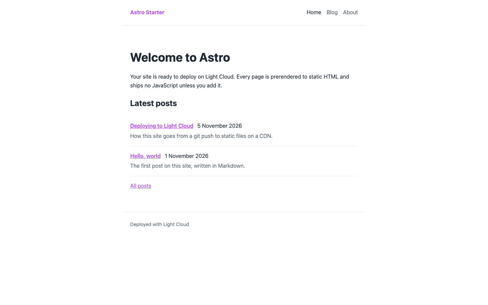
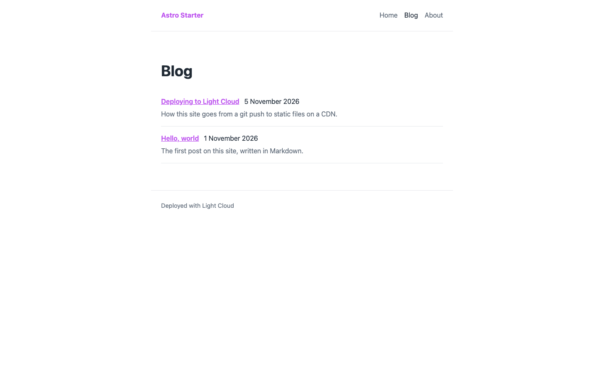
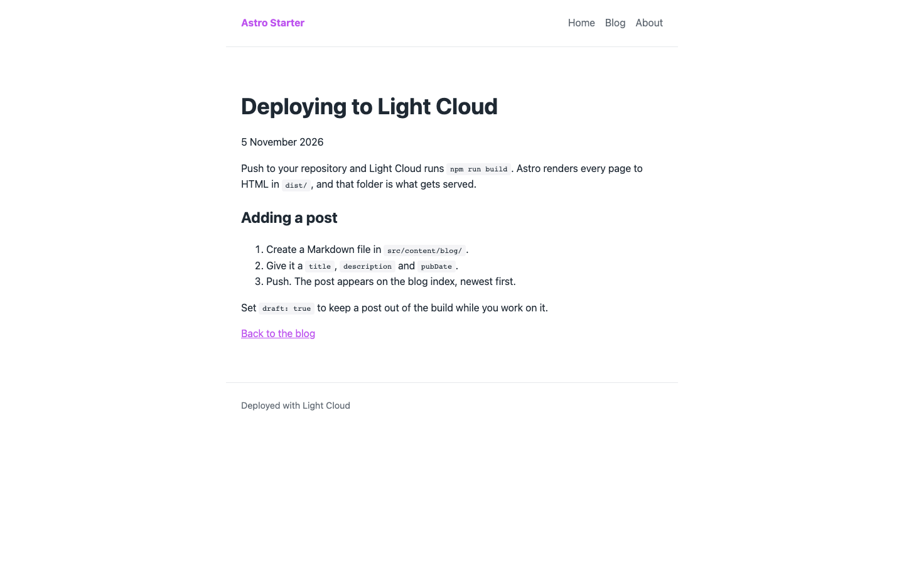
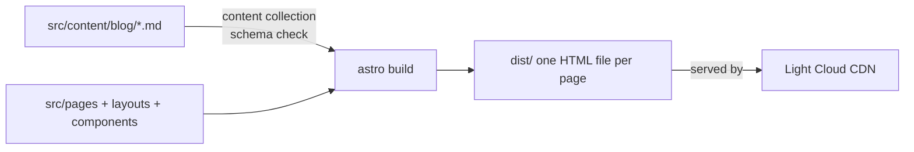

# Astro Blog Starter

[](LICENSE) [](https://astro.build) [](https://nodejs.org) [](tsconfig.json) [](https://github.com/light-cloud-templates/astro-blog-starter/generate) [](https://www.light-cloud.com/templates/astro-blog-starter)

An Astro 7 blog starter that prerenders every page to static HTML and ships no JavaScript to the browser. It is a small, content-first boilerplate for developers and writers who want a Markdown blog with a typed content collection, a shared layout, home, blog, post, about and 404 pages, and nothing else to remove. It builds to a folder of static files that any static host serves, and deploys to Light Cloud in one click.

## Screenshot





## Features

- Astro 7 with static output (the default): every page is prerendered at build time
- No client-side JavaScript unless you add it
- A `blog` content collection loaded from `src/content/blog/*.md` or `.mdx`
- A typed frontmatter schema (`title`, `description`, `pubDate`, `draft`), checked at build time
- Drafts: `draft: true` leaves a post out of the lists and out of the build
- Home page with the three latest posts, a blog index, one page per post, an about page and a 404 page
- One `BaseLayout` with a header, footer, page title and meta description on every page
- Strict TypeScript through `astro/tsconfigs/strict`

## Quick start

You need Node.js 22.12 or later (Astro 7 requires it, see `engines` in `package.json`) and npm.

```bash
git clone https://github.com/light-cloud-templates/astro-blog-starter.git
cd astro-blog-starter
npm install
npm run dev
```

Open <http://localhost:4321>. Edit a post in `src/content/blog/` and the page updates as you save.

Other ways to start:

- **Use this template**: press [Use this template](https://github.com/light-cloud-templates/astro-blog-starter/generate) to create your own repository from this one.
- **Deploy to Light Cloud**: open the [template page](https://www.light-cloud.com/templates/astro-blog-starter) and press Deploy to get a running copy.

## Deploy

### Deploy to Light Cloud

[](https://www.light-cloud.com/templates/astro-blog-starter)

The Deploy button copies this template into your GitHub account and creates a static site: Light Cloud runs `npm run build` and serves the `dist/` folder from a CDN.

There are no secrets to fill in. Every push to the default branch deploys again, so publishing a post is a commit. Static sites run on the Free plan.

### Deploy anywhere else

There is no Light Cloud code in it and no server adapter. Run `npm run build` and upload `dist/` to any static file host (Netlify, Cloudflare Pages, GitHub Pages, S3 with CloudFront, nginx). Every page is a real HTML file, such as `dist/blog/hello-world/index.html`, so no SPA fallback is needed; point the host's not-found page at `dist/404.html`.

## Project structure

```text
.
├── astro.config.mjs           # Astro config, static output by default
├── public/                    # favicons, copied as is
├── src/
│   ├── consts.ts              # site title and description
│   ├── content.config.ts      # blog collection and its frontmatter schema
│   ├── content/blog/          # posts in Markdown
│   ├── layouts/
│   │   └── BaseLayout.astro   # <head>, header, main, footer
│   ├── components/            # Header, Footer, PostList, FormattedDate
│   ├── lib/posts.ts           # published posts, newest first
│   ├── pages/
│   │   ├── index.astro        # home with the latest posts
│   │   ├── about.astro        # about page
│   │   ├── 404.astro          # not-found page
│   │   └── blog/
│   │       ├── index.astro    # all posts
│   │       └── [id].astro     # one page per post
│   └── styles/global.css      # design tokens and base styles
└── tsconfig.json              # strict TypeScript
```

## Pages

| Path | File | What it shows |
| --- | --- | --- |
| `/` | `src/pages/index.astro` | Welcome text and the three latest posts |
| `/blog/` | `src/pages/blog/index.astro` | Every published post, newest first |
| `/blog/<id>/` | `src/pages/blog/[id].astro` | One post; `<id>` is the Markdown file name |
| `/about/` | `src/pages/about.astro` | Where pages, layouts, components and posts live |
| `/404.html` | `src/pages/404.astro` | "Page not found" with a link home |

Two sample posts are included: `hello-world.md` and `deploying-to-light-cloud.md`.

## Environment variables

This template reads no environment variables. The site title and description are in `src/consts.ts`.

## Testing

There are no tests and no lint script. The build is the check: it validates every post's frontmatter against the schema in `src/content.config.ts` and fails on a missing title or a bad date.

```bash
npm run build     # static build into dist/
npm run preview   # serves dist/ on http://localhost:4321
```

## How it works



At build time `getStaticPaths` in `src/pages/blog/[id].astro` creates one page per published post. The output is plain HTML and CSS, so the CDN serves each page as a file with no server work per request.

## FAQ

### How do I add a blog post in Astro?

Create a Markdown file in `src/content/blog/`, for example `my-post.md`, with `title`, `description` and `pubDate` in the frontmatter. It appears at `/blog/my-post/` and in the lists on the next build.

### How do I hide a draft post?

Add `draft: true` to its frontmatter. `getPosts()` in `src/lib/posts.ts` skips drafts, so the post is not listed and its page is not built.

### How do I add a new page to an Astro site?

Create a file in `src/pages/`, such as `contact.astro`, wrap its content in `<BaseLayout title="Contact">`, and add `{ href: '/contact/', label: 'Contact' }` to the `links` array in `src/components/Header.astro`.

### Can I deploy it without Light Cloud?

Yes. Run `npm run build` and serve `dist/` from any static file host. There is no server code and no adapter to configure.

### Can I add React, Vue or Svelte components or MDX?

Yes. Run `npx astro add react` (or `vue`, `svelte`, `mdx`) to install the integration. The collection already loads `.mdx` files once the MDX integration is added.

## Related templates

- [eleventy-blog-starter](https://github.com/light-cloud-templates/eleventy-blog-starter): a static Markdown blog built with Eleventy
- [docusaurus-docs-starter](https://github.com/light-cloud-templates/docusaurus-docs-starter): a static documentation site
- [static-html-website-starter](https://github.com/light-cloud-templates/static-html-website-starter): plain HTML and CSS with no build step
- [nextjs-app-router-starter](https://github.com/light-cloud-templates/nextjs-app-router-starter): React with server rendering in Next.js

## Licence

MIT, see [LICENSE](LICENSE). Started from Astro's `minimal` template.

---

Maintained by [Light Cloud](https://light-cloud.com): deploy apps, APIs and databases in one click.
