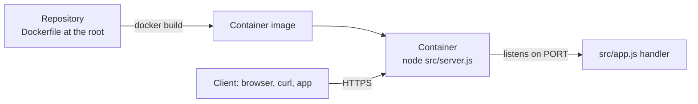

# Dockerfile Starter: Deploy Any Language as a Container

[](LICENSE) [](https://docs.docker.com/reference/dockerfile/) [](https://nodejs.org) [](test) [](https://github.com/light-cloud-templates/dockerfile-starter/generate) [](https://www.light-cloud.com/templates/dockerfile-starter)

A Dockerfile starter for deploying an app in any language or runtime as a container, with a small dependency-free Node.js 22 HTTP server inside as a working example. It is a template for developers who want to bring their own Dockerfile: keep the example, or replace `src/` and the `Dockerfile` with Python, Go, Rust, Java or anything else, as long as the container listens on `PORT`. The image runs on any container host and deploys to Light Cloud in one click.

## Features

- A `Dockerfile` that Light Cloud builds as it is, at the root of the repository
- Example app: a Node.js 22 server on `node:http` with no npm dependencies, answering JSON on `/` and `/health`
- Runs as the image's unprivileged `node` user, not root
- Shuts down cleanly on `SIGTERM` and `SIGINT`: the server stops taking new connections and lets open requests finish
- Listens on the port in `PORT`, with `8080` as the fallback
- `.dockerignore` keeps tests, `.env` files and docs out of the image
- Tests with the built-in Node.js test runner, no test framework to install

## Quick start

You need Docker. To run the example without Docker, or to run the tests, you need Node.js 22.

```bash
git clone https://github.com/light-cloud-templates/dockerfile-starter.git
cd dockerfile-starter
docker build -t dockerfile-starter .
docker run -p 8080:8080 dockerfile-starter
```

Open <http://localhost:8080> to see the welcome message. Without Docker, run `node src/server.js` instead.

Other ways to start:

- **Use this template**: press [Use this template](https://github.com/light-cloud-templates/dockerfile-starter/generate) to create your own repository from this one.
- **Deploy to Light Cloud**: open the [template page](https://www.light-cloud.com/templates/dockerfile-starter) and press Deploy to get a running copy.

## Deploy

### Deploy to Light Cloud

[](https://www.light-cloud.com/templates/dockerfile-starter)

The Deploy button copies this template into your GitHub account and creates a server app: Light Cloud builds the `Dockerfile` and runs the image as a container that listens on the port in `PORT`.

There are no secrets to fill in. Every push to the default branch deploys again, so a change to the `Dockerfile` is picked up on the next push. The Free plan includes up to 3 server apps.

### Deploy anywhere else

The `Dockerfile` has no Light Cloud code in it. Any host that builds or runs container images runs it: build with `docker build`, push the image to a registry, and start it with `PORT` set to the port the host routes traffic to.

## Project structure

```text
.
├── Dockerfile          # node:22-alpine, non-root user, CMD node src/server.js
├── .dockerignore       # files kept out of the image
├── src/
│   ├── server.js       # starts the HTTP server, shuts down on SIGTERM
│   ├── app.js          # request handler: / and /health
│   └── config.js       # settings read from the environment
├── test/
│   └── app.test.js     # node:test tests against the handler
├── .mcp.json           # Light Cloud MCP server for AI coding agents
└── .env.example        # PORT, for reference
```

## API endpoints

| Method | Path | Description |
| --- | --- | --- |
| `GET` | `/` | Welcome message, version and the list of endpoints |
| `GET` | `/health` | `{"status": "healthy", "timestamp": "...", "uptime": 4.2}`, uptime in seconds since start |

Every other path answers `404` with `{"error": "Not Found"}`.

```bash
curl http://localhost:8080/health
```

On Light Cloud, use your app's URL instead of `http://localhost:8080`.

## Environment variables

| Name | Required | Default | What it does |
| --- | --- | --- | --- |
| `PORT` | No | `8080` | Port the server listens on. Set by Light Cloud. |

The `Dockerfile` also sets `NODE_ENV=production` in the image.

## Testing

```bash
node --test
```

The tests start the handler from `src/app.js` on a random port and check `/`, `/health` and the JSON `404`. There is no `package.json`; the Node.js test runner finds the files in `test/` by itself.

## How it works



Light Cloud builds the `Dockerfile` at the root of the repository exactly as it is, runs the image, and sends traffic to `PORT`. Whatever runs inside the container only has to listen on that port.

## FAQ

### How do I deploy a Python, Go or Java app with this Dockerfile starter?

Replace `src/` with your code and rewrite the `Dockerfile` for your runtime: a base image such as `python:3.12-slim` or `golang:1.24`, your install and build steps, and a `CMD` that starts a server on `0.0.0.0` and the port in `PORT`.

### How do I add npm dependencies to the example?

Add a `package.json` and lockfile, then in the `Dockerfile` copy them and run `npm ci --omit=dev` before `COPY src ./src`, so the install layer is cached between builds.

### Which port does the container need to listen on?

The one in the `PORT` environment variable. Light Cloud sets it, and the example falls back to `8080` when it is not set.

### Why does the server handle SIGTERM?

The container runs `node` as process 1, which ignores `SIGTERM` unless the app handles it. Container platforms send `SIGTERM` before stopping an instance, so the server closes its connections and exits instead of being killed.

### Can I deploy it without Light Cloud?

Yes. It is a standard `Dockerfile`: build the image and run it on any container host, or run `node src/server.js` on any machine with Node.js 22.

## Related templates

- [express-api-starter](https://github.com/light-cloud-templates/express-api-starter): a Node.js REST API with Express
- [go-api-starter](https://github.com/light-cloud-templates/go-api-starter): a REST API in Go with the standard library
- [aspnet-core-api-starter](https://github.com/light-cloud-templates/aspnet-core-api-starter): a C# API with its own Dockerfile
- [slim-php-api-starter](https://github.com/light-cloud-templates/slim-php-api-starter): a PHP API on the official PHP Apache image

## Licence

MIT, see [LICENSE](LICENSE).

---

Maintained by [Light Cloud](https://light-cloud.com): deploy apps, APIs and databases in one click.
