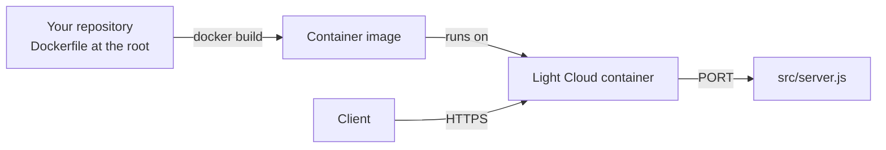

<p align="center">
  
</p>

<h1 align="center">Dockerfile Boilerplate</h1>

<p align="center">
  A custom Dockerfile for any runtime, ready to deploy on Light Cloud.
</p>

<p align="center">
  <a href="https://console.light-cloud.com/new?repo=https://github.com/light-cloud-com/starter-dockerfile"></a>
</p>

---

## Features

- Bring your own Dockerfile — any language, any runtime
- A small, dependency-free Node.js server included as a working example, ready to replace
- Runs as the image's unprivileged `node` user and shuts down cleanly on `SIGTERM`
- Tests with the built-in Node test runner
- Listens on `$PORT`, which is what Cloud Run sends traffic to
- Docker-ready for Cloud Run

## How it works



Light Cloud builds the `Dockerfile` at the root of the repository exactly as it is, then runs the image and sends traffic to `$PORT`.

## API Endpoints

| Method | Endpoint | Description |
|--------|----------|-------------|
| GET | `/` | Welcome message |
| GET | `/health` | Health check with uptime |

## Project structure

```text
.
├── Dockerfile              # How the image is built and started
├── .dockerignore           # Files kept out of the image
├── src/
│   ├── server.js           # Starts the HTTP server, shuts down on SIGTERM
│   ├── app.js              # Request handler: / and /health
│   └── config.js           # Settings read from the environment
├── test/
│   └── app.test.js         # node:test tests against the handler
└── .env.example            # Environment variables the app reads
```

## Local Development

```bash
# Build the image
docker build -t my-app .

# Run it
docker run -p 8080:8080 -e PORT=8080 my-app

# Run the tests (Node.js 22 or newer)
node --test
```

Replace `src/` and the `Dockerfile` with your own — the only requirement is
that the container listens on `$PORT`.

## Deploy to Light Cloud

### 1. Create an Account

Visit [console.light-cloud.com](https://console.light-cloud.com) and sign up with GitHub or Google.

### 2. Create New Application

1. Click **"New Application"** in the dashboard
2. Select **"Container"** as the deployment type
3. Choose **"Dockerfile"** as the runtime

### 3. Connect Repository

- **Option A:** Fork this repository and connect it via GitHub
- **Option B:** Push this code to your own GitHub repository and connect it

### 4. Configure Settings

Light Cloud will auto-detect your settings, but you can verify:

| Setting | Value |
|---------|-------|
| Port | `8080` |
| Dockerfile | Auto-detected |

### 5. Deploy

Click **"Deploy"** and your container will be live in minutes!

Your container will be available at `https://your-app.light-cloud.io`

## Learn More

- [Dockerfile reference](https://docs.docker.com/reference/dockerfile/)
- [Docker documentation](https://docs.docker.com)
- [Light Cloud documentation](https://docs.light-cloud.com)

---

<p align="center">
  <a href="https://light-cloud.com">Website</a> •
  <a href="https://docs.light-cloud.com">Documentation</a> •
  <a href="https://console.light-cloud.com">Console</a>
</p>

<p align="center">
  Made with ☁️ by <a href="https://light-cloud.com">Light Cloud</a>
</p>
