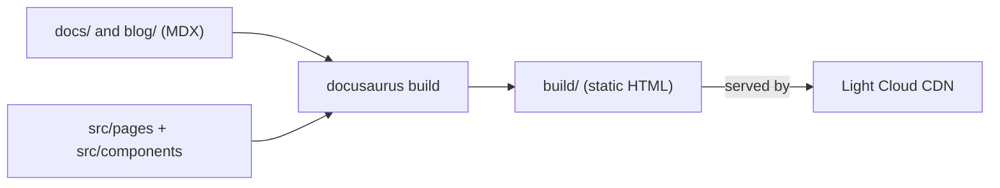

<p align="center">
  
</p>

<h1 align="center">Docusaurus Boilerplate</h1>

<p align="center">
  A Docusaurus documentation site, ready to deploy on Light Cloud.
</p>

<p align="center">
  <a href="https://www.light-cloud.com/templates/starter-docusaurus"></a>
</p>

---

## Features

- Docusaurus 3, scaffolded with `create-docusaurus` (TypeScript)
- Docs with a generated sidebar, a blog with authors and tags, and a custom React home page
- MDX: write Markdown, embed React components
- Versioning and translations built in
- Faster builds with `@docusaurus/faster`

## How it works



## Project structure

```text
.
├── blog/                   # Blog posts, authors.yml, tags.yml
├── docs/                   # Documentation pages (MDX), grouped by folder
├── src/
│   ├── components/         # React components used by pages
│   ├── css/custom.css      # Theme overrides
│   └── pages/              # Standalone pages, e.g. the home page
├── static/                 # Images and files copied as is
├── docusaurus.config.ts    # Site title, navbar, footer, presets
└── sidebars.ts             # Docs sidebar
```

## Local development

```bash
npm install         # install dependencies
npm start           # dev server on http://localhost:3000
npm run typecheck   # TypeScript check
npm run build       # static build into build/
npm run serve       # serve the build locally
```

Before you publish, set `title`, `url` and the navbar and footer links in `docusaurus.config.ts`.

## Deploy to Light Cloud

### 1. Create an Account

Visit [console.light-cloud.com](https://console.light-cloud.com) and sign up with GitHub or Google.

### 2. Create New Application

1. Click **"New Application"** in the dashboard
2. Select **"Static Site"** as the deployment type
3. Choose **"Docusaurus"** as the framework

### 3. Connect Repository

- **Option A:** Fork this repository and connect it via GitHub
- **Option B:** Push this code to your own GitHub repository and connect it

### 4. Configure Build Settings

Light Cloud will auto-detect your settings, but you can verify:

| Setting | Value |
|---------|-------|
| Build Command | `npm run build` |
| Output Directory | `build` |

### 5. Deploy

Click **"Deploy"** and your site will be live in seconds!

Your site will be available at `https://your-app.light-cloud.io`

## Learn More

This starter is the output of `npx create-docusaurus@latest`, with only the changes noted above.

- [Docusaurus documentation](https://docusaurus.io/docs)
- [Light Cloud documentation](https://docs.light-cloud.com)

## License

[MIT](./LICENSE)

---

<p align="center">
  <a href="https://light-cloud.com">Website</a> •
  <a href="https://docs.light-cloud.com">Documentation</a> •
  <a href="https://console.light-cloud.com">Console</a>
</p>

<p align="center">
  Made with ☁️ by <a href="https://light-cloud.com">Light Cloud</a>
</p>
