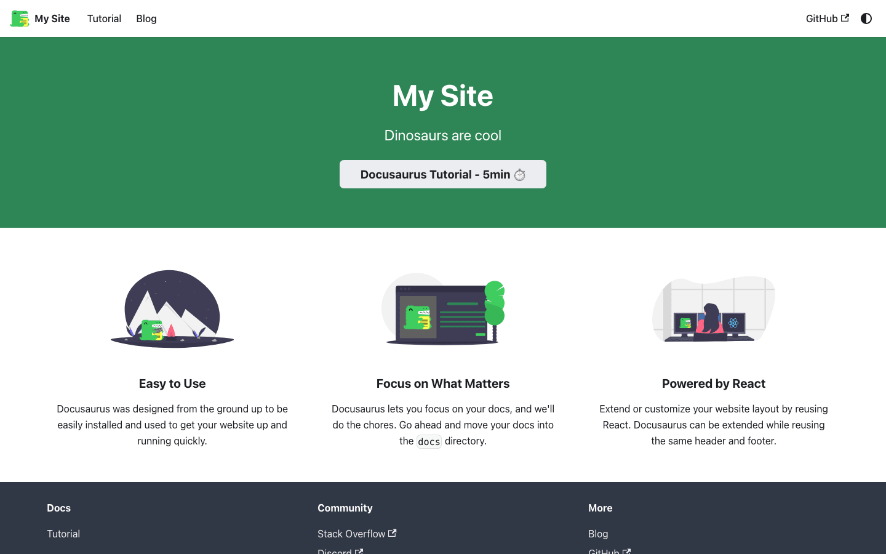
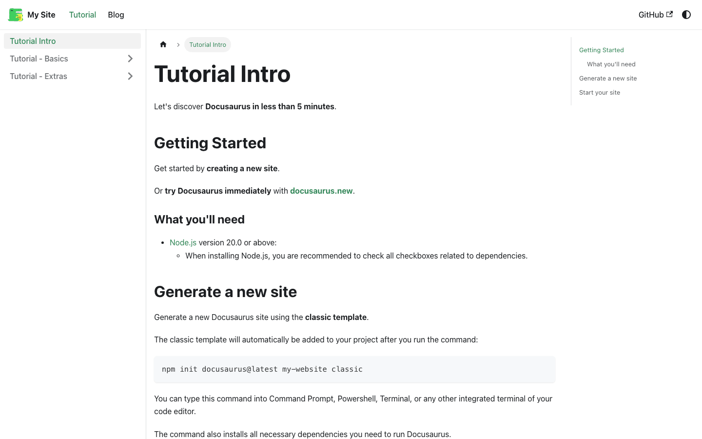
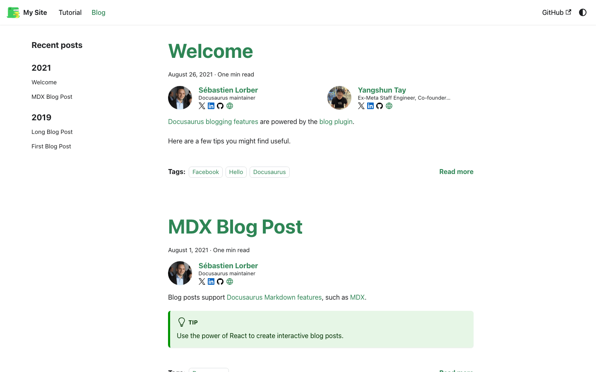
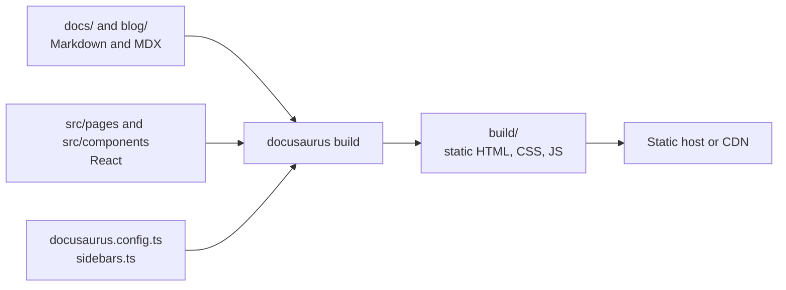

# Docusaurus Documentation Site Starter

[](LICENSE) [](https://docusaurus.io) [](https://react.dev) [](https://nodejs.org) [](https://www.typescriptlang.org) [](https://github.com/light-cloud-templates/docusaurus-docs-starter/generate) [](https://www.light-cloud.com/templates/docusaurus-docs-starter)

A Docusaurus 3 documentation site starter with React 19 and TypeScript, built into static HTML with docs, a blog, a custom home page and light and dark themes. It is the standard `create-docusaurus` classic TypeScript site, for teams who want a documentation website or knowledge base written in Markdown and MDX, with a generated sidebar, versioning and translations available. It deploys to any static host, and to Light Cloud in one click on the Free plan.

## Screenshot

<picture><source media="(prefers-color-scheme: dark)" srcset="docs/screenshots/home-dark.png"></picture>
<picture><source media="(prefers-color-scheme: dark)" srcset="docs/screenshots/docs-dark.png"></picture>
<picture><source media="(prefers-color-scheme: dark)" srcset="docs/screenshots/blog-dark.png"></picture>

## Features

- Docusaurus 3.10 with the classic preset: docs, blog, pages and theme
- Docs in `docs/` with a sidebar generated from the folder structure, in two categories
- A blog in `blog/` with authors (`authors.yml`), tags (`tags.yml`), reading time and RSS and Atom feeds
- A custom React home page in `src/pages/index.tsx` and a standalone Markdown page
- MDX: Markdown with React components in it
- Light and dark mode that follows the system setting, with a toggle in the navbar
- The Docusaurus v4 future flags turned on, which include Docusaurus Faster (Rspack builds, `@docusaurus/faster`)
- `onBrokenLinks: 'throw'`: the build fails on a broken internal link
- TypeScript config, sidebars and pages, checked with `npm run typecheck`

## Quick start

You need Node.js 20 or later and npm.

```bash
git clone https://github.com/light-cloud-templates/docusaurus-docs-starter.git
cd docusaurus-docs-starter
npm install
npm start
```

Open <http://localhost:3000>. The dev server reloads when you edit a page.

Other ways to start:

- **Use this template**: press [Use this template](https://github.com/light-cloud-templates/docusaurus-docs-starter/generate) to create your own repository from this one.
- **Deploy to Light Cloud**: open the [template page](https://www.light-cloud.com/templates/docusaurus-docs-starter) and press Deploy to get a running copy.

Before you publish, set `title`, `tagline`, `url`, the navbar and footer links, and the `editUrl` values in `docusaurus.config.ts`. They still point at the Docusaurus defaults.

## Deploy

### Deploy to Light Cloud

[](https://www.light-cloud.com/templates/docusaurus-docs-starter)

The Deploy button copies this template into your GitHub account and creates a static site: Light Cloud runs `npm run build` and serves the `build` folder from a CDN.

There are no secrets to fill in. Every push to the default branch deploys again. Static sites run on the Free plan.

### Deploy anywhere else

This is a standard Docusaurus site with no Light Cloud code in it. Run `npm run build` and upload `build/` to any static file host. If the site is served from a sub-path, set `baseUrl` in `docusaurus.config.ts` first. The `npm run deploy` script is Docusaurus's own GitHub Pages deploy.

## Project structure

```text
.
├── blog/                         # blog posts (MDX), authors.yml, tags.yml
├── docs/
│   ├── intro.mdx                 # /docs/intro
│   ├── tutorial-basics/          # pages, docs, blog posts, Markdown, deploying
│   └── tutorial-extras/          # versioning and translations
├── src/
│   ├── components/HomepageFeatures/  # the three feature columns on the home page
│   ├── css/custom.css            # theme colour overrides
│   └── pages/
│       ├── index.tsx             # home page (/)
│       └── markdown-page.mdx     # /markdown-page
├── static/                       # images and files copied as is
├── docusaurus.config.ts          # title, URL, presets, navbar, footer
├── sidebars.ts                   # docs sidebar, generated from docs/
└── tsconfig.json                 # for the editor and npm run typecheck
```

## Pages

| Path | Source | What it shows |
| --- | --- | --- |
| `/` | `src/pages/index.tsx` | Hero banner and feature columns |
| `/docs/intro` | `docs/intro.mdx` | First docs page; the sidebar lists the rest of `docs/` |
| `/blog` | `blog/` | Blog index, with pages per post, author and tag |
| `/markdown-page` | `src/pages/markdown-page.mdx` | A standalone page written in Markdown |

## Environment variables

There are none. Site settings live in `docusaurus.config.ts`.

## Testing

There are no tests. Type check and build, which also fails on broken internal links:

```bash
npm run typecheck
npm run build
npm run serve     # serve the build locally on http://localhost:3000
```

## How it works



`docusaurus build` renders every docs page, blog post and page to static HTML, then React hydrates it in the browser so navigation between pages is client-side. No server is needed after the build.

## FAQ

### How do I add a page to the Docusaurus docs?

Create a `.md` or `.mdx` file in `docs/`. The sidebar is generated from the folder, so the page appears on its own; set `sidebar_position` in the front matter to order it, and use a `_category_.json` file to label a folder.

### How do I add a blog post in Docusaurus?

Create a file in `blog/` named `YYYY-MM-DD-slug.mdx` with a `title`, `authors` and `tags` in the front matter. Authors and tags are defined in `blog/authors.yml` and `blog/tags.yml`.

### How do I change the site title, URL and edit links?

Edit `docusaurus.config.ts`: `title`, `tagline` and `url` at the top, `navbar` and `footer` under `themeConfig`, and `editUrl` under the docs and blog presets (remove `editUrl` to hide the "Edit this page" links).

### Does this Docusaurus template have search?

No search is configured. Add Algolia DocSearch through `themeConfig.algolia`, or a local search plugin, in `docusaurus.config.ts`.

### Can I deploy it without Light Cloud?

Yes. `npm run build` writes plain files to `build/`, which any static host serves.

## Related templates

- [eleventy-blog-starter](https://github.com/light-cloud-templates/eleventy-blog-starter): a static blog built with Eleventy
- [astro-blog-starter](https://github.com/light-cloud-templates/astro-blog-starter): a static blog built with Astro
- [react-vite-starter](https://github.com/light-cloud-templates/react-vite-starter): a React single-page app served as static files
- [static-html-website-starter](https://github.com/light-cloud-templates/static-html-website-starter): a plain HTML and CSS site with no build step

## Licence

MIT, see [LICENSE](LICENSE). The sample docs, blog posts and images come from the Docusaurus `create-docusaurus` template (MIT, Meta Platforms).

---

Maintained by [Light Cloud](https://light-cloud.com): deploy apps, APIs and databases in one click.
