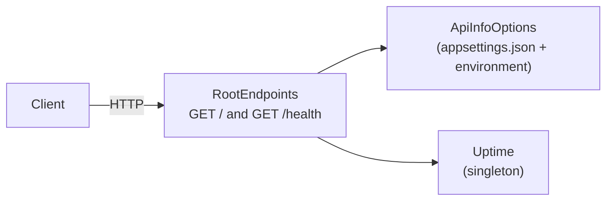

<p align="center">
  
</p>

<h1 align="center">.NET API Boilerplate</h1>

<p align="center">
  A modern ASP.NET Core minimal API, ready to deploy on Light Cloud.
</p>

<p align="center">
  <a href="https://console.light-cloud.com/new?repo=https://github.com/light-cloud-com/starter-dotnet"></a>
</p>

---

## Features

- ASP.NET Core minimal APIs on .NET 8
- Endpoints grouped in extension classes, services registered in DI, `Program.cs` kept short
- Settings through the options pattern (`appsettings.json`, overridable by environment variables)
- xUnit tests that run the app in memory with `WebApplicationFactory`
- CORS enabled
- Docker-ready for Cloud Run

## How it works



## API Endpoints

| Method | Endpoint | Description |
|--------|----------|-------------|
| GET | `/` | Welcome message and API info |
| GET | `/health` | Health check with uptime |

## Project structure

```
.
├── DotnetApi.csproj        web project (the Dockerfile publishes this one)
├── DotnetApi.sln           solution: web project + tests
├── Program.cs              services, middleware, endpoint mapping
├── appsettings.json        logging and the "Api" section
├── Dockerfile
├── Endpoints/RootEndpoints.cs
├── Services/               ApiInfoOptions, Uptime
├── Properties/launchSettings.json
└── tests/DotnetApi.Tests/  xUnit + WebApplicationFactory
```

The web project stays at the root so `dotnet run` works there; its `DefaultItemExcludes` keeps `tests/` out of it.

## Local Development

```bash
# Run the application
dotnet run

# Run the tests
dotnet test

# Build for release (what the Dockerfile does)
dotnet publish DotnetApi.csproj -c Release
```

The API will be available at `http://localhost:8080`. `.env.example` lists the settings you can override.

## Deploy to Light Cloud

### 1. Create an Account

Visit [console.light-cloud.com](https://console.light-cloud.com) and sign up with GitHub or Google.

### 2. Create New Application

1. Click **"New Application"** in the dashboard
2. Select **"Container"** as the deployment type
3. Choose **".NET"** as the runtime

### 3. Connect Repository

- **Option A:** Fork this repository and connect it via GitHub
- **Option B:** Push this code to your own GitHub repository and connect it

### 4. Configure Settings

Light Cloud will auto-detect your settings, but you can verify:

| Setting | Value |
|---------|-------|
| Port | `8080` |
| Dockerfile | Auto-detected |

### 5. Deploy

Click **"Deploy"** and your API will be live in minutes!

Your API will be available at `https://your-app.light-cloud.io`

## Learn More

- [ASP.NET Core documentation](https://learn.microsoft.com/aspnet/core)
- [Minimal APIs overview](https://learn.microsoft.com/aspnet/core/fundamentals/minimal-apis)
- [Light Cloud documentation](https://docs.light-cloud.com)

---

<p align="center">
  <a href="https://light-cloud.com">Website</a> •
  <a href="https://docs.light-cloud.com">Documentation</a> •
  <a href="https://console.light-cloud.com">Console</a>
</p>

<p align="center">
  Made with ☁️ by <a href="https://light-cloud.com">Light Cloud</a>
</p>
