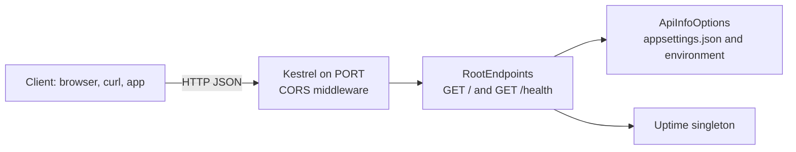

# ASP.NET Core Minimal API Starter (.NET 8, C#)

[](LICENSE) [](https://dotnet.microsoft.com/apps/aspnet) [](https://dotnet.microsoft.com) [](tests) [](https://github.com/light-cloud-templates/aspnet-core-api-starter/generate) [](https://www.light-cloud.com/templates/aspnet-core-api-starter)

An ASP.NET Core minimal API starter in C# on .NET 8, with a two-stage Dockerfile. It is a small, tested REST API boilerplate for .NET developers who want a working web service with endpoints grouped in extension classes, the options pattern for settings, dependency injection, CORS and a health check, ready to rename and extend. It runs with `dotnet run` locally or as a container anywhere Docker runs, and deploys to Light Cloud in one click.

## Features

- ASP.NET Core minimal APIs on .NET 8, with a short `Program.cs`
- Endpoints grouped in an extension class (`MapRootEndpoints`), services registered in DI
- Settings through the options pattern: the `Api` section of `appsettings.json`, overridable by environment variables such as `Api__Message`
- `GET /health` with a timestamp and uptime, counted from app start by a singleton `Uptime` service
- CORS open to any origin, method and header, so a browser frontend on another domain can call it
- Listens on `0.0.0.0` and the port in `PORT`, with `8080` as the fallback
- xUnit tests that run the real app in memory with `WebApplicationFactory`
- Two-stage `Dockerfile`: the .NET 8 SDK image builds, the smaller ASP.NET runtime image runs

## Quick start

You need the .NET 8 SDK.

```bash
git clone https://github.com/light-cloud-templates/aspnet-core-api-starter.git
cd aspnet-core-api-starter
dotnet run
```

Open <http://localhost:8080> to see the API info. `dotnet run` uses the `http` profile in `Properties/launchSettings.json`, which sets `PORT=8080` and the `Development` environment.

Other ways to start:

- **Use this template**: press [Use this template](https://github.com/light-cloud-templates/aspnet-core-api-starter/generate) to create your own repository from this one.
- **Deploy to Light Cloud**: open the [template page](https://www.light-cloud.com/templates/aspnet-core-api-starter) and press Deploy to get a running copy.

## Deploy

### Deploy to Light Cloud

[](https://www.light-cloud.com/templates/aspnet-core-api-starter)

The Deploy button copies this template into your GitHub account and creates a server app: Light Cloud builds the `Dockerfile` and runs the image as a container that listens on the port in `PORT`.

There are no secrets to fill in. Every push to the default branch deploys again. The Free plan includes up to 3 server apps.

### Deploy anywhere else

This is a standard ASP.NET Core app with no Light Cloud code in it. Any host that runs Docker runs the image:

```bash
docker build -t aspnet-core-api-starter .
docker run -p 8080:8080 aspnet-core-api-starter
```

Without Docker, publish it and run the DLL on any host with the ASP.NET Core 8 runtime:

```bash
dotnet publish DotnetApi.csproj -c Release -o out
dotnet out/DotnetApi.dll
```

## Project structure

```text
.
├── Program.cs                     # services, CORS, port, endpoint mapping
├── Endpoints/
│   └── RootEndpoints.cs           # GET / and GET /health
├── Services/
│   ├── ApiInfoOptions.cs          # the "Api" settings section
│   └── Uptime.cs                  # how long the app has been running
├── Properties/
│   └── launchSettings.json        # dotnet run profile: PORT=8080, Development
├── appsettings.json               # logging and the "Api" section
├── appsettings.Development.json   # logging in Development
├── tests/
│   └── DotnetApi.Tests/           # xUnit with WebApplicationFactory
├── DotnetApi.csproj               # web project, net8.0
├── DotnetApi.sln                  # solution: web project and tests
├── Dockerfile                     # SDK image builds, ASP.NET image runs
├── .mcp.json                      # Light Cloud MCP server for AI coding agents
└── .env.example                   # PORT and the Api__ overrides
```

The web project stays at the root so `dotnet run` works there; `DefaultItemExcludes` in the `.csproj` keeps `tests/` out of it.

## API endpoints

| Method | Path | Description |
| --- | --- | --- |
| `GET` | `/` | API info: `message`, `version` and the list of endpoints |
| `GET` | `/health` | `{"status": "healthy", "timestamp": "...", "uptime": 12.3}`, uptime in seconds |

Unknown routes answer `404`.

```bash
curl http://localhost:8080/health
```

On Light Cloud, use your app's URL instead of `http://localhost:8080`.

## Environment variables

| Name | Required | Default | What it does |
| --- | --- | --- | --- |
| `PORT` | No | `8080` | Port to listen on. Set by Light Cloud. |
| `Api__Message` | No | `Welcome to your .NET API` | `message` returned by `GET /`. |
| `Api__Version` | No | `1.0.0` | `version` returned by `GET /`. |
| `ASPNETCORE_ENVIRONMENT` | No | `Production` | `Development` when started with `dotnet run`. |

Any value in `appsettings.json` can be overridden the same way, with `__` between section and key.

## Testing

```bash
dotnet test
```

The tests start the app in memory with `WebApplicationFactory<Program>`, so nothing listens on a port. They check `GET /`, `GET /health` and a `404` for an unknown route.

## How it works



`Program.cs` binds Kestrel to the port in `PORT`, registers the options and the `Uptime` singleton, and maps the endpoints. Minimal API handlers get their dependencies as parameters and return anonymous objects, which ASP.NET Core writes as JSON.

## FAQ

### How do I add a new endpoint to an ASP.NET Core minimal API?

Add a static class in `Endpoints/` with a `Map...Endpoints` extension method, as in `RootEndpoints.cs`, and call it from `Program.cs` next to `app.MapRootEndpoints()`.

### How do I add Swagger or OpenAPI docs?

It has none yet. On .NET 8, add the `Swashbuckle.AspNetCore` package, call `builder.Services.AddEndpointsApiExplorer()` and `builder.Services.AddSwaggerGen()`, then `app.UseSwagger()` and `app.UseSwaggerUI()`; Swagger UI is then at `/swagger`.

### How do I change settings with environment variables in .NET?

Use the setting's path with double underscores: `Api__Message="Hello" dotnet run` overrides `Api:Message` from `appsettings.json`. Environment variables win over the JSON files.

### How do I restrict CORS to my own frontend?

Replace `AllowAnyOrigin()` in `Program.cs` with `WithOrigins("https://your-frontend.example")`.

### Can I deploy it without Light Cloud?

Yes. It is a plain ASP.NET Core app with a standard `Dockerfile`: run the image on any container host, or `dotnet publish` it and run `dotnet DotnetApi.dll` on a server with the .NET 8 runtime.

## Related templates

- [aspnet-core-postgresql-crud-api](https://github.com/light-cloud-templates/aspnet-core-postgresql-crud-api): ASP.NET Core with a PostgreSQL CRUD API
- [spring-boot-api-starter](https://github.com/light-cloud-templates/spring-boot-api-starter): the same kind of API in Java and Spring Boot
- [go-api-starter](https://github.com/light-cloud-templates/go-api-starter): a REST API in Go with the standard library
- [dockerfile-starter](https://github.com/light-cloud-templates/dockerfile-starter): bring your own Dockerfile for any runtime

## Licence

MIT, see [LICENSE](LICENSE).

---

Maintained by [Light Cloud](https://light-cloud.com): deploy apps, APIs and databases in one click.
