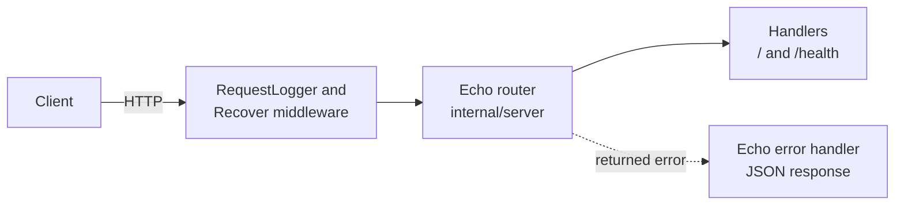

# Echo API Starter for Go

[](LICENSE) [](https://echo.labstack.com) [](https://go.dev) [](internal/server) [](https://github.com/light-cloud-templates/echo-api-starter/generate) [](https://www.light-cloud.com/templates/echo-api-starter)

An Echo API starter for Go 1.25, built on Echo v4.15, with a JSON root route, a health check, structured request logs and graceful shutdown. It is a small, tested boilerplate for Go developers who want Echo's router, handlers that return errors, and its built-in middleware in a clean layout (`main.go` plus `internal/config` and `internal/server`), ready to add routes to. It compiles to one static binary, and deploys to Light Cloud in one click.

## Features

- Echo v4.15 with the start banner and port line turned off
- `GET /` answers `{"message": "Hello from Echo on Light Cloud"}`
- `GET /health` answers `{"status": "ok"}`
- Echo's `RequestLogger` middleware writes one `log/slog` JSON line per request, with the real status of errors
- Echo's `Recover` middleware turns a panic into a `500`
- Unknown routes answer Echo's JSON `404`
- Graceful shutdown on `SIGTERM` through `e.Shutdown`, with a 10 second drain
- `ReadHeaderTimeout` of 10 seconds on the server
- Table-driven route tests with `net/http/httptest`
- Listens on `PORT`, default `8080`

## Quick start

You need Go 1.25 or newer.

```bash
git clone https://github.com/light-cloud-templates/echo-api-starter.git
cd echo-api-starter
cp .env.example .env
make run
```

`make run` loads `.env` when it exists and runs `go run .`. Open <http://localhost:8080> to see the JSON greeting.

Other ways to start:

- **Use this template**: press [Use this template](https://github.com/light-cloud-templates/echo-api-starter/generate) to create your own repository from this one.
- **Deploy to Light Cloud**: open the [template page](https://www.light-cloud.com/templates/echo-api-starter) and press Deploy to get a running copy.

## Deploy

### Deploy to Light Cloud

[](https://www.light-cloud.com/templates/echo-api-starter)

The Deploy button copies this template into your GitHub account and creates a server app: Light Cloud builds the Go module and runs it as a container that listens on `PORT`. There are no secrets to fill in, and every push to the default branch deploys again. The Free plan includes up to 3 server apps.

### Deploy anywhere else

There is no Light Cloud code in the app. `make build` runs `CGO_ENABLED=0 go build -trimpath -o bin/server .` and writes a static binary; start `./bin/server` with `PORT` set on any server, or copy it into a minimal container image.

## Project structure

```text
.
├── main.go                  # entry point: config, logger, e.Start, graceful shutdown
├── internal/
│   ├── config/config.go     # reads PORT
│   └── server/
│       ├── server.go        # echo.New(), middleware and routes
│       ├── handlers.go      # GET / and GET /health
│       ├── middleware.go    # RequestLogger to slog
│       └── server_test.go   # table-driven route tests
├── Makefile                 # make run, make test, make build
├── .env.example             # PORT, for local runs
└── go.mod                   # Go 1.25, Echo v4.15
```

## API endpoints

| Method | Path | Description |
| --- | --- | --- |
| `GET` | `/` | `{"message": "Hello from Echo on Light Cloud"}` |
| `GET` | `/health` | `{"status": "ok"}` |

```bash
curl http://localhost:8080/health
```

On Light Cloud, use your app's URL instead of `http://localhost:8080`.

## Environment variables

| Name | Required | Default | What it does |
| --- | --- | --- | --- |
| `PORT` | No | `8080` | Port to listen on. Set by Light Cloud. |

## Testing

```bash
make test
```

`make test` runs `go vet ./...` and `go test ./...`. The tests send requests to the Echo instance with `httptest`, so no server needs to be running.

## How it works



Echo handlers return an `error`; Echo's error handler turns it into a JSON response, and the logger records the final status. `main.go` runs `e.Start` until Light Cloud (or Ctrl+C) sends a stop signal, then calls `e.Shutdown` so open requests finish.

## FAQ

### How do I add a new route in Echo?

Write a handler `func(c echo.Context) error` in `internal/server/handlers.go` and register it in `server.New`, for example `e.GET("/items/:id", getItem)`. Read the path value with `c.Param("id")` and answer with `return c.JSON(http.StatusOK, item)`.

### How do I return an error with a status code in Echo?

Return `echo.NewHTTPError(http.StatusNotFound, "item not found")` from the handler. Echo's default error handler sends it as JSON with that status.

### How do I add CORS or other middleware?

Echo ships middleware in `github.com/labstack/echo/v4/middleware`, which this template already imports. Add it in `server.New`, for example `e.Use(middleware.CORS())`.

### Can I deploy it without Light Cloud?

Yes. It is a plain Go module: build it with `make build` and run `./bin/server` with `PORT` set on any server or container platform.

### How do I add a PostgreSQL database?

This starter has no database. The [gin-postgresql-crud-api](https://github.com/light-cloud-templates/gin-postgresql-crud-api) template shows a Go app wired to PostgreSQL with pgx, reading the `DB_HOST`, `DB_NAME`, `DB_USER` and `DB_PASSWORD` variables that Light Cloud sets when an app has a database.

## Related templates

- [go-api-starter](https://github.com/light-cloud-templates/go-api-starter): the same kind of starter on the standard library only
- [gin-api-starter](https://github.com/light-cloud-templates/gin-api-starter): the same kind of starter on Gin
- [fiber-api-starter](https://github.com/light-cloud-templates/fiber-api-starter): the same kind of starter on Fiber
- [gin-postgresql-crud-api](https://github.com/light-cloud-templates/gin-postgresql-crud-api): a Go CRUD API with PostgreSQL

## Licence

MIT, see [LICENSE](LICENSE).

---

Maintained by [Light Cloud](https://light-cloud.com): deploy apps, APIs and databases in one click.
