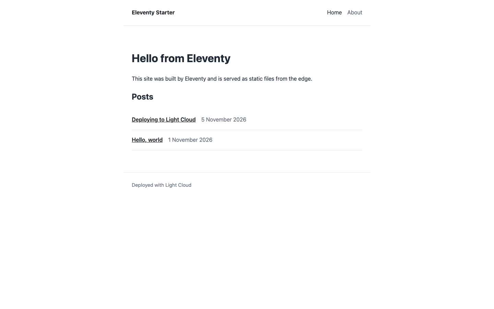
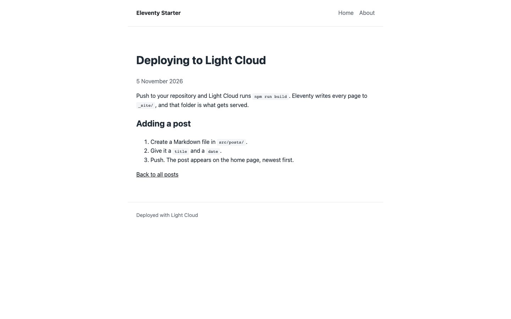
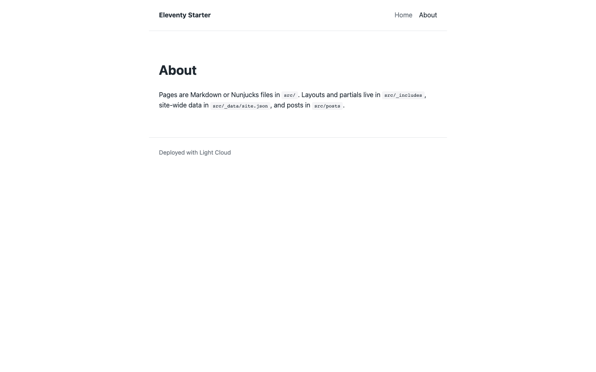
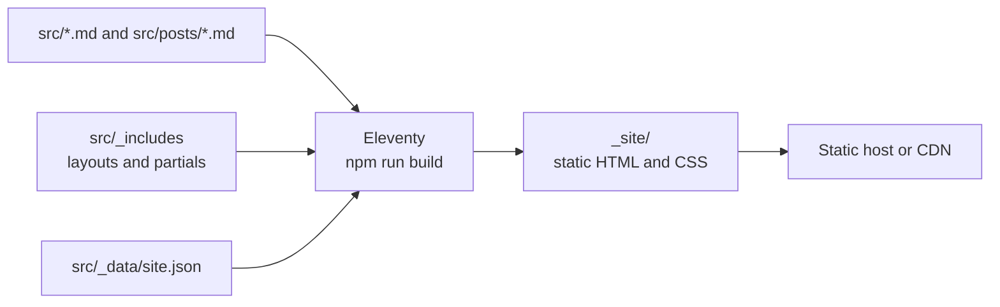

# Eleventy Blog Starter

[](LICENSE) [](https://www.11ty.dev) [](https://mozilla.github.io/nunjucks/) [](https://github.com/light-cloud-templates/eleventy-blog-starter/generate) [](https://www.light-cloud.com/templates/eleventy-blog-starter)

An Eleventy 3 blog starter that builds Markdown posts and Nunjucks layouts into plain static HTML, with no client-side JavaScript. It is a small static site generator boilerplate for developers and writers who want a content-first site with a post list, post pages, an about page and site-wide data, ready to rename and write in. It deploys to any static host, and to Light Cloud in one click on the Free plan.

## Screenshot





## Features

- Eleventy 3.1 with an ESM config file, `eleventy.config.js`
- Markdown and Nunjucks content, with a base layout, a post layout and header and footer partials
- A `posts` collection set up by directory data (`src/posts/posts.json`): every Markdown file in the folder gets the post layout, the `posts` tag and a `/posts/<file name>/` URL
- The home page lists posts newest first, with readable dates from two small filters (`readableDate`, `isoDate`)
- Site title and description in `src/_data/site.json`, used in the header and the `<title>` and description tags
- CSS in `src/assets` copied to the output as is
- Builds `src/` to `_site/`, with no client-side JavaScript
- Two sample posts and an about page

## Quick start

You need Node.js 18 or later and npm.

```bash
git clone https://github.com/light-cloud-templates/eleventy-blog-starter.git
cd eleventy-blog-starter
npm install
npm run dev
```

Open <http://localhost:8080>. Eleventy rebuilds and reloads the page when you save a file in `src/`.

Other ways to start:

- **Use this template**: press [Use this template](https://github.com/light-cloud-templates/eleventy-blog-starter/generate) to create your own repository from this one.
- **Deploy to Light Cloud**: open the [template page](https://www.light-cloud.com/templates/eleventy-blog-starter) and press Deploy to get a running copy.

## Deploy

### Deploy to Light Cloud

[](https://www.light-cloud.com/templates/eleventy-blog-starter)

The Deploy button copies this template into your GitHub account and creates a static site: Light Cloud runs `npm run build` and serves the `_site` folder from a CDN.

There are no secrets to fill in. Every push to the default branch deploys again. Static sites run on the Free plan.

### Deploy anywhere else

This is a standard Eleventy project with no Light Cloud code in it. Run `npm run build` and upload `_site/` to any static file host, or point the host's build settings at `npm run build` with `_site` as the output folder.

## Project structure

```text
.
├── eleventy.config.js        # input and output folders, passthrough copy, date filters
├── package.json              # build and dev scripts
└── src/
    ├── _data/site.json       # site title and description
    ├── _includes/
    │   ├── layouts/
    │   │   ├── base.njk      # HTML document, header, footer
    │   │   └── post.njk      # post title, date, content
    │   └── partials/
    │       ├── header.njk    # site name and navigation
    │       └── footer.njk
    ├── assets/css/main.css   # copied to _site/assets as is
    ├── posts/
    │   ├── posts.json        # layout, tag and URL for every post in the folder
    │   ├── hello-world.md
    │   └── deploying-to-light-cloud.md
    ├── index.njk             # home page with the post list
    └── about.md              # /about/
```

## Pages

| Path | Source | What it shows |
| --- | --- | --- |
| `/` | `src/index.njk` | Welcome text and the list of posts, newest first |
| `/about/` | `src/about.md` | Where pages, layouts, data and posts live |
| `/posts/<file name>/` | `src/posts/*.md` | One page per post, for example `/posts/hello-world/` |

## Environment variables

There are none. The site title and description live in `src/_data/site.json`.

## Testing

There are no tests. The build is the check: it fails on a template error or a missing layout.

```bash
npm run build
```

## How it works



Eleventy reads every Markdown and Nunjucks file in `src/`, wraps it in its layout, and writes one HTML file per page to `_site/`. Nothing runs on a server after the build.

## FAQ

### How do I add a blog post in Eleventy?

Create a Markdown file in `src/posts/` with a `title`, a `date` and, optionally, a `description` in the front matter. `posts.json` gives it the post layout and a URL, and it appears on the home page.

### How do I add a page?

Create a Markdown or Nunjucks file in `src/` with `layout: layouts/base.njk` and a `permalink`, as in `src/about.md`. Add the link to `src/_includes/partials/header.njk`.

### How do I change the site title?

Edit `src/_data/site.json`. The title is used in the header and in every page's `<title>`.

### Does the site ship any JavaScript?

No. The output is HTML and one CSS file. Add a script to `src/assets` and a `<script>` tag in `base.njk` if you need one.

### Can I deploy it without Light Cloud?

Yes. `npm run build` writes plain files to `_site/`, which any static host serves.

## Related templates

- [astro-blog-starter](https://github.com/light-cloud-templates/astro-blog-starter): a static blog built with Astro
- [docusaurus-docs-starter](https://github.com/light-cloud-templates/docusaurus-docs-starter): a static documentation site with a blog
- [static-html-website-starter](https://github.com/light-cloud-templates/static-html-website-starter): a plain HTML and CSS site with no build step

## Licence

MIT, see [LICENSE](LICENSE).

---

Maintained by [Light Cloud](https://light-cloud.com): deploy apps, APIs and databases in one click.
