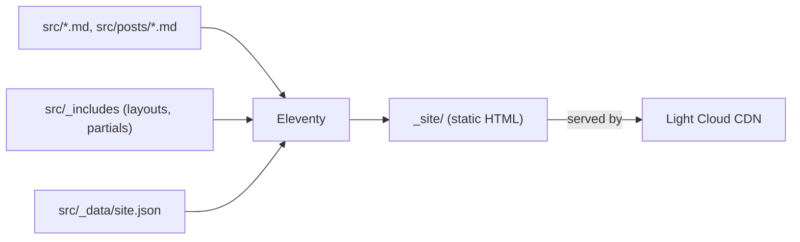

<p align="center">
  
</p>

<h1 align="center">Eleventy Boilerplate</h1>

<p align="center">
  An Eleventy static site generator project, ready to deploy on Light Cloud.
</p>

<p align="center">
  <a href="https://console.light-cloud.com/new?repo=https://github.com/light-cloud-com/starter-eleventy"></a>
</p>

---

## Features

- Eleventy 3 with an ESM config (`eleventy.config.js`)
- Markdown and Nunjucks content with a base layout, a post layout and partials
- A `posts` collection set up by directory data, listed newest first on the home page
- Site-wide data in `src/_data/site.json`, CSS copied through from `src/assets`
- Builds `src` to `_site`, no client-side JavaScript

## How it works



## Project structure

```text
.
├── eleventy.config.js        # Input/output folders, passthrough copy, date filters
└── src/
    ├── _data/site.json       # Site title and description
    ├── _includes/
    │   ├── layouts/          # base.njk, post.njk
    │   └── partials/         # header.njk, footer.njk
    ├── assets/css/main.css   # Copied to _site/assets as is
    ├── posts/
    │   ├── posts.json        # Layout, tag and URL for every post in the folder
    │   └── *.md              # Posts
    ├── index.njk             # Home page with the post list
    └── about.md              # /about/
```

## Local development

```bash
npm install       # install dependencies
npm run dev       # dev server with live reload on http://localhost:8080
npm run build     # static build into _site/
```

To add a post, create a Markdown file in `src/posts/` with a `title` and a `date`.

## Deploy to Light Cloud

### 1. Create an Account

Visit [console.light-cloud.com](https://console.light-cloud.com) and sign up with GitHub or Google.

### 2. Create New Application

1. Click **"New Application"** in the dashboard
2. Select **"Static Site"** as the deployment type
3. Choose **"Eleventy"** as the framework

### 3. Connect Repository

- **Option A:** Fork this repository and connect it via GitHub
- **Option B:** Push this code to your own GitHub repository and connect it

### 4. Configure Build Settings

Light Cloud will auto-detect your settings, but you can verify:

| Setting | Value |
|---------|-------|
| Build Command | `npm run build` |
| Output Directory | `_site` |

### 5. Deploy

Click **"Deploy"** and your site will be live in seconds!

Your site will be available at `https://your-app.light-cloud.io`

## Learn More

- [Eleventy documentation](https://www.11ty.dev/docs/)
- [Light Cloud documentation](https://docs.light-cloud.com)

## License

[MIT](./LICENSE)

---

<p align="center">
  <a href="https://light-cloud.com">Website</a> •
  <a href="https://docs.light-cloud.com">Documentation</a> •
  <a href="https://console.light-cloud.com">Console</a>
</p>

<p align="center">
  Made with ☁️ by <a href="https://light-cloud.com">Light Cloud</a>
</p>
