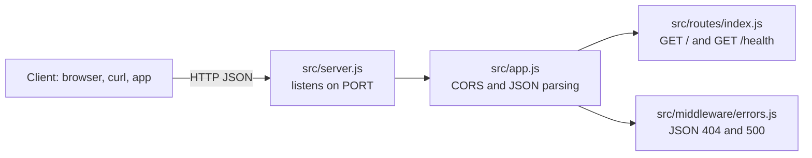

# Express REST API Starter (Node.js)

[](LICENSE) [](https://expressjs.com) [](https://nodejs.org) [](test) [](https://github.com/light-cloud-templates/express-api-starter/generate) [](https://www.light-cloud.com/templates/express-api-starter)

An Express 4 REST API starter for Node.js 22 in plain JavaScript, with CORS, JSON body parsing, a `/health` check and JSON error responses. It is a small, tested Express boilerplate for developers who want a clean API skeleton to add their own routes to, without a database or build step. It runs with `npm start` anywhere Node.js runs, and deploys to Light Cloud in one click.

## Features

- Express 4 with two routes: `GET /` lists the endpoints, `GET /health` reports status, timestamp and uptime
- CORS enabled for every origin with the `cors` middleware
- JSON body parsing with `express.json()`; a malformed JSON body answers `400` in JSON
- Unknown routes answer `404` as `{ "error": "Not found" }` instead of Express's HTML page; other errors answer `500` as JSON and are logged
- App and server in separate files, so tests use the app without a fixed port
- Graceful shutdown on `SIGTERM` and `SIGINT`: in-flight requests finish before the process exits
- Tests with the built-in Node.js test runner (`node --test`), no test dependencies
- Two runtime dependencies: `express` and `cors`
- Listens on `PORT`, defaulting to `8080`

## Quick start

You need Node.js 22 or newer.

```bash
git clone https://github.com/light-cloud-templates/express-api-starter.git
cd express-api-starter
npm install
npm run dev
```

Open <http://localhost:8080> to see the endpoint list. `npm run dev` restarts the server when a file changes (`node --watch`); `npm start` runs it without watching.

Other ways to start:

- **Use this template**: press [Use this template](https://github.com/light-cloud-templates/express-api-starter/generate) to create your own repository from this one.
- **Deploy to Light Cloud**: open the [template page](https://www.light-cloud.com/templates/express-api-starter) and press Deploy to get a running copy.

## Deploy

### Deploy to Light Cloud

[](https://www.light-cloud.com/templates/express-api-starter)

The Deploy button copies this template into your GitHub account and creates a server app that runs `npm start` in a container, listening on the port in `PORT`.

There are no secrets to fill in. Every push to the default branch deploys again. The Free plan includes up to 3 server apps.

### Deploy anywhere else

This is a standard Express app with no Light Cloud code in it. Any host that runs Node.js 22 runs it: `npm ci --omit=dev`, then `npm start` with `PORT` set. It also fits any Node.js Docker image.

## Project structure

```text
.
├── src/
│   ├── app.js              # Express app: CORS, JSON parsing, routes, error handling
│   ├── server.js           # starts the server, shuts down on SIGTERM
│   ├── config.js           # settings read from the environment
│   ├── routes/
│   │   └── index.js        # GET / and GET /health
│   └── middleware/
│       └── errors.js       # JSON 404 and error handler
├── test/
│   └── app.test.js         # node:test tests against the app
├── .env.example            # the variables the app reads
├── .mcp.json               # Light Cloud MCP server for AI coding agents
└── package.json            # scripts: start, dev, test
```

## API endpoints

| Method | Path | Description |
| --- | --- | --- |
| `GET` | `/` | Welcome message and the list of endpoints |
| `GET` | `/health` | `{ "status": "healthy", "timestamp", "uptime" }` |

Any other path answers `404` with `{ "error": "Not found" }`.

```bash
curl http://localhost:8080/health
```

On Light Cloud, use your app's URL instead of `http://localhost:8080`.

## Environment variables

| Name | Required | Default | What it does |
| --- | --- | --- | --- |
| `PORT` | No | `8080` | Port to listen on. Set by Light Cloud. |

## Testing

```bash
npm test
```

The tests start the app on a random free port and check `/`, `/health`, the JSON `404` and the JSON `400` for a malformed body. There is no linter configured.

## How it works



`src/app.js` builds the Express app and `src/server.js` starts it, so the tests can load the app on their own port. Requests pass through CORS and JSON parsing, then the routes, then the JSON error handlers.

## FAQ

### How do I add a new route in Express?

Add a handler to `src/routes/index.js`, or create a new router file in `src/routes/` and mount it in `src/app.js` with `app.use('/things', thingsRouter)` before the `notFound` handler.

### How do I restrict CORS to my own domain?

`app.use(cors())` allows every origin. Pass the origins you want instead, for example `app.use(cors({ origin: 'https://example.com' }))`.

### Does it use TypeScript?

No. It is plain CommonJS JavaScript with no build step, so `npm start` runs the source directly. For a TypeScript API, see the NestJS starter below.

### How do I add a database?

This starter has none. The [express-postgresql-crud-api](https://github.com/light-cloud-templates/express-postgresql-crud-api) template is the same layout with PostgreSQL and a full CRUD resource.

### Can I deploy it without Light Cloud?

Yes. It is a plain Express app: any host with Node.js 22 runs it with `npm start`, listening on `PORT`.

## Related templates

- [express-postgresql-crud-api](https://github.com/light-cloud-templates/express-postgresql-crud-api): Express with PostgreSQL and a CRUD resource
- [fastify-api-starter](https://github.com/light-cloud-templates/fastify-api-starter): the same starter in Fastify
- [hono-api-starter](https://github.com/light-cloud-templates/hono-api-starter): the same starter in Hono
- [nestjs-api-starter](https://github.com/light-cloud-templates/nestjs-api-starter): a TypeScript API with NestJS

## Licence

MIT, see [LICENSE](LICENSE).

---

Maintained by [Light Cloud](https://light-cloud.com): deploy apps, APIs and databases in one click.
