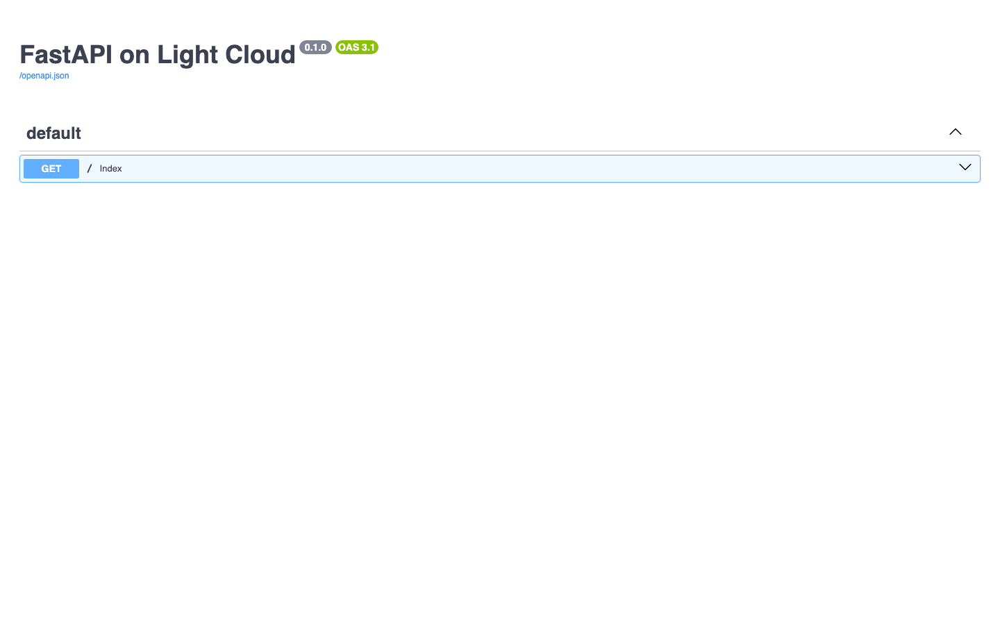
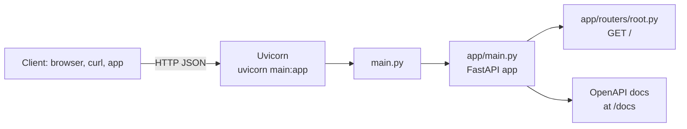

# FastAPI Starter (Python REST API)

[](LICENSE) [](https://fastapi.tiangolo.com) [](https://www.python.org) [](tests) [](https://github.com/light-cloud-templates/fastapi-starter/generate) [](https://www.light-cloud.com/templates/fastapi-starter)

A FastAPI 0.115 starter in Python 3.12, served by Uvicorn, with routes grouped in an `app` package and interactive OpenAPI docs at `/docs`. It is a minimal, tested FastAPI boilerplate for developers who want a clean Python API skeleton with pytest and ruff set up and no database. It runs with `uvicorn main:app` anywhere Python runs, and deploys to Light Cloud in one click.

## Screenshot



## Features

- FastAPI 0.115 on Uvicorn 0.30, with `GET /` answering a JSON welcome message
- Interactive OpenAPI docs: Swagger UI at `/docs`, ReDoc at `/redoc`, the schema at `/openapi.json`
- Routes grouped with `APIRouter` in `app/routers/`, included in `app/main.py`
- `main.py` entry point that works both as `uvicorn main:app` and as `python main.py`
- `python main.py` binds `0.0.0.0` and reads `PORT`, defaulting to `8000`
- Tests with pytest and FastAPI's `TestClient`, linting with ruff
- Two runtime dependencies, pinned in `requirements.txt`: `fastapi` and `uvicorn`

## Quick start

You need Python 3.12.

```bash
git clone https://github.com/light-cloud-templates/fastapi-starter.git
cd fastapi-starter
python3 -m venv .venv && . .venv/bin/activate
pip install -r requirements-dev.txt
uvicorn main:app --reload
```

Open <http://localhost:8000/docs> to try the API in the browser. `python main.py` starts the same app without reloading.

Other ways to start:

- **Use this template**: press [Use this template](https://github.com/light-cloud-templates/fastapi-starter/generate) to create your own repository from this one.
- **Deploy to Light Cloud**: open the [template page](https://www.light-cloud.com/templates/fastapi-starter) and press Deploy to get a running copy.

## Deploy

### Deploy to Light Cloud

[](https://www.light-cloud.com/templates/fastapi-starter)

The Deploy button copies this template into your GitHub account and creates a server app that installs `requirements.txt` and runs `uvicorn main:app` in a container, on the port in `PORT`.

There are no secrets to fill in. Every push to the default branch deploys again. The Free plan includes up to 3 server apps.

### Deploy anywhere else

This is a standard FastAPI app with no Light Cloud code in it. Any host that runs Python 3.12 runs it: install `requirements.txt` and start `uvicorn main:app --host 0.0.0.0 --port $PORT`.

## Project structure

```text
.
├── app/
│   ├── main.py          # creates the FastAPI app and includes the routers
│   └── routers/
│       └── root.py      # GET /
├── tests/
│   └── test_root.py     # pytest: GET / and /docs
├── main.py              # entry point: uvicorn main:app or python main.py
├── requirements.txt     # runtime dependencies (what gets installed on deploy)
├── requirements-dev.txt # adds pytest, httpx and ruff
├── pyproject.toml       # pytest and ruff settings
├── .env.example         # the variables the app reads
└── .python-version      # Python 3.12
```

## API endpoints

| Method | Path | Description |
| --- | --- | --- |
| `GET` | `/` | `{ "message": "Hello from FastAPI on Light Cloud" }` |
| `GET` | `/docs` | Swagger UI |
| `GET` | `/redoc` | ReDoc |
| `GET` | `/openapi.json` | The OpenAPI schema |

```bash
curl http://localhost:8000/
```

On Light Cloud, use your app's URL instead of `http://localhost:8000`.

## Environment variables

| Name | Required | Default | What it does |
| --- | --- | --- | --- |
| `PORT` | No | `8000` | Port to listen on. Read by `python main.py`; with `uvicorn`, pass `--port`. Set by Light Cloud. |

## Testing

With the virtual environment active and `requirements-dev.txt` installed:

```bash
pytest
ruff check .
```

The tests call `/` and `/docs` through `TestClient`, without starting a server.

## How it works



`main.py` imports the app from `app/main.py`, so Uvicorn finds it as `main:app`. FastAPI builds the OpenAPI schema and the `/docs` page from the routes and their type hints.

## FAQ

### How do I add a new endpoint in FastAPI?

Add a module in `app/routers/` with its own `router = APIRouter()`, then add `app.include_router(things.router)` in `app/main.py`. The new routes appear in `/docs` straight away.

### Where are the FastAPI docs?

FastAPI serves Swagger UI at `/docs`, ReDoc at `/redoc` and the raw schema at `/openapi.json`, on your local server and on the deployed app alike.

### How do I enable CORS in FastAPI?

CORS is not enabled. Add `CORSMiddleware` from `fastapi.middleware.cors` in `app/main.py` with `app.add_middleware(CORSMiddleware, allow_origins=["https://example.com"])`.

### How do I add a database?

This starter has none. The [fastapi-postgresql-crud-api](https://github.com/light-cloud-templates/fastapi-postgresql-crud-api) template adds PostgreSQL with psycopg 3 and a full CRUD resource.

### Can I deploy it without Light Cloud?

Yes. It is a plain FastAPI app: any host with Python 3.12 runs it with `uvicorn main:app --host 0.0.0.0 --port $PORT`.

## Related templates

- [fastapi-postgresql-crud-api](https://github.com/light-cloud-templates/fastapi-postgresql-crud-api): FastAPI with PostgreSQL and a CRUD resource
- [flask-api-starter](https://github.com/light-cloud-templates/flask-api-starter): the same starter in Flask
- [django-rest-framework-postgresql-api](https://github.com/light-cloud-templates/django-rest-framework-postgresql-api): a Python API with Django REST framework
- [express-api-starter](https://github.com/light-cloud-templates/express-api-starter): a Node.js API starter in Express

## Licence

MIT, see [LICENSE](LICENSE).

---

Maintained by [Light Cloud](https://light-cloud.com): deploy apps, APIs and databases in one click.
