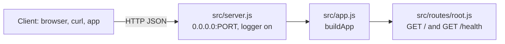

# Fastify REST API Starter (Node.js)

[](LICENSE) [](https://fastify.dev) [](https://nodejs.org) [](test) [](https://github.com/light-cloud-templates/fastify-api-starter/generate) [](https://www.light-cloud.com/templates/fastify-api-starter)

A Fastify 5 REST API starter for Node.js 22 in plain JavaScript, with structured JSON logging, a `/health` check and routes written as Fastify plugins. It is a small, tested Fastify boilerplate for developers who want a fast API skeleton with a single dependency, no database and no build step. It runs with `npm start` anywhere Node.js runs, and deploys to Light Cloud in one click.

## Features

- Fastify 5 with two routes: `GET /` lists the endpoints, `GET /health` reports status, timestamp and uptime
- Structured JSON request logs from Fastify's built-in logger (pino)
- Routes as Fastify plugins in `src/routes/`, registered in `src/app.js`
- Unknown routes and thrown errors answer in JSON, Fastify's default
- Binds `0.0.0.0` instead of Fastify's localhost default, so the server is reachable inside a container
- `buildApp()` creates the app without listening, so tests call it with `app.inject()` and open no port
- Graceful shutdown on `SIGTERM` and `SIGINT` through `app.close()`
- Tests with the built-in Node.js test runner (`node --test`), no test dependencies
- One runtime dependency: `fastify`
- Listens on `PORT`, defaulting to `3000`

## Quick start

You need Node.js 22 or newer.

```bash
git clone https://github.com/light-cloud-templates/fastify-api-starter.git
cd fastify-api-starter
npm install
npm run dev
```

Open <http://localhost:3000> to see the endpoint list. `npm run dev` restarts the server when a file changes (`node --watch`); `npm start` runs it without watching.

Other ways to start:

- **Use this template**: press [Use this template](https://github.com/light-cloud-templates/fastify-api-starter/generate) to create your own repository from this one.
- **Deploy to Light Cloud**: open the [template page](https://www.light-cloud.com/templates/fastify-api-starter) and press Deploy to get a running copy.

## Deploy

### Deploy to Light Cloud

[](https://www.light-cloud.com/templates/fastify-api-starter)

The Deploy button copies this template into your GitHub account and creates a server app that runs `npm start` in a container, listening on the port in `PORT`.

There are no secrets to fill in. Every push to the default branch deploys again. The Free plan includes up to 3 server apps.

### Deploy anywhere else

This is a standard Fastify app with no Light Cloud code in it. Any host that runs Node.js 22 runs it: `npm ci --omit=dev`, then `npm start` with `PORT` set. It already binds `0.0.0.0`, so it works in any Node.js Docker image.

## Project structure

```text
.
├── src/
│   ├── app.js              # buildApp(): creates Fastify and registers the routes
│   ├── server.js           # starts the server with logging, shuts down on SIGTERM
│   ├── config.js           # port from the environment, host 0.0.0.0
│   └── routes/
│       └── root.js         # GET / and GET /health, as a Fastify plugin
├── test/
│   └── app.test.js         # node:test tests using app.inject()
├── .env.example            # the variables the app reads
├── .mcp.json               # Light Cloud MCP server for AI coding agents
└── package.json            # scripts: start, dev, test
```

## API endpoints

| Method | Path | Description |
| --- | --- | --- |
| `GET` | `/` | Welcome message and the list of endpoints |
| `GET` | `/health` | `{ "status": "healthy", "timestamp", "uptime" }` |

Any other path answers `404` with Fastify's JSON error, `{ "message", "error": "Not Found", "statusCode": 404 }`.

```bash
curl http://localhost:3000/health
```

On Light Cloud, use your app's URL instead of `http://localhost:3000`.

## Environment variables

| Name | Required | Default | What it does |
| --- | --- | --- | --- |
| `PORT` | No | `3000` | Port to listen on. Set by Light Cloud. |

## Testing

```bash
npm test
```

The tests use `app.inject()` to call `/`, `/health` and an unknown route without starting a server. There is no linter configured.

## How it works



`src/server.js` calls `buildApp({ logger: true })` and listens; the tests call `buildApp()` with no logger and inject requests directly. Each file in `src/routes/` is a plugin that `buildApp` registers.

## FAQ

### How do I add a new route in Fastify?

Create a plugin file in `src/routes/` shaped like `root.js` (an `async function (app)` that calls `app.get`, `app.post` and so on), then register it in `src/app.js` with `app.register(require('./routes/things'))`.

### How do I validate a request body in Fastify?

Pass a JSON schema in the route options, for example `app.post('/things', { schema: { body: { type: 'object', required: ['name'] } } }, handler)`. Fastify validates the body and answers `400` in JSON when it does not match.

### How do I enable CORS?

CORS is not included. Install `@fastify/cors` and register it in `buildApp()` with `app.register(require('@fastify/cors'), { origin: 'https://example.com' })`.

### Why does it listen on 0.0.0.0?

Fastify listens on localhost by default, which nothing outside the container can reach. `src/config.js` sets the host to `0.0.0.0` so the platform's traffic gets in.

### Can I deploy it without Light Cloud?

Yes. It is a plain Fastify app: any host with Node.js 22 runs it with `npm start`, listening on `PORT`.

## Related templates

- [express-api-starter](https://github.com/light-cloud-templates/express-api-starter): the same starter in Express
- [hono-api-starter](https://github.com/light-cloud-templates/hono-api-starter): the same starter in Hono
- [nestjs-api-starter](https://github.com/light-cloud-templates/nestjs-api-starter): a TypeScript API with NestJS
- [express-postgresql-crud-api](https://github.com/light-cloud-templates/express-postgresql-crud-api): a Node.js CRUD API with PostgreSQL

## Licence

MIT, see [LICENSE](LICENSE).

---

Maintained by [Light Cloud](https://light-cloud.com): deploy apps, APIs and databases in one click.
