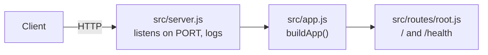

<p align="center">
  
</p>

<h1 align="center">Fastify API Boilerplate</h1>

<p align="center">
  A Fastify REST API with structured logging, ready to deploy on Light Cloud.
</p>

<p align="center">
  <a href="https://console.light-cloud.com/new?repo=https://github.com/light-cloud-com/starter-fastify"></a>
</p>

---

## Features

- Fastify 5 with structured logging
- Binds `0.0.0.0` rather than Fastify's localhost default, which is unreachable from outside the container
- Routes as Fastify plugins, app built separately from the server so tests call it with `app.inject()`
- Graceful shutdown on `SIGTERM`
- Tests with the built-in Node test runner, no extra dependencies
- Listens on `$PORT`, defaulting to 3000

## How it works



## API Endpoints

| Method | Endpoint | Description |
|--------|----------|-------------|
| GET | `/` | Welcome message and API info |
| GET | `/health` | Health check with uptime |

## Project structure

```text
.
├── src/
│   ├── app.js              # buildApp(): creates Fastify and registers routes
│   ├── server.js           # Starts the server, shuts down on SIGTERM
│   ├── config.js           # Settings read from the environment
│   └── routes/
│       └── root.js         # GET / and GET /health, as a Fastify plugin
├── test/
│   └── app.test.js         # node:test tests using app.inject()
├── .env.example            # Environment variables the app reads
└── package.json
```

## Local Development

You need Node.js 22 or newer.

```bash
# Install dependencies
npm install

# Start the server
npm start

# Start with file watching
npm run dev

# Run the tests
npm test
```

The API will be available at `http://localhost:3000`. `.env.example` lists the environment variables the app reads.

## Deploy to Light Cloud

### 1. Create an Account

Visit [console.light-cloud.com](https://console.light-cloud.com) and sign up with GitHub or Google.

### 2. Create New Application

1. Click **"New Application"** in the dashboard
2. Select **"Container"** as the deployment type
3. Choose **"Fastify"** as the framework

### 3. Connect Repository

- **Option A:** Fork this repository and connect it via GitHub
- **Option B:** Push this code to your own GitHub repository and connect it

### 4. Configure Settings

Light Cloud will auto-detect your settings, but you can verify:

| Setting | Value |
|---------|-------|
| Port | `3000` |
| Start Command | `npm start` |

### 5. Deploy

Click **"Deploy"** and your API will be live in minutes!

Your API will be available at `https://your-app.light-cloud.io`

## Learn More

- [Fastify documentation](https://fastify.dev/docs/latest/)
- [Light Cloud documentation](https://docs.light-cloud.com)

---

<p align="center">
  <a href="https://light-cloud.com">Website</a> •
  <a href="https://docs.light-cloud.com">Documentation</a> •
  <a href="https://console.light-cloud.com">Console</a>
</p>

<p align="center">
  Made with ☁️ by <a href="https://light-cloud.com">Light Cloud</a>
</p>
