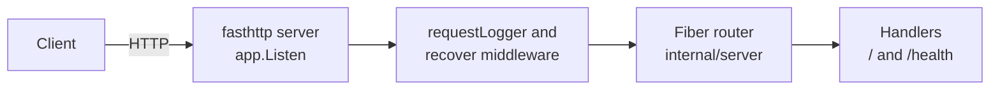

# Fiber API Starter for Go

[](LICENSE) [](https://gofiber.io) [](https://go.dev) [](internal/server) [](https://github.com/light-cloud-templates/fiber-api-starter/generate) [](https://www.light-cloud.com/templates/fiber-api-starter)

A Fiber API starter for Go 1.25, built on Fiber v2.52 and the fasthttp engine, with a JSON root route, a health check, structured request logs and graceful shutdown. It is a small, tested boilerplate for Go developers who want Fiber's Express-style routing in a clean layout (`main.go` plus `internal/config` and `internal/server`), ready to add routes to. It compiles to one static binary, and deploys to Light Cloud in one click.

## Features

- Fiber v2.52 on fasthttp, with the start-up banner turned off
- `GET /` answers `{"message": "Hello from Fiber on Light Cloud"}`
- `GET /health` answers `{"status": "ok"}`
- A small Fiber middleware writes one `log/slog` JSON line per request, after the error handler, so `404` and `500` log their real status
- Fiber's `recover` middleware turns a panic into a `500`
- Graceful shutdown on `SIGTERM` through `app.ShutdownWithTimeout`, with a 10 second drain
- `ReadTimeout` of 10 seconds
- Table-driven route tests with Fiber's `app.Test` and `net/http/httptest` requests
- Listens on `PORT`, default `8080`

## Quick start

You need Go 1.25 or newer.

```bash
git clone https://github.com/light-cloud-templates/fiber-api-starter.git
cd fiber-api-starter
cp .env.example .env
make run
```

`make run` loads `.env` when it exists and runs `go run .`. Open <http://localhost:8080> to see the JSON greeting.

Other ways to start:

- **Use this template**: press [Use this template](https://github.com/light-cloud-templates/fiber-api-starter/generate) to create your own repository from this one.
- **Deploy to Light Cloud**: open the [template page](https://www.light-cloud.com/templates/fiber-api-starter) and press Deploy to get a running copy.

## Deploy

### Deploy to Light Cloud

[](https://www.light-cloud.com/templates/fiber-api-starter)

The Deploy button copies this template into your GitHub account and creates a server app: Light Cloud builds the Go module and runs it as a container that listens on `PORT`. There are no secrets to fill in, and every push to the default branch deploys again. The Free plan includes up to 3 server apps.

### Deploy anywhere else

There is no Light Cloud code in the app. `make build` runs `CGO_ENABLED=0 go build -trimpath -o bin/server .` and writes a static binary; start `./bin/server` with `PORT` set on any server, or copy it into a minimal container image.

## Project structure

```text
.
├── main.go                  # entry point: config, logger, app.Listen, graceful shutdown
├── internal/
│   ├── config/config.go     # reads PORT
│   └── server/
│       ├── server.go        # fiber.New(), middleware and routes
│       ├── handlers.go      # GET / and GET /health
│       ├── middleware.go    # one slog line per request
│       └── server_test.go   # table-driven route tests with app.Test
├── Makefile                 # make run, make test, make build
├── .env.example             # PORT, for local runs
└── go.mod                   # Go 1.25, Fiber v2.52
```

## API endpoints

| Method | Path | Description |
| --- | --- | --- |
| `GET` | `/` | `{"message": "Hello from Fiber on Light Cloud"}` |
| `GET` | `/health` | `{"status": "ok"}` |

```bash
curl http://localhost:8080/health
```

On Light Cloud, use your app's URL instead of `http://localhost:8080`.

## Environment variables

| Name | Required | Default | What it does |
| --- | --- | --- | --- |
| `PORT` | No | `8080` | Port to listen on. Set by Light Cloud. |

## Testing

```bash
make test
```

`make test` runs `go vet ./...` and `go test ./...`. The tests use Fiber's `app.Test`, which runs each request through the app in memory, so no server needs to be running.

## How it works



Fiber runs on fasthttp, not `net/http`, so handlers take a `*fiber.Ctx` instead of a `http.ResponseWriter` and `*http.Request`. `main.go` runs `app.Listen` until Light Cloud (or Ctrl+C) sends a stop signal, then shuts down with a 10 second timeout.

## FAQ

### How do I add a new route in Fiber?

Write a handler `func(c *fiber.Ctx) error` in `internal/server/handlers.go` and register it in `server.New`, for example `app.Get("/items/:id", getItem)`. Read the path value with `c.Params("id")` and answer with `return c.JSON(item)`.

### Why does Fiber not use net/http?

Fiber is built on fasthttp, which reuses request and response objects to cut allocations. The trade-off is that `net/http` middleware does not plug in directly, and values from `*fiber.Ctx` are only valid inside the handler unless you copy them.

### How do I add CORS or other middleware in Fiber?

Fiber ships middleware under `github.com/gofiber/fiber/v2/middleware`, like the `recover` package this template already uses. Add one in `server.New`, for example `app.Use(cors.New())` after importing `github.com/gofiber/fiber/v2/middleware/cors`.

### Can I deploy it without Light Cloud?

Yes. It is a plain Go module: build it with `make build` and run `./bin/server` with `PORT` set on any server or container platform.

### How do I add a PostgreSQL database?

This starter has no database. The [gin-postgresql-crud-api](https://github.com/light-cloud-templates/gin-postgresql-crud-api) template shows a Go app wired to PostgreSQL with pgx, reading the `DB_HOST`, `DB_NAME`, `DB_USER` and `DB_PASSWORD` variables that Light Cloud sets when an app has a database.

## Related templates

- [go-api-starter](https://github.com/light-cloud-templates/go-api-starter): the same kind of starter on the standard library only
- [gin-api-starter](https://github.com/light-cloud-templates/gin-api-starter): the same kind of starter on Gin
- [echo-api-starter](https://github.com/light-cloud-templates/echo-api-starter): the same kind of starter on Echo
- [express-api-starter](https://github.com/light-cloud-templates/express-api-starter): the Express API that inspired Fiber's routing, in Node.js

## Licence

MIT, see [LICENSE](LICENSE).

---

Maintained by [Light Cloud](https://light-cloud.com): deploy apps, APIs and databases in one click.
