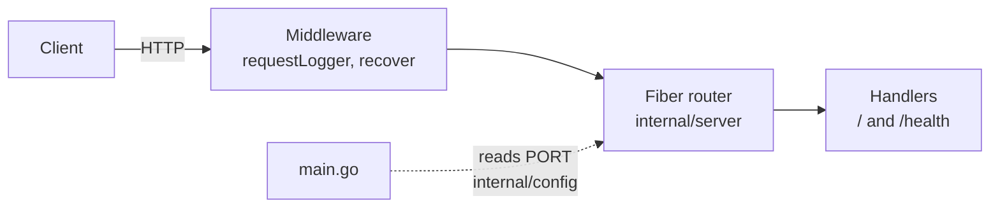

<p align="center">
  
</p>

<h1 align="center">Fiber API Boilerplate</h1>

<p align="center">
  A Fiber HTTP service in Go, ready to deploy on Light Cloud.
</p>

<p align="center">
  <a href="https://console.light-cloud.com/new?repo=https://github.com/light-cloud-com/starter-fiber"></a>
</p>

---

## Features

- Fiber v2 on fasthttp
- Structured JSON logs with `log/slog`, one line per request
- Graceful shutdown on `SIGTERM`
- Table-driven handler tests with `net/http/httptest`
- Compiles to a single static binary
- Listens on `$PORT`, defaulting to 8080

## How it works



`main.go` only wires things together: it loads the config, builds the router and runs the server until Light Cloud (or Ctrl+C) asks it to stop.

## API Endpoints

| Method | Endpoint | Description |
|--------|----------|-------------|
| GET | `/` | Welcome message |
| GET | `/health` | Health check |

## Project structure

```text
.
├── main.go                  # Entry point: config, logger, server, graceful shutdown
├── internal/
│   ├── config/              # Settings from environment variables
│   └── server/              # Routes, handlers, middleware and their tests
├── .env.example             # Local settings, copy to .env
├── Makefile                 # make run, make test, make build
└── go.mod
```

Code under `internal/` can only be imported by this module, which keeps the HTTP layer private to the app.

## Local Development

You need Go 1.25 or newer.

```bash
cp .env.example .env   # optional, make run loads it
make run               # or: go run .
make test              # go vet ./... and go test ./...
make build             # static binary in bin/server
```

The API will be available at `http://localhost:8080`

## Deploy to Light Cloud

### 1. Create an Account

Visit [console.light-cloud.com](https://console.light-cloud.com) and sign up with GitHub or Google.

### 2. Create New Application

1. Click **"New Application"** in the dashboard
2. Select **"Container"** as the deployment type
3. Choose **"Fiber"** as the framework

### 3. Connect Repository

- **Option A:** Fork this repository and connect it via GitHub
- **Option B:** Push this code to your own GitHub repository and connect it

### 4. Configure Settings

Light Cloud will auto-detect your settings, but you can verify:

| Setting | Value |
|---------|-------|
| Port | `8080` |
| Start Command | `./server` |

### 5. Deploy

Click **"Deploy"** and your API will be live in minutes!

Your API will be available at `https://your-app.light-cloud.io`

## Learn More

- [Fiber documentation](https://docs.gofiber.io)
- [Go documentation](https://go.dev/doc/)
- [Light Cloud documentation](https://docs.light-cloud.com)

---

<p align="center">
  <a href="https://light-cloud.com">Website</a> •
  <a href="https://docs.light-cloud.com">Documentation</a> •
  <a href="https://console.light-cloud.com">Console</a>
</p>

<p align="center">
  Made with ☁️ by <a href="https://light-cloud.com">Light Cloud</a>
</p>
