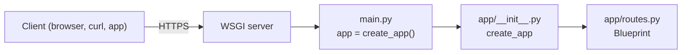

<p align="center">
  
</p>

<h1 align="center">Flask API Boilerplate</h1>

<p align="center">
  A Flask service served by Gunicorn, ready to deploy on Light Cloud.
</p>

<p align="center">
  <a href="https://console.light-cloud.com/new?repo=https://github.com/light-cloud-com/starter-flask"></a>
</p>

---

## Features

- Flask 3 with an application factory (`create_app`) and blueprints
- Served by Gunicorn on Light Cloud (`gunicorn main:app`), and by Waitress when you run `python main.py` locally, rather than Flask's single-threaded development server
- Tests with pytest and Flask's test client
- Binds `0.0.0.0` so the container is reachable
- Binds `$PORT`, defaulting to 8000

## How it works



## API Endpoints

| Method | Endpoint | Description |
|--------|----------|-------------|
| GET | `/` | Welcome message |

## Project structure

```text
.
├── app/
│   ├── __init__.py      # create_app(): builds the app, registers blueprints
│   └── routes.py        # GET /
├── tests/
│   ├── conftest.py      # test client fixture
│   └── test_routes.py
├── main.py              # entry point: app = create_app()
├── requirements.txt     # runtime dependencies (what Light Cloud installs)
├── requirements-dev.txt # adds pytest and ruff
├── pyproject.toml       # pytest and ruff settings
└── .python-version      # Python 3.12
```

Add a feature as a new blueprint module in `app/` and register it in `create_app`.

## Local Development

```bash
python3 -m venv .venv && . .venv/bin/activate
pip install -r requirements-dev.txt

# Run the server
python main.py

# Run the tests and the linter
pytest
ruff check .
```

The API will be available at `http://localhost:8000`

## Deploy to Light Cloud

### 1. Create an Account

Visit [console.light-cloud.com](https://console.light-cloud.com) and sign up with GitHub or Google.

### 2. Create New Application

1. Click **"New Application"** in the dashboard
2. Select **"Container"** as the deployment type
3. Choose **"Flask"** as the framework

### 3. Connect Repository

- **Option A:** Fork this repository and connect it via GitHub
- **Option B:** Push this code to your own GitHub repository and connect it

### 4. Configure Settings

Light Cloud will auto-detect your settings, but you can verify:

| Setting | Value |
|---------|-------|
| Port | `8000` |
| Start Command | `python main.py` |

### 5. Deploy

Click **"Deploy"** and your API will be live in minutes!

Your API will be available at `https://your-app.light-cloud.io`

## Learn More

- [Flask documentation](https://flask.palletsprojects.com)
- [Waitress documentation](https://docs.pylonsproject.org/projects/waitress/)
- [Light Cloud documentation](https://docs.light-cloud.com)

---

<p align="center">
  <a href="https://light-cloud.com">Website</a> •
  <a href="https://docs.light-cloud.com">Documentation</a> •
  <a href="https://console.light-cloud.com">Console</a>
</p>

<p align="center">
  Made with ☁️ by <a href="https://light-cloud.com">Light Cloud</a>
</p>
