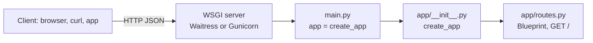

# Flask REST API Starter (Python)

[](LICENSE) [](https://flask.palletsprojects.com) [](https://www.python.org) [](tests) [](https://github.com/light-cloud-templates/flask-api-starter/generate) [](https://www.light-cloud.com/templates/flask-api-starter)

A Flask 3 API starter in Python 3.12 with an application factory, a blueprint and a production WSGI server instead of Flask's development server. It is a minimal, tested Flask boilerplate for developers who want a clean JSON API skeleton with pytest and ruff set up and no database. It runs with `python main.py` (Waitress) or `gunicorn main:app` anywhere Python runs, and deploys to Light Cloud in one click.

## Features

- Flask 3.0 with an application factory (`create_app`) and a blueprint for the routes
- `GET /` answers a JSON welcome message
- Served by Waitress when you run `python main.py`, and by Gunicorn on Light Cloud, never by the single-threaded development server
- `python main.py` binds `0.0.0.0` and reads `PORT`, defaulting to `8000`
- Tests with pytest and Flask's test client, linting with ruff
- Two runtime dependencies, pinned in `requirements.txt`: `Flask` and `waitress`

## Quick start

You need Python 3.12.

```bash
git clone https://github.com/light-cloud-templates/flask-api-starter.git
cd flask-api-starter
python3 -m venv .venv && . .venv/bin/activate
pip install -r requirements-dev.txt
python main.py
```

Open <http://localhost:8000> to see the welcome message. For auto-reload while you edit, run `flask --app main run --debug --port 8000` instead.

Other ways to start:

- **Use this template**: press [Use this template](https://github.com/light-cloud-templates/flask-api-starter/generate) to create your own repository from this one.
- **Deploy to Light Cloud**: open the [template page](https://www.light-cloud.com/templates/flask-api-starter) and press Deploy to get a running copy.

## Deploy

### Deploy to Light Cloud

[](https://www.light-cloud.com/templates/flask-api-starter)

The Deploy button copies this template into your GitHub account and creates a server app that installs `requirements.txt` and runs `gunicorn main:app` in a container, on the port in `PORT`. Light Cloud adds Gunicorn at build time, so it is not in `requirements.txt`.

There are no secrets to fill in. Every push to the default branch deploys again. The Free plan includes up to 3 server apps.

### Deploy anywhere else

This is a standard Flask app with no Light Cloud code in it. Any host that runs Python 3.12 runs it: install `requirements.txt` and start `python main.py` with `PORT` set, or point any WSGI server at `main:app`.

## Project structure

```text
.
├── app/
│   ├── __init__.py      # create_app(): builds the app, registers the blueprint
│   └── routes.py        # GET /
├── tests/
│   ├── conftest.py      # test client fixture
│   └── test_routes.py   # pytest: GET / and an unknown route
├── main.py              # entry point: app = create_app(), served by Waitress
├── requirements.txt     # runtime dependencies (what gets installed on deploy)
├── requirements-dev.txt # adds pytest and ruff
├── pyproject.toml       # pytest and ruff settings
├── .env.example         # the variables the app reads
└── .python-version      # Python 3.12
```

## API endpoints

| Method | Path | Description |
| --- | --- | --- |
| `GET` | `/` | `{ "message": "Hello from Flask on Light Cloud" }` |

Any other path answers Flask's default `404` page.

```bash
curl http://localhost:8000/
```

On Light Cloud, use your app's URL instead of `http://localhost:8000`.

## Environment variables

| Name | Required | Default | What it does |
| --- | --- | --- | --- |
| `PORT` | No | `8000` | Port to listen on. Read by `python main.py`; Gunicorn gets it as `--bind`. Set by Light Cloud. |

## Testing

With the virtual environment active and `requirements-dev.txt` installed:

```bash
pytest
ruff check .
```

The tests build the app with `create_app()` and call it through Flask's test client, without starting a server.

## How it works



`main.py` builds the app once with `create_app()`, and the WSGI server serves that object as `main:app`. The tests call `create_app()` themselves, so each test gets a fresh app.

## FAQ

### How do I add a new route in Flask?

Add a function to the blueprint in `app/routes.py`, or create a new blueprint module in `app/` and register it in `create_app()` with `app.register_blueprint(things_bp)`.

### Why Waitress and Gunicorn instead of flask run?

`flask run` is Flask's development server: single-threaded and not meant for production. `python main.py` serves the app with Waitress, and Light Cloud runs it with Gunicorn; both use the same `main:app` object.

### How do I return JSON for 404 errors?

Register an error handler in `create_app()`, for example `app.register_error_handler(404, lambda e: ({"error": "Not found"}, 404))`. Without it, Flask answers with its HTML error page.

### How do I add a database?

This starter has none. The [flask-postgresql-crud-api](https://github.com/light-cloud-templates/flask-postgresql-crud-api) template adds PostgreSQL and a full CRUD resource.

### Can I deploy it without Light Cloud?

Yes. It is a plain Flask app: any host with Python 3.12 runs it with `python main.py`, or with any WSGI server pointed at `main:app`.

## Related templates

- [flask-postgresql-crud-api](https://github.com/light-cloud-templates/flask-postgresql-crud-api): Flask with PostgreSQL and a CRUD resource
- [fastapi-starter](https://github.com/light-cloud-templates/fastapi-starter): the same starter in FastAPI
- [django-rest-framework-postgresql-api](https://github.com/light-cloud-templates/django-rest-framework-postgresql-api): a Python API with Django REST framework
- [sinatra-api-starter](https://github.com/light-cloud-templates/sinatra-api-starter): a similar micro-framework API in Ruby

## Licence

MIT, see [LICENSE](LICENSE).

---

Maintained by [Light Cloud](https://light-cloud.com): deploy apps, APIs and databases in one click.
