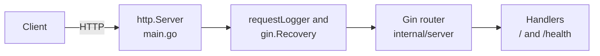

# Gin API Starter for Go

[](LICENSE) [](https://gin-gonic.com) [](https://go.dev) [](internal/server) [](https://github.com/light-cloud-templates/gin-api-starter/generate) [](https://www.light-cloud.com/templates/gin-api-starter)

A Gin API starter for Go 1.25, built on Gin 1.12, with a JSON root route, a health check, structured request logs and graceful shutdown. It is a small, tested boilerplate for Go developers who want Gin's router, middleware and JSON helpers in a clean layout (`main.go` plus `internal/config` and `internal/server`), ready to add routes to. It compiles to one static binary, and deploys to Light Cloud in one click.

## Features

- Gin 1.12 router created with `gin.New()`, so only the middleware you see is registered
- `GET /` answers `{"message": "Hello from Gin on Light Cloud"}`
- `GET /health` answers `{"status": "ok"}`
- Structured JSON logs with `log/slog` through a small Gin middleware, one line per request
- `gin.Recovery()` turns a panic into a `500` instead of a dropped connection
- `GIN_MODE` switches between `release` (default), `debug` and `test`
- Gin runs inside a standard `http.Server`, with graceful shutdown on `SIGTERM` and a 10 second drain
- Table-driven route tests with `net/http/httptest` in Gin's test mode
- Listens on `PORT`, default `8080`

## Quick start

You need Go 1.25 or newer.

```bash
git clone https://github.com/light-cloud-templates/gin-api-starter.git
cd gin-api-starter
cp .env.example .env
make run
```

`make run` loads `.env` (which sets `GIN_MODE=debug` for local runs) and runs `go run .`. Open <http://localhost:8080> to see the JSON greeting.

Other ways to start:

- **Use this template**: press [Use this template](https://github.com/light-cloud-templates/gin-api-starter/generate) to create your own repository from this one.
- **Deploy to Light Cloud**: open the [template page](https://www.light-cloud.com/templates/gin-api-starter) and press Deploy to get a running copy.

## Deploy

### Deploy to Light Cloud

[](https://www.light-cloud.com/templates/gin-api-starter)

The Deploy button copies this template into your GitHub account and creates a server app: Light Cloud builds the Go module and runs it as a container that listens on `PORT`. There are no secrets to fill in, and every push to the default branch deploys again. The Free plan includes up to 3 server apps.

### Deploy anywhere else

There is no Light Cloud code in the app. `make build` runs `CGO_ENABLED=0 go build -trimpath -o bin/server .` and writes a static binary; start `./bin/server` with `PORT` set on any server, or copy it into a minimal container image.

## Project structure

```text
.
├── main.go                  # entry point: config, logger, Gin mode, http.Server, graceful shutdown
├── internal/
│   ├── config/config.go     # reads PORT and GIN_MODE
│   └── server/
│       ├── server.go        # gin.New(), middleware and routes
│       ├── handlers.go      # GET / and GET /health
│       ├── middleware.go    # one slog line per request
│       └── server_test.go   # table-driven route tests
├── Makefile                 # make run, make test, make build
├── .env.example             # PORT and GIN_MODE, for local runs
└── go.mod                   # Go 1.25, Gin 1.12
```

## API endpoints

| Method | Path | Description |
| --- | --- | --- |
| `GET` | `/` | `{"message": "Hello from Gin on Light Cloud"}` |
| `GET` | `/health` | `{"status": "ok"}` |

```bash
curl http://localhost:8080/health
```

On Light Cloud, use your app's URL instead of `http://localhost:8080`.

## Environment variables

| Name | Required | Default | What it does |
| --- | --- | --- | --- |
| `PORT` | No | `8080` | Port to listen on. Set by Light Cloud. |
| `GIN_MODE` | No | `release` | Gin mode: `release`, `debug` (route list and debug warnings in the log) or `test`. |

## Testing

```bash
make test
```

`make test` runs `go vet ./...` and `go test ./...`. The tests send requests to the Gin engine with `httptest`, so no server needs to be running.

## How it works



`main.go` sets the Gin mode, hands the Gin engine to a standard `http.Server` and runs it until Light Cloud (or Ctrl+C) sends a stop signal, then lets open requests finish.

## FAQ

### How do I add a new route in Gin?

Write a handler `func(c *gin.Context)` in `internal/server/handlers.go` and register it in `server.New`, for example `r.GET("/items/:id", getItem)`. Read the path value with `c.Param("id")` and answer with `c.JSON`.

### How do I group routes, for example under /api/v1?

Use a Gin group in `server.New`: `v1 := r.Group("/api/v1")`, then `v1.GET("/items", listItems)`. Middleware passed to `r.Group` runs only for that group.

### What does GIN_MODE do?

In `debug` Gin prints every registered route and warnings at start; in `release` it stays quiet. The app defaults to `release`, and `.env.example` sets `debug` for local work.

### Can I deploy it without Light Cloud?

Yes. It is a plain Go module: build it with `make build` and run `./bin/server` with `PORT` set on any server or container platform.

### How do I add a PostgreSQL database?

This starter has no database. The [gin-postgresql-crud-api](https://github.com/light-cloud-templates/gin-postgresql-crud-api) template shows a Gin app wired to PostgreSQL with pgx, reading the `DB_HOST`, `DB_NAME`, `DB_USER` and `DB_PASSWORD` variables that Light Cloud sets when an app has a database.

## Related templates

- [gin-postgresql-crud-api](https://github.com/light-cloud-templates/gin-postgresql-crud-api): Gin with a PostgreSQL items CRUD API
- [go-api-starter](https://github.com/light-cloud-templates/go-api-starter): the same kind of starter on the standard library only
- [echo-api-starter](https://github.com/light-cloud-templates/echo-api-starter): the same kind of starter on Echo
- [fiber-api-starter](https://github.com/light-cloud-templates/fiber-api-starter): the same kind of starter on Fiber

## Licence

MIT, see [LICENSE](LICENSE).

---

Maintained by [Light Cloud](https://light-cloud.com): deploy apps, APIs and databases in one click.
