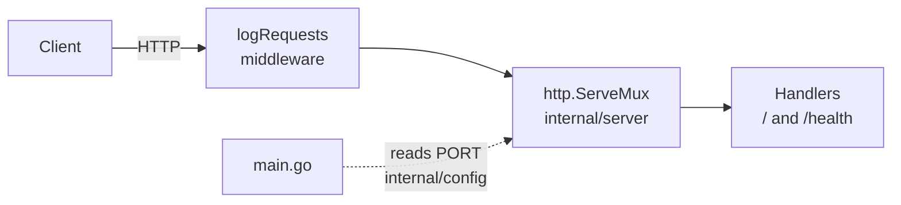

# Go REST API Starter (net/http)

[](LICENSE) [](https://go.dev) [](https://pkg.go.dev/net/http) [](go.mod) [](internal/server) [](https://github.com/light-cloud-templates/go-api-starter/generate) [](https://www.light-cloud.com/templates/go-api-starter)

A Go REST API starter for Go 1.25 built only on the standard library: `net/http` for routing, `encoding/json` for responses and `log/slog` for logs, with no third-party dependencies. It is a small, tested boilerplate for Go developers who want a clean JSON API skeleton with a health check, structured request logs, graceful shutdown and a Dockerfile, ready to add routes to. It compiles to one static binary, and deploys to Light Cloud in one click.

## Features

- Standard library only: `go.mod` has no `require` lines and no `go.sum`
- `GET /` answers a JSON welcome message with the API version and its endpoints
- `GET /health` answers `healthy`, the current time (RFC 3339) and the uptime in seconds
- Unknown paths answer `404`
- Structured JSON logs with `log/slog`, one line per request with method, path, status and duration
- Graceful shutdown on `SIGTERM` or Ctrl+C, with a 10 second drain
- `ReadHeaderTimeout` of 10 seconds on the server
- Table-driven route tests with `net/http/httptest`
- Multi-stage Dockerfile: builds on `golang:1.25-alpine`, runs as `nobody` on Alpine
- Listens on `PORT`, default `8080`

## Quick start

You need Go 1.25 or newer.

```bash
git clone https://github.com/light-cloud-templates/go-api-starter.git
cd go-api-starter
cp .env.example .env
make run
```

`make run` loads `.env` when it exists and runs `go run .`. Open <http://localhost:8080/health> to see the health check.

Other ways to start:

- **Use this template**: press [Use this template](https://github.com/light-cloud-templates/go-api-starter/generate) to create your own repository from this one.
- **Deploy to Light Cloud**: open the [template page](https://www.light-cloud.com/templates/go-api-starter) and press Deploy to get a running copy.

## Deploy

### Deploy to Light Cloud

[](https://www.light-cloud.com/templates/go-api-starter)

The Deploy button copies this template into your GitHub account and creates a server app: Light Cloud builds the image from the `Dockerfile` and runs it as a container that listens on `PORT`. There are no secrets to fill in, and every push to the default branch deploys again. The Free plan includes up to 3 server apps.

### Deploy anywhere else

There is no Light Cloud code in the app. Any container platform runs the Dockerfile:

```bash
docker build -t go-api-starter .
docker run -p 8080:8080 go-api-starter
```

Without Docker, `make build` writes a static binary to `bin/server`; copy it to any Linux, macOS or Windows host you built it for and start it with `PORT` set.

## Project structure

```text
.
├── main.go                  # entry point: config, logger, server, graceful shutdown
├── internal/
│   ├── config/config.go     # reads PORT
│   └── server/
│       ├── server.go        # ServeMux and routes
│       ├── handlers.go      # GET / and GET /health, JSON helper
│       ├── middleware.go    # one slog line per request
│       └── server_test.go   # table-driven route tests
├── Dockerfile               # multi-stage build to a small Alpine image
├── Makefile                 # make run, make test, make build
├── .env.example             # PORT, for local runs
├── .mcp.json                # Light Cloud MCP server for AI coding tools
└── go.mod                   # Go 1.25, no dependencies
```

Code under `internal/` can only be imported by this module, which keeps the HTTP layer private to the app.

## API endpoints

| Method | Path | Description |
| --- | --- | --- |
| `GET` | `/` | Welcome message, version and the list of endpoints |
| `GET` | `/health` | `{"status": "healthy", "timestamp", "uptime"}` |

```bash
curl http://localhost:8080/health
```

On Light Cloud, use your app's URL instead of `http://localhost:8080`.

## Environment variables

| Name | Required | Default | What it does |
| --- | --- | --- | --- |
| `PORT` | No | `8080` | Port to listen on. Set by Light Cloud. |

## Testing

```bash
make test
```

`make test` runs `go vet ./...` and `go test ./...`. The tests call the handler directly with `httptest`, so no server needs to be running.

## How it works



`main.go` only wires things together: it loads the config, builds the handler and runs `http.Server` until Light Cloud (or Ctrl+C) sends a stop signal, then lets open requests finish.

## FAQ

### How do I add a route with path parameters in net/http?

Since Go 1.22 the standard `ServeMux` matches methods and wildcards. Register it in `internal/server/server.go`, for example `mux.HandleFunc("GET /items/{id}", h.getItem)`, and read the value with `r.PathValue("id")` in the handler.

### Do I need a framework like Gin, Echo or Fiber?

Not for a JSON API of this size. `net/http` handles routing, middleware is a function that wraps an `http.Handler`, and the code keeps no dependencies to update. Pick a framework when you want its binding, validation or middleware ecosystem.

### How do I add an environment variable?

Add a field to `Config` in `internal/config/config.go` and read it in `Load` with `getenv("NAME", "default")`. Put a local value in `.env` for `make run`, and set it on your app in Light Cloud for the deployed copy.

### Can I deploy it without Light Cloud?

Yes. Build the Dockerfile on any container platform, or run the binary from `make build` on any server with `PORT` set. The app has no Light Cloud code in it.

### How do I add a PostgreSQL database?

This starter has no database. The [gin-postgresql-crud-api](https://github.com/light-cloud-templates/gin-postgresql-crud-api) template shows a Go app wired to PostgreSQL with pgx, reading the `DB_HOST`, `DB_NAME`, `DB_USER` and `DB_PASSWORD` variables that Light Cloud sets when an app has a database.

## Related templates

- [gin-api-starter](https://github.com/light-cloud-templates/gin-api-starter): the same kind of starter on Gin
- [echo-api-starter](https://github.com/light-cloud-templates/echo-api-starter): the same kind of starter on Echo
- [fiber-api-starter](https://github.com/light-cloud-templates/fiber-api-starter): the same kind of starter on Fiber
- [gin-postgresql-crud-api](https://github.com/light-cloud-templates/gin-postgresql-crud-api): a Go CRUD API with PostgreSQL
- [dockerfile-starter](https://github.com/light-cloud-templates/dockerfile-starter): deploy any app from its Dockerfile

## Licence

MIT, see [LICENSE](LICENSE).

---

Maintained by [Light Cloud](https://light-cloud.com): deploy apps, APIs and databases in one click.
