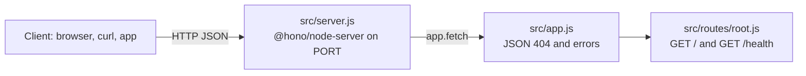

# Hono REST API Starter (Node.js)

[](LICENSE) [](https://hono.dev) [](https://nodejs.org) [](test) [](https://github.com/light-cloud-templates/hono-api-starter/generate) [](https://www.light-cloud.com/templates/hono-api-starter)

A Hono 4 REST API starter for Node.js 22, written in plain JavaScript ES modules and served by `@hono/node-server`, with a `/health` check and JSON error responses. It is a small, tested Hono boilerplate for developers who want a lightweight, Web Standards based API skeleton with no database and no build step. It runs with `npm start` anywhere Node.js runs, and deploys to Light Cloud in one click.

## Features

- Hono 4 on `@hono/node-server` with two routes: `GET /` lists the endpoints, `GET /health` reports status, timestamp and uptime
- Routes grouped in sub-apps under `src/routes/`, mounted with `app.route()`
- Unknown routes answer `404` as `{ "error": "Not found" }`; errors answer `500` as JSON and are logged
- ES modules (`"type": "module"`), no TypeScript build step
- App and server in separate files, so tests call `app.request()` without opening a port
- Graceful shutdown on `SIGTERM` and `SIGINT`: in-flight requests finish before the process exits
- Tests with the built-in Node.js test runner (`node --test`), no test dependencies
- Two runtime dependencies: `hono` and `@hono/node-server`
- Listens on `PORT`, defaulting to `3000`

## Quick start

You need Node.js 22 or newer.

```bash
git clone https://github.com/light-cloud-templates/hono-api-starter.git
cd hono-api-starter
npm install
npm run dev
```

Open <http://localhost:3000> to see the endpoint list. `npm run dev` restarts the server when a file changes (`node --watch`); `npm start` runs it without watching.

Other ways to start:

- **Use this template**: press [Use this template](https://github.com/light-cloud-templates/hono-api-starter/generate) to create your own repository from this one.
- **Deploy to Light Cloud**: open the [template page](https://www.light-cloud.com/templates/hono-api-starter) and press Deploy to get a running copy.

## Deploy

### Deploy to Light Cloud

[](https://www.light-cloud.com/templates/hono-api-starter)

The Deploy button copies this template into your GitHub account and creates a server app that runs `npm start` in a container, listening on the port in `PORT`.

There are no secrets to fill in. Every push to the default branch deploys again. The Free plan includes up to 3 server apps.

### Deploy anywhere else

This is a standard Hono app on Node.js with no Light Cloud code in it. Any host that runs Node.js 22 runs it: `npm ci --omit=dev`, then `npm start` with `PORT` set. It also fits any Node.js Docker image.

## Project structure

```text
.
├── src/
│   ├── app.js              # Hono app: mounts routes, JSON 404 and error handler
│   ├── server.js           # starts @hono/node-server, shuts down on SIGTERM
│   ├── config.js           # settings read from the environment
│   └── routes/
│       └── root.js         # GET / and GET /health, as a sub-app
├── test/
│   └── app.test.js         # node:test tests using app.request()
├── .env.example            # the variables the app reads
├── .mcp.json               # Light Cloud MCP server for AI coding agents
└── package.json            # scripts: start, dev, test
```

## API endpoints

| Method | Path | Description |
| --- | --- | --- |
| `GET` | `/` | Welcome message and the list of endpoints |
| `GET` | `/health` | `{ "status": "healthy", "timestamp", "uptime" }` |

Any other path answers `404` with `{ "error": "Not found" }`.

```bash
curl http://localhost:3000/health
```

On Light Cloud, use your app's URL instead of `http://localhost:3000`.

## Environment variables

| Name | Required | Default | What it does |
| --- | --- | --- | --- |
| `PORT` | No | `3000` | Port to listen on. Set by Light Cloud. |

## Testing

```bash
npm test
```

The tests call `app.request()` for `/`, `/health` and an unknown route, without starting a server. There is no linter configured.

## How it works



`@hono/node-server` turns each Node.js request into a Web Standards `Request` and passes it to `app.fetch`. The Hono app in `src/app.js` mounts the route groups and answers anything unmatched in JSON.

## FAQ

### How do I add a new route in Hono?

Create a sub-app in `src/routes/` like `root.js` (`const things = new Hono()` with `things.get(...)`), then mount it in `src/app.js` with `app.route('/things', things)`.

### How do I enable CORS in Hono?

CORS is not enabled. Hono ships the middleware: add `import { cors } from 'hono/cors'` and `app.use('*', cors({ origin: 'https://example.com' }))` in `src/app.js`, before the routes.

### Can this Hono app run on Bun, Deno or Cloudflare Workers?

The app in `src/app.js` is a standard `fetch` handler; only `src/server.js` is Node.js specific. `/health` calls `process.uptime()`, so on a runtime without `process` you would change that line and replace `src/server.js` with that runtime's entry point.

### How do I add a database?

This starter has none. The [hono-postgresql-crud-api](https://github.com/light-cloud-templates/hono-postgresql-crud-api) template adds PostgreSQL and a full CRUD resource.

### Can I deploy it without Light Cloud?

Yes. It is a plain Hono app on Node.js: any host with Node.js 22 runs it with `npm start`, listening on `PORT`.

## Related templates

- [hono-postgresql-crud-api](https://github.com/light-cloud-templates/hono-postgresql-crud-api): Hono with PostgreSQL and a CRUD resource
- [express-api-starter](https://github.com/light-cloud-templates/express-api-starter): the same starter in Express
- [fastify-api-starter](https://github.com/light-cloud-templates/fastify-api-starter): the same starter in Fastify
- [nestjs-api-starter](https://github.com/light-cloud-templates/nestjs-api-starter): a TypeScript API with NestJS

## Licence

MIT, see [LICENSE](LICENSE).

---

Maintained by [Light Cloud](https://light-cloud.com): deploy apps, APIs and databases in one click.
