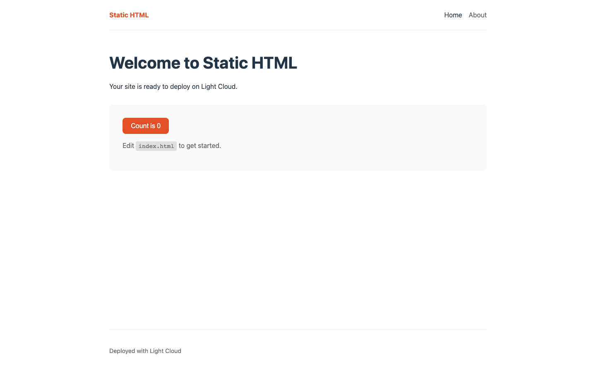
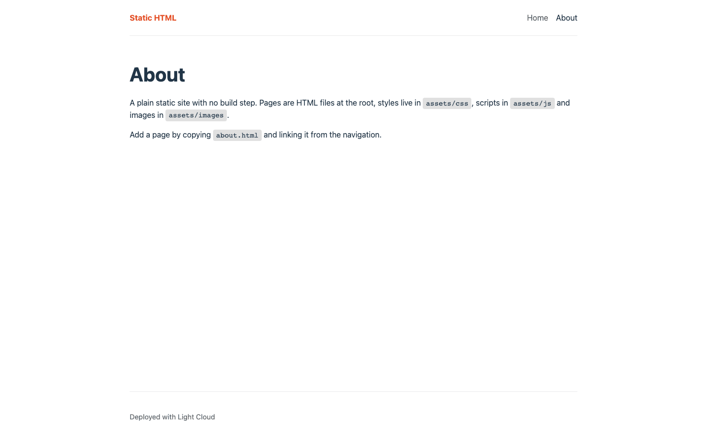
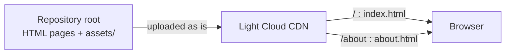

# Static HTML Website Starter

[](LICENSE) [](https://developer.mozilla.org/docs/Web/HTML) [](https://developer.mozilla.org/docs/Web/CSS) [](https://developer.mozilla.org/docs/Web/JavaScript) [](index.html) [](https://github.com/light-cloud-templates/static-html-website-starter/generate) [](https://www.light-cloud.com/templates/static-html-website-starter)

A static website starter in plain HTML, CSS and vanilla JavaScript, with no framework, no npm packages and no build step. It is a two-page boilerplate (home and about) for anyone who wants a simple, hand-editable site with a shared header, navigation and footer, styles split into three files and one small script. Open `index.html` in a browser to work on it, and deploy it to Light Cloud or any static host as it is.

## Screenshot




## Features

- Plain HTML, CSS and JavaScript: nothing to install, nothing to build
- Two pages, `index.html` and `about.html`, with the same header, navigation and footer
- `aria-current="page"` on the active link and a labelled `<nav>`
- A page title and meta description on every page
- Styles split into `base.css` (tokens, reset, type), `layout.css` and `components.css`
- One deferred script, `assets/js/main.js`, for the counter on the home page
- Relative links, so the site works from any folder, host or subpath

## Quick start

You need a web browser. Python 3 is optional, for a local server.

```bash
git clone https://github.com/light-cloud-templates/static-html-website-starter.git
cd static-html-website-starter
python3 -m http.server 8080
```

Open <http://localhost:8080>, or open `index.html` straight from the folder. Edit the HTML and reload the page to see the change.

Other ways to start:

- **Use this template**: press [Use this template](https://github.com/light-cloud-templates/static-html-website-starter/generate) to create your own repository from this one.
- **Deploy to Light Cloud**: open the [template page](https://www.light-cloud.com/templates/static-html-website-starter) and press Deploy to get a running copy.

## Deploy

### Deploy to Light Cloud

[](https://www.light-cloud.com/templates/static-html-website-starter)

The Deploy button copies this template into your GitHub account and creates a static site: there is no build command, so Light Cloud serves the repository root from a CDN as it is. `/about` is served from `about.html`.

There are no secrets to fill in. Every push to the default branch deploys again. Static sites run on the Free plan.

### Deploy anywhere else

There is no Light Cloud code in it. Upload the folder (without `.git`) to any static file host: GitHub Pages, Netlify, Cloudflare Pages, S3, nginx or Apache. There is no client-side routing, so no rewrite rules are needed; the links point at `index.html` and `about.html` directly.

## Project structure

```text
.
├── index.html             # home page
├── about.html             # second page, same layout
└── assets/
    ├── css/
    │   ├── base.css       # design tokens, reset, typography
    │   ├── layout.css     # header, navigation, main, footer
    │   └── components.css # card and button
    ├── js/main.js         # page behaviour: the counter
    └── images/
        └── favicon.svg    # site icon
```

## Pages

| URL | File | What it shows |
| --- | --- | --- |
| `/` | `index.html` | Welcome text and a click counter |
| `/about` | `about.html` | Where pages, styles, scripts and images live |

Each page links the three stylesheets and `assets/js/main.js` in its `<head>`. The navigation is copied into each page, so update it in every file when you add a page.

## Environment variables

This template reads no environment variables: everything is in the HTML, CSS and JavaScript files.

## Testing

There are no tests and nothing to build or lint. Serve the folder with `python3 -m http.server 8080` and click through both pages. Any HTML validator, such as the [W3C Markup Validation Service](https://validator.w3.org), can check the markup.

## How it works



Each page is a complete HTML file that the browser renders as it arrives. `main.js` is loaded with `defer`, so it runs after the page is parsed and only acts when the counter button is on the page.

## FAQ

### How do I add a page to a static HTML website?

Copy `about.html` to a new file such as `contact.html`, change its `<title>`, meta description and content, and add `<a href="contact.html">Contact</a>` to the `<nav>` in every page. Set `aria-current="page"` on the link of the page you are on.

### Do I need Node.js or npm for this template?

No. There is no `package.json` and no build step. A text editor and a browser are enough; Python is only used for an optional local server.

### How do I change the colours and fonts?

Edit the colour custom properties and `font-family` in the `:root` rule at the top of `assets/css/base.css`. Layout and components read those tokens, so one change applies to every page.

### Can I deploy it without Light Cloud?

Yes. Upload the files to any static file host, such as GitHub Pages or Netlify. Nothing in the site depends on Light Cloud.

### When should I switch to a static site generator?

When copying the header and navigation into every page gets tedious, or you want Markdown posts. [astro-blog-starter](https://github.com/light-cloud-templates/astro-blog-starter) and [eleventy-blog-starter](https://github.com/light-cloud-templates/eleventy-blog-starter) still output static HTML.

## Related templates

- [astro-blog-starter](https://github.com/light-cloud-templates/astro-blog-starter): a static blog with shared layouts and Markdown posts
- [eleventy-blog-starter](https://github.com/light-cloud-templates/eleventy-blog-starter): a static blog built with Eleventy
- [docusaurus-docs-starter](https://github.com/light-cloud-templates/docusaurus-docs-starter): a static documentation site
- [react-vite-starter](https://github.com/light-cloud-templates/react-vite-starter): a React single-page app when you need components and state

## Licence

MIT, see [LICENSE](LICENSE).

---

Maintained by [Light Cloud](https://light-cloud.com): deploy apps, APIs and databases in one click.
