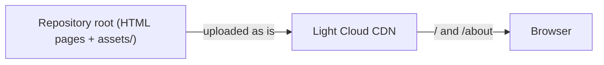

<p align="center">
  
</p>

<h1 align="center">Static HTML Boilerplate</h1>

<p align="center">
  A simple static HTML website, ready to deploy on Light Cloud.
</p>

<p align="center">
  <a href="https://www.light-cloud.com/templates/starter-html"></a>
</p>

---

## Features

- Pure HTML, CSS and JavaScript, no build step
- Two pages (Home, About) sharing one layout and navigation
- Styles split into base, layout and components; scripts and images under `assets/`
- Relative links, so the site works from any folder or host

## How it works



Light Cloud serves the repository root without building it. `/about` is served from `about.html`.

## Project structure

```text
.
├── index.html             # Home page
├── about.html             # Second page, same layout
└── assets/
    ├── css/
    │   ├── base.css       # Design tokens, reset, typography
    │   ├── layout.css     # Header, navigation, footer
    │   └── components.css # Card and button
    ├── js/main.js         # Page behaviour (the counter)
    └── images/            # Favicon and other images
```

## Local development

Open `index.html` in your browser, or serve the folder:

```bash
python3 -m http.server 8080   # then open http://localhost:8080
```

There is nothing to build or test. To add a page, copy `about.html`, change its content and link it from the `<nav>` in each page.

## Deploy to Light Cloud

### 1. Create an Account

Visit [console.light-cloud.com](https://console.light-cloud.com) and sign up with GitHub or Google.

### 2. Create New Application

1. Click **"New Application"** in the dashboard
2. Select **"Static Site"** as the deployment type
3. Choose **"Static HTML"** as the framework

### 3. Connect Repository

- **Option A:** Fork this repository and connect it via GitHub
- **Option B:** Push this code to your own GitHub repository and connect it

### 4. Configure Build Settings

Light Cloud will auto-detect your settings, but you can verify:

| Setting | Value |
|---------|-------|
| Build Command | *(leave empty)* |
| Output Directory | `.` |

### 5. Deploy

Click **"Deploy"** and your site will be live in seconds!

Your site will be available at `https://your-app.light-cloud.io`

## Learn More

- [MDN Web Docs](https://developer.mozilla.org)
- [Light Cloud documentation](https://docs.light-cloud.com)

## License

[MIT](./LICENSE)

---

<p align="center">
  <a href="https://light-cloud.com">Website</a> •
  <a href="https://docs.light-cloud.com">Documentation</a> •
  <a href="https://console.light-cloud.com">Console</a>
</p>

<p align="center">
  Made with ☁️ by <a href="https://light-cloud.com">Light Cloud</a>
</p>
