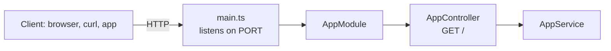

# NestJS REST API Starter (TypeScript)

[](LICENSE) [](https://nestjs.com) [](https://www.typescriptlang.org) [](https://nodejs.org) [](test) [](https://github.com/light-cloud-templates/nestjs-api-starter/generate) [](https://www.light-cloud.com/templates/nestjs-api-starter)

A NestJS 11 API starter in TypeScript 5 for Node.js 22, scaffolded with `nest new` and set up to run in a container: it listens on `PORT` and shuts down cleanly on `SIGTERM`. It is a minimal NestJS boilerplate for developers who want the standard module, controller and service layout with Jest unit and end-to-end tests, ESLint and Prettier, and no database. It builds with `npm run build`, runs with `npm start` anywhere Node.js runs, and deploys to Light Cloud in one click.

## Features

- NestJS 11 on Express (`@nestjs/platform-express`), with one module, one controller and one service
- TypeScript 5 with decorators and dependency injection, compiled to `dist/` by the Nest CLI
- `GET /` answers `Hello World!` from `AppService`, ready to replace with your own resources
- Settings read from the environment in one place, `src/config.ts`
- Graceful shutdown on `SIGTERM` through Nest's shutdown hooks (`app.enableShutdownHooks()`)
- Unit tests with Jest and `@nestjs/testing`, end-to-end tests with Supertest
- ESLint (typescript-eslint) and Prettier configured
- Listens on `PORT`, defaulting to `3000`

## Quick start

You need Node.js 22 or newer.

```bash
git clone https://github.com/light-cloud-templates/nestjs-api-starter.git
cd nestjs-api-starter
npm install
npm run start:dev
```

Open <http://localhost:3000> to see `Hello World!`. `npm run start:dev` recompiles and restarts on every change. For a production run, use `npm run build` and then `npm start`.

Other ways to start:

- **Use this template**: press [Use this template](https://github.com/light-cloud-templates/nestjs-api-starter/generate) to create your own repository from this one.
- **Deploy to Light Cloud**: open the [template page](https://www.light-cloud.com/templates/nestjs-api-starter) and press Deploy to get a running copy.

## Deploy

### Deploy to Light Cloud

[](https://www.light-cloud.com/templates/nestjs-api-starter)

The Deploy button copies this template into your GitHub account and creates a server app: Light Cloud runs `npm run build`, then `npm start` (`node dist/main`) in a container, listening on the port in `PORT`.

There are no secrets to fill in. Every push to the default branch deploys again. The Free plan includes up to 3 server apps.

### Deploy anywhere else

This is a standard NestJS app with no Light Cloud code in it. Any host that runs Node.js 22 runs it: `npm ci`, `npm run build`, then `npm start` with `PORT` set. It also fits any Node.js Docker image with a build stage.

## Project structure

```text
.
├── src/
│   ├── main.ts                  # bootstraps the app, enables shutdown hooks, listens on PORT
│   ├── config.ts                # settings read from the environment
│   ├── app.module.ts            # root module
│   ├── app.controller.ts        # GET /
│   ├── app.service.ts           # logic behind the controller
│   └── app.controller.spec.ts   # unit test
├── test/
│   ├── app.e2e-spec.ts          # end-to-end test over HTTP with Supertest
│   └── jest-e2e.json            # Jest settings for the e2e tests
├── .env.example                 # the variables the app reads
├── nest-cli.json                # Nest CLI settings
├── tsconfig.json                # TypeScript settings
├── tsconfig.build.json          # what npm run build compiles
├── eslint.config.mjs            # ESLint flat config
├── .prettierrc                  # Prettier settings
└── package.json                 # scripts: build, start, start:dev, test, test:e2e, lint
```

## API endpoints

| Method | Path | Description |
| --- | --- | --- |
| `GET` | `/` | Answers `Hello World!` as plain text |

Any other path answers `404` with Nest's JSON error, `{ "message", "error": "Not Found", "statusCode": 404 }`.

```bash
curl http://localhost:3000/
```

On Light Cloud, use your app's URL instead of `http://localhost:3000`.

## Environment variables

| Name | Required | Default | What it does |
| --- | --- | --- | --- |
| `PORT` | No | `3000` | Port to listen on. Set by Light Cloud. |

## Testing

```bash
npm test
npm run test:e2e
npm run lint
```

`npm test` runs the unit tests in `src/`, `npm run test:e2e` starts the app in memory and calls it over HTTP, and `npm run lint` runs ESLint with `--fix`, so it rewrites files it can fix. `npm run test:cov` adds a coverage report.

## How it works



`main.ts` creates the app from `AppModule`, which declares the controller and injects the service into it. Each new feature becomes its own module that `AppModule` imports.

## FAQ

### How do I add a new resource in NestJS?

Run `npx nest generate resource things`. The Nest CLI creates a module, controller, service and DTOs under `src/things/` and imports the module into `AppModule`.

### Does it include Swagger or OpenAPI docs?

No. Install `@nestjs/swagger` and set up `SwaggerModule` in `src/main.ts` to serve a docs page; nothing else in the starter needs to change.

### How do I enable CORS in NestJS?

CORS is off. Call `app.enableCors({ origin: 'https://example.com' })` in `src/main.ts` before `app.listen`.

### Why does it need a build step?

NestJS is written in TypeScript, so `npm run build` compiles `src/` to `dist/` and `npm start` runs `node dist/main`. Light Cloud runs the build for you on every deploy.

### Can I deploy it without Light Cloud?

Yes. It is a plain NestJS app: any host with Node.js 22 runs it with `npm ci`, `npm run build` and `npm start`, listening on `PORT`.

## Related templates

- [nestjs-postgresql-crud-api](https://github.com/light-cloud-templates/nestjs-postgresql-crud-api): NestJS with PostgreSQL and a CRUD resource
- [express-api-starter](https://github.com/light-cloud-templates/express-api-starter): a smaller Node.js API in Express
- [fastify-api-starter](https://github.com/light-cloud-templates/fastify-api-starter): a Node.js API in Fastify
- [hono-api-starter](https://github.com/light-cloud-templates/hono-api-starter): a Node.js API in Hono

## Licence

MIT, see [LICENSE](LICENSE).

---

Maintained by [Light Cloud](https://light-cloud.com): deploy apps, APIs and databases in one click.
