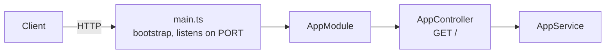

<p align="center">
  
</p>

<h1 align="center">NestJS API Boilerplate</h1>

<p align="center">
  A NestJS REST API in TypeScript, ready to deploy on Light Cloud.
</p>

<p align="center">
  <a href="https://www.light-cloud.com/templates/starter-nestjs"></a>
</p>

---

## Features

- NestJS 11, scaffolded with `nest new`
- TypeScript with decorators and dependency injection
- Modular architecture — controllers, providers, modules
- Settings read from the environment in one place (`src/config.ts`)
- Graceful shutdown on `SIGTERM` through Nest's shutdown hooks
- Unit tests and end-to-end tests with Jest and Supertest
- Listens on `$PORT`, defaulting to 3000

## How it works



## API Endpoints

| Method | Endpoint | Description |
|--------|----------|-------------|
| GET | `/` | Welcome message |

## Project structure

```text
.
├── src/
│   ├── main.ts                  # Bootstraps the app, enables shutdown hooks
│   ├── config.ts                # Settings read from the environment
│   ├── app.module.ts            # Root module
│   ├── app.controller.ts        # GET /
│   ├── app.service.ts           # Logic behind the controller
│   └── app.controller.spec.ts   # Unit test
├── test/
│   ├── app.e2e-spec.ts          # End-to-end test over HTTP
│   └── jest-e2e.json
├── .env.example                 # Environment variables the app reads
├── nest-cli.json
├── tsconfig.json
└── package.json
```

Add a feature with `npx nest generate resource <name>`: it creates a module, controller and service under `src/<name>/`.

## Local Development

You need Node.js 22 or newer.

```bash
# Install dependencies
npm install

# Start development server
npm run start:dev

# Build and run for production
npm run build && npm run start:prod

# Run the unit and end-to-end tests
npm test
npm run test:e2e
```

The API will be available at `http://localhost:3000`. `.env.example` lists the environment variables the app reads.

## Deploy to Light Cloud

### 1. Create an Account

Visit [console.light-cloud.com](https://console.light-cloud.com) and sign up with GitHub or Google.

### 2. Create New Application

1. Click **"New Application"** in the dashboard
2. Select **"Container"** as the deployment type
3. Choose **"NestJS"** as the framework

### 3. Connect Repository

- **Option A:** Fork this repository and connect it via GitHub
- **Option B:** Push this code to your own GitHub repository and connect it

### 4. Configure Settings

Light Cloud will auto-detect your settings, but you can verify:

| Setting | Value |
|---------|-------|
| Port | `3000` |
| Start Command | `npm run start:prod` |

### 5. Deploy

Click **"Deploy"** and your API will be live in minutes!

Your API will be available at `https://your-app.light-cloud.io`

## Learn More

- [NestJS documentation](https://docs.nestjs.com)
- [Light Cloud documentation](https://docs.light-cloud.com)

---

<p align="center">
  <a href="https://light-cloud.com">Website</a> •
  <a href="https://docs.light-cloud.com">Documentation</a> •
  <a href="https://console.light-cloud.com">Console</a>
</p>

<p align="center">
  Made with ☁️ by <a href="https://light-cloud.com">Light Cloud</a>
</p>
