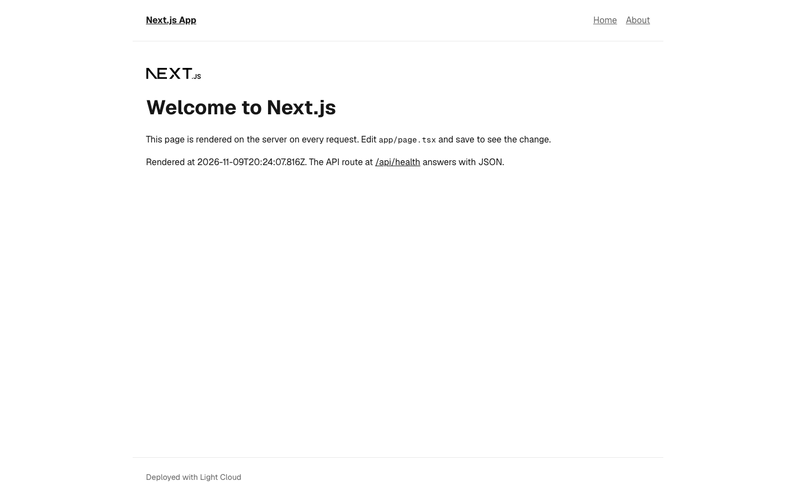
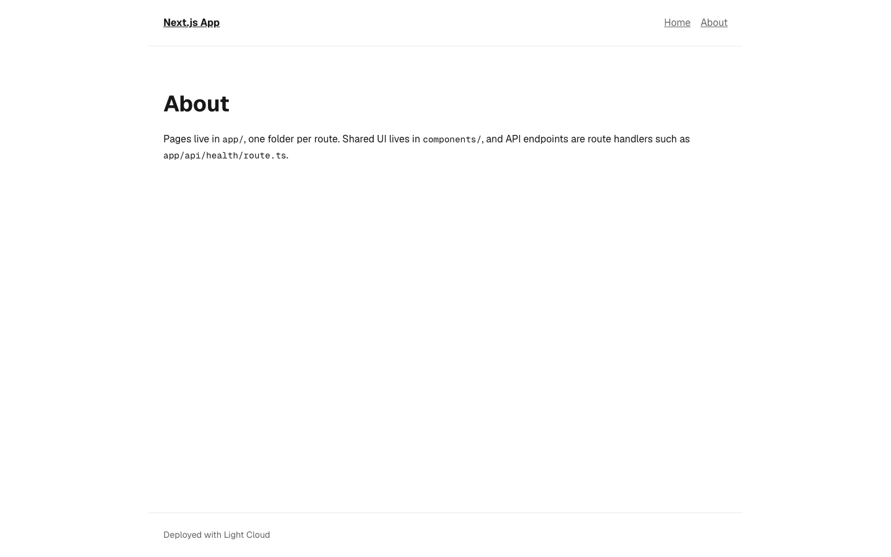
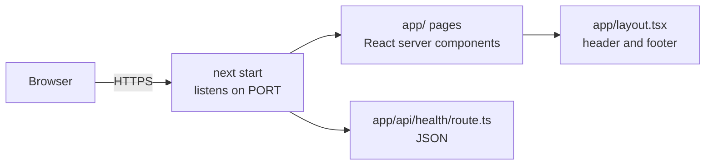

# Next.js App Router Starter

[](LICENSE) [](https://nextjs.org) [](https://react.dev) [](https://www.typescriptlang.org) [](app/api/health) [](https://github.com/light-cloud-templates/nextjs-app-router-starter/generate) [](https://www.light-cloud.com/templates/nextjs-app-router-starter)

A Next.js 16 starter on the App Router with React 19 and TypeScript, rendered on a Node.js server with `next start` rather than exported as static files. It is a small boilerplate for developers who want a clean server-rendered Next.js app with a shared layout, two pages, a 404 page and a JSON API route, plus ESLint and Vitest already set up. It runs on any host that runs Node.js, and deploys to Light Cloud in one click.

## Screenshot

<picture><source media="(prefers-color-scheme: dark)" srcset="docs/screenshots/home-dark.png"></picture>
<picture><source media="(prefers-color-scheme: dark)" srcset="docs/screenshots/about-dark.png"></picture>

## Features

- Next.js 16.3 with the App Router and React 19 server components
- TypeScript, with the `@/*` import alias pointing at the project root
- Root layout with a shared header (site name and navigation) and footer in `components/`
- Home, About and a custom 404 page; the home page renders on every request (`dynamic = "force-dynamic"`)
- A route handler at `GET /api/health` that answers `{ "status": "ok" }`
- Geist and Geist Mono through `next/font`, CSS variables with a dark theme that follows the system setting
- ESLint 9 flat config with `eslint-config-next` (Core Web Vitals and TypeScript rules)
- A Vitest test for the API route
- Production server with `next start`, which listens on `PORT`

## Quick start

You need Node.js 20.9 or later and npm.

```bash
git clone https://github.com/light-cloud-templates/nextjs-app-router-starter.git
cd nextjs-app-router-starter
npm install
cp .env.example .env.local
npm run dev
```

Open <http://localhost:3000>. Edit `app/page.tsx` and the page reloads.

Other ways to start:

- **Use this template**: press [Use this template](https://github.com/light-cloud-templates/nextjs-app-router-starter/generate) to create your own repository from this one.
- **Deploy to Light Cloud**: open the [template page](https://www.light-cloud.com/templates/nextjs-app-router-starter) and press Deploy to get a running copy.

## Deploy

### Deploy to Light Cloud

[](https://www.light-cloud.com/templates/nextjs-app-router-starter)

The Deploy button copies this template into your GitHub account and creates a server app: Light Cloud runs `npm run build`, then `npm start` (`next start`) in a container that listens on the port in `PORT`.

There are no secrets to fill in. Every push to the default branch deploys again. The Free plan includes up to 3 server apps.

### Deploy anywhere else

This is a standard Next.js app with no Light Cloud code in it. Any host that runs Node.js 20.9 or later runs it: `npm ci`, `npm run build`, then `npm start`. `next start` reads `PORT` (default `3000`).

## Project structure

```text
.
├── app/
│   ├── layout.tsx              # root layout: <html>, fonts, metadata, header, footer
│   ├── page.tsx                # home page (/), rendered per request
│   ├── about/page.tsx          # /about
│   ├── not-found.tsx           # 404 page
│   ├── globals.css             # colour tokens (light and dark) and base styles
│   └── api/health/
│       ├── route.ts            # GET /api/health
│       └── route.test.ts       # Vitest test for the route
├── components/
│   ├── site-header.tsx         # site name and navigation
│   ├── site-header.module.css  # header styles (CSS module)
│   └── site-footer.tsx
├── public/                     # static files served from /
├── .env.example                # the variables, for local runs
├── AGENTS.md                   # notes for AI coding agents, written by next dev
├── eslint.config.mjs           # ESLint flat config
├── next.config.ts              # Next.js config (empty by default)
└── tsconfig.json
```

## Pages

| Path | File | What it shows |
| --- | --- | --- |
| `/` | `app/page.tsx` | Welcome page with the time it was rendered on the server |
| `/about` | `app/about/page.tsx` | Where pages, components and API routes live |
| any unknown path | `app/not-found.tsx` | 404 page with a link home |

## API endpoints

| Method | Path | Description |
| --- | --- | --- |
| `GET` | `/api/health` | Answers `200` with `{ "status": "ok" }` |

```bash
curl http://localhost:3000/api/health
```

On Light Cloud, use your app's URL instead of `http://localhost:3000`.

## Environment variables

| Name | Required | Default | What it does |
| --- | --- | --- | --- |
| `PORT` | No | `3000` | Port `next start` listens on. Set by Light Cloud. |
| `NEXT_PUBLIC_SITE_NAME` | No | `Next.js App` | Site name in the header. Inlined into the browser bundle at build time, so redeploy after changing it. |

Variables that start with `NEXT_PUBLIC_` end up in the browser bundle, so never put secrets in them. Variables without the prefix stay on the server (route handlers and server components). Locally, put them in `.env.local`.

## Testing

```bash
npm test          # Vitest
npm run lint      # ESLint
npm run build     # type check and production build
```

## How it works



Every request reaches the Next.js server. Pages are React server components rendered into HTML on the server, and route handlers in `app/api/` answer with JSON.

## FAQ

### How do I add a new page in the Next.js App Router?

Create a folder under `app/` with a `page.tsx` in it: `app/contact/page.tsx` becomes `/contact`. Add a link to it in `components/site-header.tsx`.

### How do I add an API route in Next.js?

Create a `route.ts` file under `app/api/` and export a function named after the HTTP method, as in `app/api/health/route.ts`. `app/api/hello/route.ts` with `export function GET()` answers `GET /api/hello`.

### Can I prerender the home page instead of rendering it on every request?

Yes. Remove `export const dynamic = "force-dynamic"` from `app/page.tsx` and Next.js renders it once at build time. The app still runs on a server, so route handlers keep working.

### How do I use environment variables in Next.js?

Put them in `.env.local` locally and in your app's environment variables on Light Cloud. Read them with `process.env.NAME` in server code; only `NEXT_PUBLIC_` variables are available in the browser, and those are fixed at build time.

### Can I deploy it without Light Cloud?

Yes. It is a plain Next.js app: any host with Node.js 20.9 or later runs it with `npm run build` and `npm start`.

## Related templates

- [nextjs-saas-starter](https://github.com/light-cloud-templates/nextjs-saas-starter): Next.js with auth, teams, billing and PostgreSQL
- [remix-vite-starter](https://github.com/light-cloud-templates/remix-vite-starter): server-rendered React with Remix v2 on Vite
- [react-vite-starter](https://github.com/light-cloud-templates/react-vite-starter): a React single-page app served as static files
- [nuxt-ssr-starter](https://github.com/light-cloud-templates/nuxt-ssr-starter): the same pages in Nuxt and Vue
- [sveltekit-starter](https://github.com/light-cloud-templates/sveltekit-starter): the same pages in SvelteKit

## Licence

MIT, see [LICENSE](LICENSE).

---

Maintained by [Light Cloud](https://light-cloud.com): deploy apps, APIs and databases in one click.
