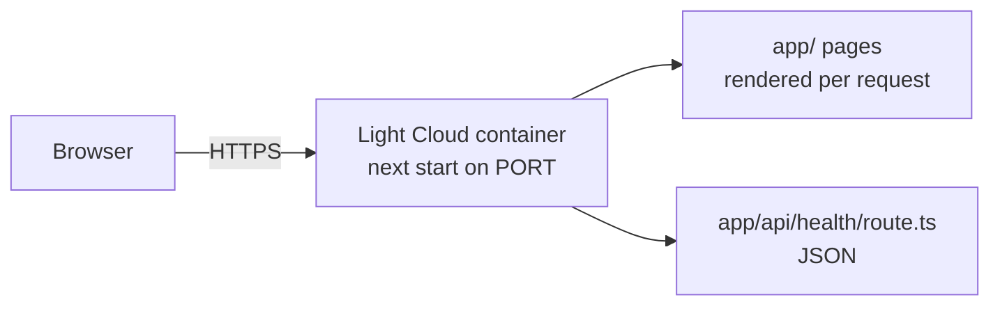

<p align="center">
  
</p>

<h1 align="center">Next.js Boilerplate</h1>

<p align="center">
  A Next.js app on the App Router, rendered on a server, ready to deploy on Light Cloud.
</p>

<p align="center">
  <a href="https://www.light-cloud.com/templates/starter-nextjs"></a>
</p>

---

## Features

- Next.js 16 with the App Router and React 19 server components
- TypeScript, ESLint (`eslint-config-next` flat config) and Vitest
- Root layout with a shared header and footer in `components/`
- Home, About and a 404 page, plus an API route at `/api/health`
- Server-rendered: runs as a container with `next start`, not a static export

## How it works



## Project structure

```text
.
├── app/
│   ├── layout.tsx            # Root layout: <html>, fonts, header, footer
│   ├── page.tsx              # Home page (/)
│   ├── about/page.tsx        # /about
│   ├── not-found.tsx         # 404 page
│   ├── globals.css           # Design tokens and base styles
│   └── api/health/
│       ├── route.ts          # GET /api/health -> {"status":"ok"}
│       └── route.test.ts     # Vitest test for the route
├── components/               # SiteHeader, SiteFooter
├── public/                   # Static files served from /
├── .env.example              # Environment variables
├── eslint.config.mjs
├── next.config.ts
└── tsconfig.json
```

## Local development

```bash
npm install       # install dependencies
npm run dev       # dev server on http://localhost:3000
npm run lint      # ESLint
npm test          # Vitest
npm run build     # production build into .next/
npm start         # serve the production build (honours PORT)
```

## Environment variables

Copy `.env.example` to `.env.local`. Variables starting with `NEXT_PUBLIC_` are inlined into the browser bundle at build time, so never put secrets in them; the rest stay on the server. On Light Cloud, set them in the app's environment variables and redeploy.

## Deploy to Light Cloud

### 1. Create an Account

Visit [console.light-cloud.com](https://console.light-cloud.com) and sign up with GitHub or Google.

### 2. Create New Application

1. Click **"New Application"** in the dashboard
2. Select **"Container"** as the deployment type
3. Choose **"Next.js"** as the framework

### 3. Connect Repository

- **Option A:** Fork this repository and connect it via GitHub
- **Option B:** Push this code to your own GitHub repository and connect it

### 4. Configure Settings

Light Cloud will auto-detect your settings, but you can verify:

| Setting | Value |
|---------|-------|
| Port | `3000` |
| Start Command | `npm start` |

### 5. Deploy

Click **"Deploy"** and your app will be live in minutes!

Your app will be available at `https://your-app.light-cloud.io`

## Learn More

This starter began as `create-next-app` output and adds the structure described above.

- [Next.js documentation](https://nextjs.org/docs)
- [Learn Next.js](https://nextjs.org/learn)
- [Light Cloud documentation](https://docs.light-cloud.com)

## License

[MIT](./LICENSE)

---

<p align="center">
  <a href="https://light-cloud.com">Website</a> •
  <a href="https://docs.light-cloud.com">Documentation</a> •
  <a href="https://console.light-cloud.com">Console</a>
</p>

<p align="center">
  Made with ☁️ by <a href="https://light-cloud.com">Light Cloud</a>
</p>
