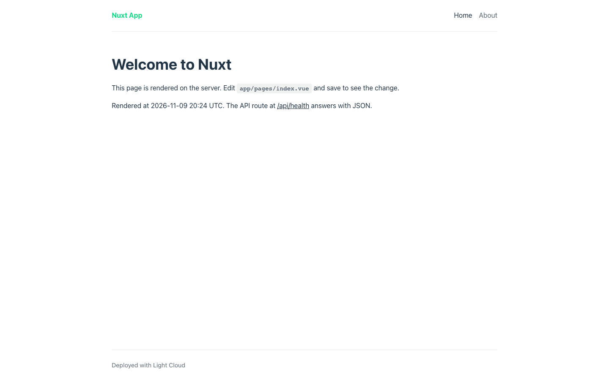
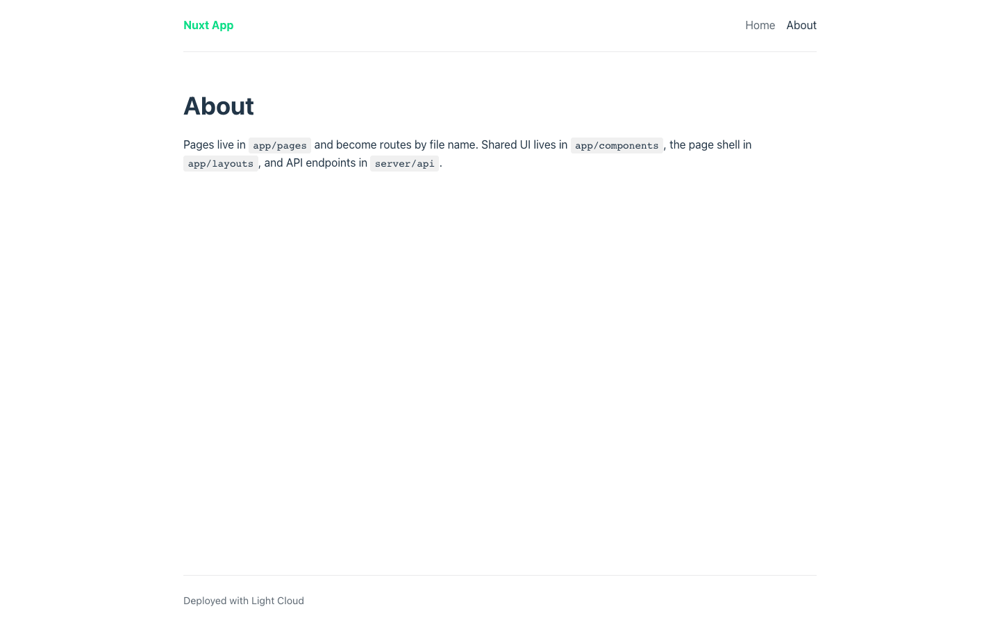
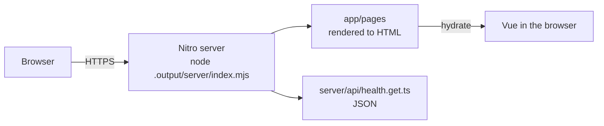

# Nuxt 4 SSR Starter

[](LICENSE) [](https://nuxt.com) [](https://vuejs.org) [](test) [](https://github.com/light-cloud-templates/nuxt-ssr-starter/generate) [](https://www.light-cloud.com/templates/nuxt-ssr-starter)

A Nuxt 4 starter with server-side rendering, Vue 3 and TypeScript, built into a standalone Node.js server in `.output/`. It is a small boilerplate for developers who want a working server-rendered Nuxt app with file-based routing, a default layout, a server API route under `server/`, runtime config read from environment variables, ESLint and Vitest. It runs on any host that runs Node.js, and deploys to Light Cloud in one click.

## Screenshot




## Features

- Nuxt 4.6 with server-side rendering, Vue 3.5 and Vue Router
- File-based routing in `app/pages/`: Home, About and Nuxt's built-in 404 page
- A default layout with a shared `AppHeader` component, both auto-imported
- A server route at `GET /api/health` in `server/api/`, run by Nitro
- An auto-imported helper in `app/utils/` that formats dates the same on server and client
- Runtime config: `NUXT_PUBLIC_SITE_NAME` sets the site name when the server starts, no rebuild needed
- ESLint through the `@nuxt/eslint` module, Vitest for unit tests
- `npm run build` produces a standalone server, `node .output/server/index.mjs`, that listens on `PORT`

## Quick start

You need Node.js 22.22 or later (or 24.15 or later) and npm.

```bash
git clone https://github.com/light-cloud-templates/nuxt-ssr-starter.git
cd nuxt-ssr-starter
npm install
cp .env.example .env
npm run dev
```

Open <http://localhost:3000>. `npm install` also runs `nuxt prepare`, which generates the `.nuxt/` types and the ESLint config.

Other ways to start:

- **Use this template**: press [Use this template](https://github.com/light-cloud-templates/nuxt-ssr-starter/generate) to create your own repository from this one.
- **Deploy to Light Cloud**: open the [template page](https://www.light-cloud.com/templates/nuxt-ssr-starter) and press Deploy to get a running copy.

## Deploy

### Deploy to Light Cloud

[](https://www.light-cloud.com/templates/nuxt-ssr-starter)

The Deploy button copies this template into your GitHub account and creates a server app: Light Cloud runs `npm run build`, then `npm start` (`node .output/server/index.mjs`) in a container that listens on the port in `PORT`.

There are no secrets to fill in. Every push to the default branch deploys again. The Free plan includes up to 3 server apps.

### Deploy anywhere else

This is a standard Nuxt app with no Light Cloud code in it. Any host that runs Node.js 22.22 or later runs it: `npm ci`, `npm run build`, then `node .output/server/index.mjs`. The server reads `PORT` (default `3000`). `.output/` is self-contained, so you can copy it to a server or a Docker image without `node_modules`.

## Project structure

```text
.
├── app/
│   ├── app.vue                  # root: route announcer, layout, current page
│   ├── layouts/default.vue      # page shell: header, main, footer
│   ├── pages/
│   │   ├── index.vue            # /
│   │   └── about.vue            # /about
│   ├── components/AppHeader.vue # site name and navigation
│   ├── utils/formatDateTime.ts  # auto-imported date helper
│   └── assets/css/main.css      # global styles
├── server/
│   └── api/health.get.ts        # GET /api/health
├── test/unit/                   # Vitest unit tests
├── public/                      # static files served from / (robots.txt)
├── .env.example                 # the variables, for local runs
├── eslint.config.mjs            # extends the config @nuxt/eslint generates
├── nuxt.config.ts               # modules, CSS, head, runtime config
└── tsconfig.json                # references the generated .nuxt configs
```

## Pages

| Path | File | What it shows |
| --- | --- | --- |
| `/` | `app/pages/index.vue` | Welcome page with the time it was rendered on the server |
| `/about` | `app/pages/about.vue` | Where pages, components, layouts and server routes live |

## API endpoints

| Method | Path | Description |
| --- | --- | --- |
| `GET` | `/api/health` | Answers `200` with `{ "status": "ok" }` |

```bash
curl http://localhost:3000/api/health
```

On Light Cloud, use your app's URL instead of `http://localhost:3000`.

## Environment variables

| Name | Required | Default | What it does |
| --- | --- | --- | --- |
| `PORT` | No | `3000` | Port the production server listens on. Set by Light Cloud. |
| `NUXT_PUBLIC_SITE_NAME` | No | `Nuxt App` | Site name in the header. Overrides `runtimeConfig.public.siteName` when the server starts. |

`NUXT_PUBLIC_*` values are sent to the browser, so never put secrets in them. Add secrets as non-public keys in `runtimeConfig` in `nuxt.config.ts` and set them with a `NUXT_` variable of the same name; those stay on the server.

## Testing

```bash
npm test          # Vitest
npm run lint      # ESLint
```

## How it works



The first request for a page is rendered to HTML on the server, then Vue takes over in the browser and later navigation happens client-side. Files in `server/api/` are server-only handlers that Nitro serves under `/api/`.

## FAQ

### How do I add a new page in Nuxt?

Create a `.vue` file in `app/pages/`: `app/pages/contact.vue` becomes `/contact`. Add a `NuxtLink` to it in `app/components/AppHeader.vue`.

### How do I add a server API route in Nuxt?

Create a file in `server/api/` named after the path and method: `server/api/hello.get.ts` with `export default defineEventHandler(() => ({ hello: 'world' }))` answers `GET /api/hello`.

### How do I read environment variables in Nuxt?

Declare the key in `runtimeConfig` in `nuxt.config.ts` and read it with `useRuntimeConfig()`. Nuxt fills it from a `NUXT_` variable when the server starts, for example `NUXT_PUBLIC_SITE_NAME` for `runtimeConfig.public.siteName`.

### Can I build a static site with Nuxt instead?

`npm run generate` prerenders the pages into `.output/public`, which any static host serves. Server routes do not run on a static host, so keep the server build if you need them.

### Can I deploy it without Light Cloud?

Yes. It is a plain Nuxt app: any host with Node.js 22.22 or later runs it with `npm run build` and `node .output/server/index.mjs`.

## Related templates

- [vue-vite-starter](https://github.com/light-cloud-templates/vue-vite-starter): a Vue single-page app served as static files
- [nextjs-app-router-starter](https://github.com/light-cloud-templates/nextjs-app-router-starter): the same pages in Next.js and React
- [sveltekit-starter](https://github.com/light-cloud-templates/sveltekit-starter): the same pages in SvelteKit
- [remix-vite-starter](https://github.com/light-cloud-templates/remix-vite-starter): the same pages in Remix v2

## Licence

MIT, see [LICENSE](LICENSE).

---

Maintained by [Light Cloud](https://light-cloud.com): deploy apps, APIs and databases in one click.
