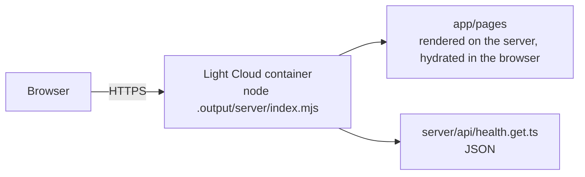

<p align="center">
  
</p>

<h1 align="center">Nuxt Boilerplate</h1>

<p align="center">
  A Nuxt app with server-side rendering, ready to deploy on Light Cloud.
</p>

<p align="center">
  <a href="https://console.light-cloud.com/new?repo=https://github.com/light-cloud-com/starter-nuxt"></a>
</p>

---

## Features

- Nuxt 4 with server-side rendering and Vue 3
- File-based routing: Home, About and Nuxt's built-in 404
- Default layout with a shared header component
- Server API route at `/api/health`
- ESLint via `@nuxt/eslint`, unit tests with Vitest
- Runtime config overridable with `NUXT_PUBLIC_*` environment variables
- Builds a standalone Node server into `.output/`

## How it works



## Project structure

```text
.
├── app/
│   ├── app.vue                 # Root: layout + current page
│   ├── layouts/default.vue     # Page shell: header, main, footer
│   ├── pages/                  # index.vue (/), about.vue (/about)
│   ├── components/AppHeader.vue
│   ├── utils/formatDateTime.ts # Auto-imported helper
│   └── assets/css/main.css     # Global styles
├── server/api/health.get.ts    # GET /api/health -> {"status":"ok"}
├── test/unit/                  # Vitest unit tests
├── public/                     # Static files served from /
├── .env.example
├── eslint.config.mjs
└── nuxt.config.ts
```

## Local development

```bash
npm install       # install dependencies (runs nuxt prepare)
npm run dev       # dev server on http://localhost:3000
npm run lint      # ESLint
npm test          # Vitest
npm run build     # production build into .output/
npm start         # run the production server (honours PORT)
```

## Environment variables

Copy `.env.example` to `.env`. `NUXT_PUBLIC_SITE_NAME` overrides `runtimeConfig.public.siteName` when the server starts, not at build time. `NUXT_PUBLIC_*` values reach the browser; keep secrets in non-public `runtimeConfig` keys.

## Deploy to Light Cloud

### 1. Create an Account

Visit [console.light-cloud.com](https://console.light-cloud.com) and sign up with GitHub or Google.

### 2. Create New Application

1. Click **"New Application"** in the dashboard
2. Select **"Container"** as the deployment type
3. Choose **"Nuxt"** as the framework

### 3. Connect Repository

- **Option A:** Fork this repository and connect it via GitHub
- **Option B:** Push this code to your own GitHub repository and connect it

### 4. Configure Settings

Light Cloud will auto-detect your settings, but you can verify:

| Setting | Value |
|---------|-------|
| Port | `3000` |
| Start Command | `npm start` |

### 5. Deploy

Click **"Deploy"** and your app will be live in minutes!

Your app will be available at `https://your-app.light-cloud.io`

## Learn More

This starter began as `npm create nuxt@latest` output and adds the structure described above.

- [Nuxt documentation](https://nuxt.com/docs)
- [Light Cloud documentation](https://docs.light-cloud.com)

## License

[MIT](./LICENSE)

---

<p align="center">
  <a href="https://light-cloud.com">Website</a> •
  <a href="https://docs.light-cloud.com">Documentation</a> •
  <a href="https://console.light-cloud.com">Console</a>
</p>

<p align="center">
  Made with ☁️ by <a href="https://light-cloud.com">Light Cloud</a>
</p>
