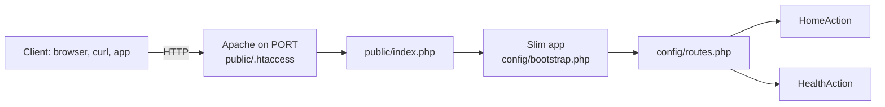

# Slim PHP REST API Starter (Slim 4, PHP 8.2)

[](LICENSE) [](https://www.slimframework.com) [](https://www.php.net) [](tests) [](https://github.com/light-cloud-templates/slim-php-api-starter/generate) [](https://www.light-cloud.com/templates/slim-php-api-starter)

A Slim 4 REST API starter in PHP 8.2, with Composer, PSR-7 requests and responses, PHPUnit tests and a Dockerfile on the official PHP Apache image. It is a small, tested boilerplate for PHP developers who want a working JSON API with a front controller, single-action classes and a health check, without the weight of a full framework, ready to rename and extend. It runs with PHP's built-in server locally and on any PHP host or container, and deploys to Light Cloud in one click.

## Features

- Slim 4.15 with `slim/psr7` for PSR-7 requests and responses
- One single-action class per route in `src/Action/`, routes in `config/routes.php`
- The app is built in `config/bootstrap.php`, shared by `public/index.php` and the tests
- Slim's error middleware: errors are logged and answered in the format the client asks for in `Accept` (JSON, XML, HTML or text)
- `APP_DEBUG=true` shows error details in responses; it is off by default
- `public/.htaccess` sends every request that is not a real file to `public/index.php`
- PHPUnit 11 tests that send requests through the real app, without a web server
- `Dockerfile` on `php:8.2-apache` with `mod_rewrite`, the document root set to `public/`, and Apache's port read from `PORT` at start

## Quick start

You need PHP 8.2 or newer and Composer.

```bash
git clone https://github.com/light-cloud-templates/slim-php-api-starter.git
cd slim-php-api-starter
composer install
composer start
```

Open <http://localhost:8080> to see the API info. `composer start` runs `php -S localhost:8080 -t public`. To see error details while you work, start it with `APP_DEBUG=true composer start`.

Other ways to start:

- **Use this template**: press [Use this template](https://github.com/light-cloud-templates/slim-php-api-starter/generate) to create your own repository from this one.
- **Deploy to Light Cloud**: open the [template page](https://www.light-cloud.com/templates/slim-php-api-starter) and press Deploy to get a running copy.

## Deploy

### Deploy to Light Cloud

[](https://www.light-cloud.com/templates/slim-php-api-starter)

The Deploy button copies this template into your GitHub account and creates a server app: Light Cloud builds the `Dockerfile` and runs the image as a container, with Apache listening on the port in `PORT`.

There are no secrets to fill in. Every push to the default branch deploys again. The Free plan includes up to 3 server apps.

### Deploy anywhere else

This is a standard Slim app with no Light Cloud code in it. Any host that runs Docker runs the image:

```bash
docker build -t slim-php-api-starter .
docker run -p 8080:8080 slim-php-api-starter
```

On a classic PHP 8.2 host, run `composer install --no-dev` and point the web server's document root at `public/`. Apache picks up `public/.htaccess`; on nginx, send requests that are not files to `public/index.php` with `try_files $uri /index.php?$query_string`.

## Project structure

```text
.
├── public/
│   ├── index.php              # front controller: loads the app and runs it
│   └── .htaccess              # Apache: route everything to index.php
├── config/
│   ├── bootstrap.php          # builds the Slim app: middleware and routes
│   ├── routes.php             # GET / and GET /health
│   └── settings.php           # APP_DEBUG and error logging
├── src/
│   └── Action/
│       ├── HomeAction.php     # GET /: API info
│       └── HealthAction.php   # GET /health
├── tests/
│   └── Action/                # PHPUnit: requests through the real app
├── composer.json              # Slim 4, PHP 8.2, start and test scripts
├── composer.lock              # locked versions
├── phpunit.xml.dist           # PHPUnit settings
├── Dockerfile                 # php:8.2-apache, document root public/
├── .mcp.json                  # Light Cloud MCP server for AI coding agents
└── .env.example               # PORT and APP_DEBUG, for reference
```

## API endpoints

| Method | Path | Description |
| --- | --- | --- |
| `GET` | `/` | API info: `message`, `version` and the list of endpoints |
| `GET` | `/health` | `{"status": "healthy", "timestamp": "...", "uptime": ...}` |

Unknown routes answer `404`. Send `Accept: application/json` to get errors as JSON. PHP starts fresh for every request, so `uptime` counts from the start of the request and stays close to zero.

```bash
curl http://localhost:8080/health
```

On Light Cloud, use your app's URL instead of `http://localhost:8080`.

## Environment variables

| Name | Required | Default | What it does |
| --- | --- | --- | --- |
| `PORT` | No | `8080` | Port Apache listens on in the container. Set by Light Cloud. |
| `APP_DEBUG` | No | `false` | `true` shows error details in responses. Keep it `false` in production. |

The app reads these with `getenv()`; it does not load a `.env` file. `.env.example` lists them for reference.

## Testing

```bash
composer test
```

`composer test` runs PHPUnit. The tests build the app from `config/bootstrap.php` and hand it requests directly: `GET /`, `GET /health`, uptime counting, and a `404` for an unknown route.

## How it works



Apache serves `public/` and rewrites every request that is not a file to `index.php`. The front controller builds the Slim app, the routing middleware matches the path, and the matching action writes JSON to the PSR-7 response.

## FAQ

### How do I add a new route in Slim 4?

Add an invokable class in `src/Action/` that takes the request and response and returns the response, as in `HomeAction.php`, then register it in `config/routes.php` with `$app->get('/path', YourAction::class)` or `$app->post(...)`.

### How do I read a JSON request body in Slim?

Add `$app->addBodyParsingMiddleware();` in `config/bootstrap.php`. `$request->getParsedBody()` then returns the decoded JSON as an array.

### How do I run a Slim app on PHP's built-in server?

Run `composer start`, which runs `php -S localhost:8080 -t public`. The built-in server falls back to `public/index.php` for paths that are not files, so routing works without Apache.

### Why Slim and not Laravel or Symfony?

Slim is a micro-framework: routing, middleware and PSR-7, with nothing else to learn or load. It suits small APIs and services, and you can add only the Composer packages you need.

### Can I deploy it without Light Cloud?

Yes. It is a plain Slim app: run the Docker image on any container host, or deploy it to any PHP 8.2 host with the document root set to `public/`.

## Related templates

- [express-api-starter](https://github.com/light-cloud-templates/express-api-starter): the same kind of API in Node.js and Express
- [flask-api-starter](https://github.com/light-cloud-templates/flask-api-starter): a small REST API in Python and Flask
- [sinatra-api-starter](https://github.com/light-cloud-templates/sinatra-api-starter): a small REST API in Ruby and Sinatra
- [dockerfile-starter](https://github.com/light-cloud-templates/dockerfile-starter): bring your own Dockerfile for any runtime

## Licence

MIT, see [LICENSE](LICENSE).

---

Maintained by [Light Cloud](https://light-cloud.com): deploy apps, APIs and databases in one click.
