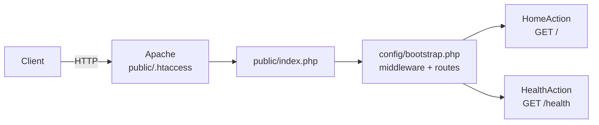

<p align="center">
  
</p>

<h1 align="center">PHP API Boilerplate</h1>

<p align="center">
  A modern Slim Framework REST API, ready to deploy on Light Cloud.
</p>

<p align="center">
  <a href="https://console.light-cloud.com/new?repo=https://github.com/light-cloud-com/starter-php"></a>
</p>

---

## Features

- Slim Framework 4 with PSR-7 HTTP messages
- PSR-4 autoloading: invokable action classes in `src/`, app bootstrap and routes in `config/`
- `public/index.php` front controller, so only `public/` is served
- Error details off unless `APP_DEBUG=true`
- PHPUnit tests that send requests through the app, no web server needed
- Docker-ready for Cloud Run

## How it works



## API Endpoints

| Method | Endpoint | Description |
|--------|----------|-------------|
| GET | `/` | Welcome message and API info |
| GET | `/health` | Health check with uptime |

## Project structure

```
.
├── composer.json, composer.lock
├── phpunit.xml.dist
├── Dockerfile
├── config
│   ├── bootstrap.php     builds the Slim app (used by index.php and the tests)
│   ├── routes.php        URL -> action
│   └── settings.php      settings from the environment
├── public
│   ├── .htaccess         sends every request to index.php
│   └── index.php         front controller
├── src/Action/           HomeAction, HealthAction (namespace App\Action)
└── tests/Action/         PHPUnit tests (namespace Tests\Action)
```

Add an endpoint as a new class in `src/Action/` and a line in `config/routes.php`.

## Local Development

You need PHP 8.2 or newer and Composer.

```bash
# Install dependencies
composer install

# Run with PHP built-in server
composer start

# Run the tests
composer test
```

The API will be available at `http://localhost:8080`

## Deploy to Light Cloud

### 1. Create an Account

Visit [console.light-cloud.com](https://console.light-cloud.com) and sign up with GitHub or Google.

### 2. Create New Application

1. Click **"New Application"** in the dashboard
2. Select **"Container"** as the deployment type
3. Choose **"PHP"** as the runtime

### 3. Connect Repository

- **Option A:** Fork this repository and connect it via GitHub
- **Option B:** Push this code to your own GitHub repository and connect it

### 4. Configure Settings

Light Cloud will auto-detect your settings, but you can verify:

| Setting | Value |
|---------|-------|
| Port | `8080` |
| Dockerfile | Auto-detected |

### 5. Deploy

Click **"Deploy"** and your API will be live in minutes!

Your API will be available at `https://your-app.light-cloud.io`

## Learn More

- [Slim Framework documentation](https://www.slimframework.com/docs/v4/)
- [Composer](https://getcomposer.org/doc/)
- [Light Cloud documentation](https://docs.light-cloud.com)

---

<p align="center">
  <a href="https://light-cloud.com">Website</a> •
  <a href="https://docs.light-cloud.com">Documentation</a> •
  <a href="https://console.light-cloud.com">Console</a>
</p>

<p align="center">
  Made with ☁️ by <a href="https://light-cloud.com">Light Cloud</a>
</p>
