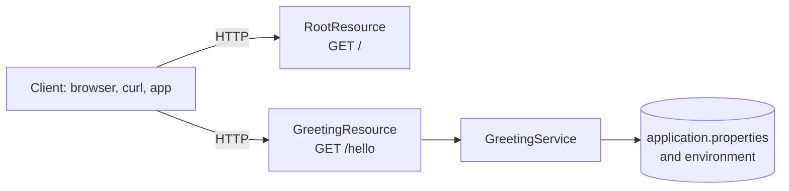

# Quarkus REST API Starter (Java 17, Maven)

[](LICENSE) [](https://quarkus.io) [](https://openjdk.org) [](src/test) [](https://github.com/light-cloud-templates/quarkus-api-starter/generate) [](https://www.light-cloud.com/templates/quarkus-api-starter)

A Quarkus 3 REST API starter in Java 17, built with Maven and the Maven wrapper, so you do not need Maven installed. It is a small, tested boilerplate for Java developers who want a working Quarkus REST (Jakarta REST) service with CDI, Jackson, settings from environment variables and live reload in dev mode, ready to rename and extend. It packages as a single runnable jar, runs with `java -jar` anywhere Java runs, and deploys to Light Cloud in one click.

## Features

- Quarkus 3.38 with Quarkus REST (Jakarta REST), Jackson and ArC (CDI)
- Two endpoints: `GET /` answers JSON, `GET /hello` answers a plain-text greeting
- Resources grouped by feature, with CDI services injected through the constructor
- Settings in `application.properties`, each overridable by an environment variable (`GREETING_MESSAGE`)
- Live coding in dev mode with `./mvnw quarkus:dev`
- Packaged as an uber-jar, `target/*-runner.jar`, so one file holds the app and its dependencies
- Listens on `0.0.0.0` and the port in `PORT`, with `8080` as the fallback
- `@QuarkusTest` tests with REST Assured, plus an integration test that runs against the packaged jar
- Maven wrapper (`./mvnw`, Maven 3.9) included

## Quick start

You need a JDK, Java 17 or newer. Maven is downloaded by the wrapper.

```bash
git clone https://github.com/light-cloud-templates/quarkus-api-starter.git
cd quarkus-api-starter
cp .env.example .env
./mvnw quarkus:dev
```

Open <http://localhost:8080/hello> to see the greeting. Dev mode reloads the app when you change a file, and the Quarkus Dev UI is at <http://localhost:8080/q/dev-ui>. On Windows, use `mvnw.cmd` instead of `./mvnw`.

Other ways to start:

- **Use this template**: press [Use this template](https://github.com/light-cloud-templates/quarkus-api-starter/generate) to create your own repository from this one.
- **Deploy to Light Cloud**: open the [template page](https://www.light-cloud.com/templates/quarkus-api-starter) and press Deploy to get a running copy.

## Deploy

### Deploy to Light Cloud

[](https://www.light-cloud.com/templates/quarkus-api-starter)

The Deploy button copies this template into your GitHub account and creates a server app: Light Cloud builds the uber-jar with Maven and runs it as a container that listens on the port in `PORT`.

There are no secrets to fill in. Every push to the default branch deploys again. The Free plan includes up to 3 server apps.

### Deploy anywhere else

This is a standard Quarkus app with no Light Cloud code in it. Any host that runs Java 17 runs it:

```bash
./mvnw clean package
java -jar target/*-runner.jar
```

`src/main/docker/` holds the Dockerfiles the Quarkus generator writes. `Dockerfile.native` and `Dockerfile.native-micro` work after a native build (`./mvnw package -Dnative`, which needs GraalVM or Docker). `Dockerfile.jvm` expects the default fast-jar layout, so switch `quarkus.package.jar.type` back to `fast-jar` before using it.

## Project structure

```text
.
├── src/
│   ├── main/
│   │   ├── docker/                     # Quarkus' generated Dockerfiles (JVM and native)
│   │   ├── java/com/lightcloud/
│   │   │   ├── greeting/
│   │   │   │   ├── GreetingResource.java  # GET /hello
│   │   │   │   └── GreetingService.java   # reads greeting.message
│   │   │   └── root/
│   │   │       └── RootResource.java      # GET /: service, status, endpoints
│   │   └── resources/
│   │       └── application.properties  # port, host, uber-jar, greeting
│   └── test/java/com/lightcloud/       # @QuarkusTest tests and one integration test
├── pom.xml                             # Quarkus 3.38.1 BOM, Java 17
├── mvnw, mvnw.cmd                      # Maven wrapper scripts
├── .mvn/wrapper/                       # wrapper settings (Maven 3.9)
└── .env.example                        # PORT and GREETING_MESSAGE
```

## API endpoints

| Method | Path | Description |
| --- | --- | --- |
| `GET` | `/` | JSON with the service name, `"status": "ok"` and the list of endpoints |
| `GET` | `/hello` | Plain-text greeting, the value of `GREETING_MESSAGE` |

```bash
curl http://localhost:8080/hello
```

On Light Cloud, use your app's URL instead of `http://localhost:8080`.

## Environment variables

| Name | Required | Default | What it does |
| --- | --- | --- | --- |
| `PORT` | No | `8080` | Port to listen on, read through `quarkus.http.port`. Set by Light Cloud. |
| `GREETING_MESSAGE` | No | `Hello from Quarkus REST` | Text returned by `GET /hello`. |

Quarkus also reads a `.env` file in the project folder, so copying `.env.example` to `.env` is enough for local runs.

## Testing

```bash
./mvnw test
```

The `@QuarkusTest` tests start the app on a test port and call `GET /` and `GET /hello` with REST Assured. To also run `GreetingResourceIT` against the packaged jar:

```bash
./mvnw verify -DskipITs=false
```

## How it works



Quarkus does most of its wiring at build time, so the jar starts quickly. `GreetingService` gets `greeting.message` injected from configuration, which falls back from the `GREETING_MESSAGE` environment variable to the default in `application.properties`.

## FAQ

### How do I change the port of a Quarkus app?

Set the `PORT` environment variable. `application.properties` maps it to `quarkus.http.port` and falls back to `8080`.

### How do I add a new REST endpoint in Quarkus?

Add a class with `@Path("/your-path")` and a method annotated with `@GET` or `@POST`. Return a record and `quarkus-rest-jackson` writes it as JSON. Quarkus finds the class at build time, so there is nothing to register.

### Why an uber-jar and not the default fast-jar?

The default fast-jar writes `target/quarkus-app/` with loose dependencies next to `quarkus-run.jar`. An uber-jar is one file, `target/*-runner.jar`, which is simpler to copy into a container or onto a server.

### How do I add OpenAPI and Swagger UI?

It has none yet. Add the `quarkus-smallrye-openapi` extension (`./mvnw quarkus:add-extension -Dextensions=smallrye-openapi`) and Quarkus serves the schema at `/q/openapi` and Swagger UI at `/q/swagger-ui`. Swagger UI is on in dev mode only, unless you set `quarkus.swagger-ui.always-include=true`.

### Can I deploy it without Light Cloud?

Yes. It is a plain Quarkus app: build it with `./mvnw clean package` and run `java -jar target/*-runner.jar` on any host with Java 17, or build a native executable and use the Dockerfiles in `src/main/docker/`.

## Related templates

- [spring-boot-api-starter](https://github.com/light-cloud-templates/spring-boot-api-starter): a Java REST API with Spring Boot
- [spring-boot-postgresql-crud-api](https://github.com/light-cloud-templates/spring-boot-postgresql-crud-api): Java with a PostgreSQL CRUD API
- [aspnet-core-api-starter](https://github.com/light-cloud-templates/aspnet-core-api-starter): the same kind of API in C# and ASP.NET Core
- [dockerfile-starter](https://github.com/light-cloud-templates/dockerfile-starter): bring your own Dockerfile for any runtime

## Licence

MIT, see [LICENSE](LICENSE).

---

Maintained by [Light Cloud](https://light-cloud.com): deploy apps, APIs and databases in one click.
