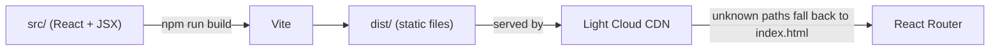

<p align="center">
  
</p>

<h1 align="center">React Boilerplate</h1>

<p align="center">
  A modern React application powered by Vite, ready to deploy on Light Cloud.
</p>

<p align="center">
  <a href="https://console.light-cloud.com/new?repo=https://github.com/light-cloud-com/starter-react"></a>
</p>

---

## Features

- React 18 with Vite
- Client-side routing with React Router (Home, About, 404)
- Shared layout, CSS Modules per component, global styles in one place
- ESLint (flat config) and Vitest with Testing Library
- `VITE_` environment variables, with an `.env.example`

## How it works



## Project structure

```text
.
├── index.html              # HTML entry, loads src/main.jsx
├── public/                 # Copied as is into dist/
├── src/
│   ├── main.jsx            # Mounts the app inside BrowserRouter
│   ├── App.jsx             # Route table
│   ├── components/         # Layout, Counter (+ its test), CSS Modules
│   ├── pages/              # Home, About, NotFound
│   ├── styles/global.css   # Design tokens and base styles
│   └── test/setup.js       # Testing Library matchers
├── .env.example            # VITE_ variables
├── eslint.config.js
└── vite.config.js          # Vite and Vitest config
```

## Local development

```bash
npm install       # install dependencies
npm run dev       # start the dev server on http://localhost:5173
npm run lint      # ESLint
npm test          # Vitest
npm run build     # production build into dist/
npm run preview   # serve the production build locally
```

## Environment variables

Copy `.env.example` to `.env.local`. Only variables that start with `VITE_` reach the browser, and they are baked in at build time, so never put secrets in them. On Light Cloud, set them in the app's environment variables and redeploy.

## Deploy to Light Cloud

### 1. Create an Account

Visit [console.light-cloud.com](https://console.light-cloud.com) and sign up with GitHub or Google.

### 2. Create New Application

1. Click **"New Application"** in the dashboard
2. Select **"Static Site"** as the deployment type
3. Choose **"React"** as the framework

### 3. Connect Repository

- **Option A:** Fork this repository and connect it via GitHub
- **Option B:** Push this code to your own GitHub repository and connect it

### 4. Configure Build Settings

Light Cloud will auto-detect your settings, but you can verify:

| Setting | Value |
|---------|-------|
| Build Command | `npm run build` |
| Output Directory | `dist` |

### 5. Deploy

Click **"Deploy"** and your app will be live in seconds!

Your app will be available at `https://your-app.light-cloud.io`

## Learn More

- [React documentation](https://react.dev)
- [Vite documentation](https://vite.dev)
- [Light Cloud documentation](https://docs.light-cloud.com)

## License

[MIT](./LICENSE)

---

<p align="center">
  <a href="https://light-cloud.com">Website</a> •
  <a href="https://docs.light-cloud.com">Documentation</a> •
  <a href="https://console.light-cloud.com">Console</a>
</p>

<p align="center">
  Made with ☁️ by <a href="https://light-cloud.com">Light Cloud</a>
</p>
