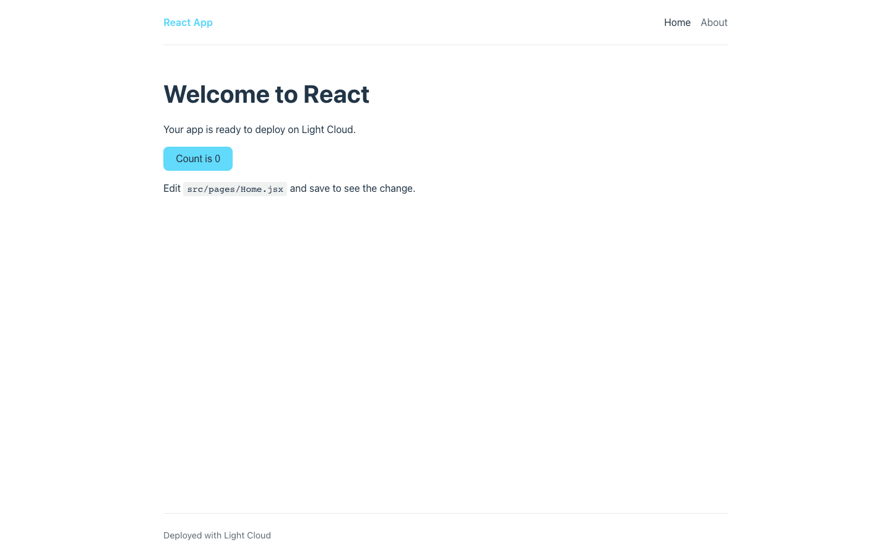
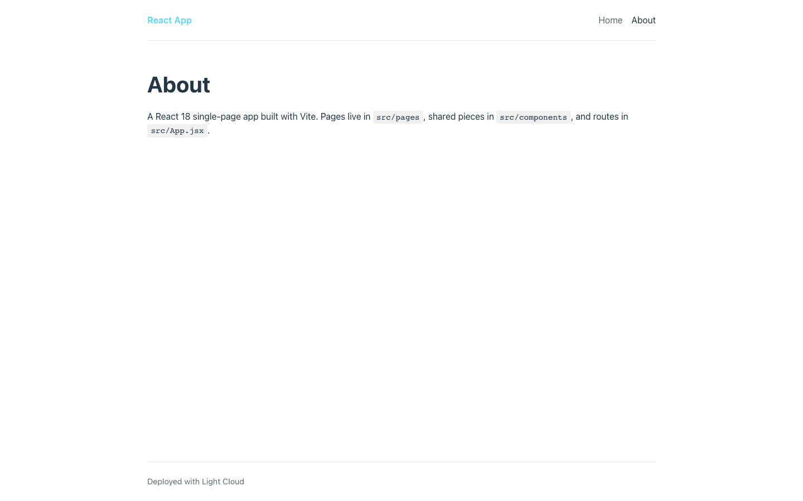
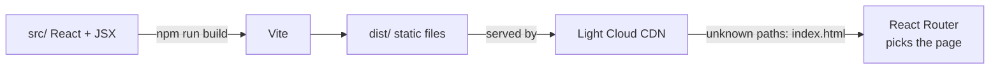

# React Vite Starter

[](LICENSE) [](https://react.dev) [](https://vite.dev) [](https://reactrouter.com) [](src/components) [](https://github.com/light-cloud-templates/react-vite-starter/generate) [](https://www.light-cloud.com/templates/react-vite-starter)

A React 18 starter built with Vite 5 and React Router 6: a single-page app with a shared layout, a home page, an about page and a 404 page. It is a small JavaScript boilerplate for developers who want a clean React project with CSS Modules, ESLint and Vitest already set up, ready to add their own pages. It builds to static files that any static host serves, and deploys to Light Cloud in one click.

## Screenshot




## Features

- React 18 with Vite 5 for the dev server and the production build
- Client-side routing with React Router 6: Home, About and a catch-all 404 page
- One shared layout (header, navigation, footer) around every page through `<Outlet />`
- CSS Modules per component, design tokens and base styles in `src/styles/global.css`
- ESLint flat config with the React Hooks and React Refresh plugins
- Vitest and Testing Library, with a sample test for the counter component
- A `VITE_APP_TITLE` build-time variable, with an `.env.example`

## Quick start

You need Node.js 20.19 or later (ESLint 10 requires it) and npm.

```bash
git clone https://github.com/light-cloud-templates/react-vite-starter.git
cd react-vite-starter
npm install
npm run dev
```

Open <http://localhost:5173>. Edit `src/pages/Home.jsx` and the page updates as you save.

Other ways to start:

- **Use this template**: press [Use this template](https://github.com/light-cloud-templates/react-vite-starter/generate) to create your own repository from this one.
- **Deploy to Light Cloud**: open the [template page](https://www.light-cloud.com/templates/react-vite-starter) and press Deploy to get a running copy.

## Deploy

### Deploy to Light Cloud

[](https://www.light-cloud.com/templates/react-vite-starter)

The Deploy button copies this template into your GitHub account and creates a static site: Light Cloud runs `npm run build` and serves the `dist/` folder from a CDN. Paths that are not files, such as `/about`, fall back to `index.html`, so React Router handles them.

There are no secrets to fill in. Every push to the default branch deploys again. Static sites run on the Free plan.

### Deploy anywhere else

This is a standard Vite app with no Light Cloud code in it. Run `npm run build` and upload `dist/` to any static file host (Netlify, Cloudflare Pages, GitHub Pages, S3 with CloudFront, nginx). Because the app uses client-side routing, configure the host to serve `index.html` for paths that do not match a file, or `/about` returns a 404 on reload.

## Project structure

```text
.
├── index.html                  # HTML entry, loads src/main.jsx
├── public/                     # copied as is into dist/
├── src/
│   ├── main.jsx                # mounts the app inside BrowserRouter
│   ├── App.jsx                 # route table
│   ├── components/
│   │   ├── Layout.jsx          # header, navigation, footer, <Outlet />
│   │   ├── Counter.jsx         # the button on the home page
│   │   └── Counter.test.jsx    # Vitest + Testing Library
│   ├── pages/                  # Home, About, NotFound
│   ├── styles/global.css       # design tokens and base styles
│   └── test/setup.js           # jest-dom matchers, cleanup after each test
├── .env.example                # VITE_ variables
├── eslint.config.js            # ESLint flat config
└── vite.config.js              # Vite and Vitest config
```

## Pages

| Path | File | What it shows |
| --- | --- | --- |
| `/` | `src/pages/Home.jsx` | Welcome text and a click counter |
| `/about` | `src/pages/About.jsx` | Where pages, components and routes live |
| any other path | `src/pages/NotFound.jsx` | "Page not found" with a link home |

Routes are declared in `src/App.jsx`; links in the header are in `src/components/Layout.jsx`.

## Environment variables

| Name | Required | Default | What it does |
| --- | --- | --- | --- |
| `VITE_APP_TITLE` | No | `React App` | Name shown in the header. |

Copy `.env.example` to `.env.local` for local runs. Vite only exposes variables that start with `VITE_` to the browser, and it writes their values into the bundle at build time, so never put secrets in them. On Light Cloud, set them in the app's environment variables and deploy again.

## Testing

```bash
npm test          # Vitest, runs once
npm run lint      # ESLint
npm run build     # production build into dist/
npm run preview   # serves dist/ on http://localhost:4173
```

The tests run in jsdom, so no browser is needed.

## How it works



Vite bundles the app into `dist/`. The browser loads `index.html` and the bundle once, then React Router swaps pages without a full reload.

## FAQ

### How do I add a new page in a React Vite app?

Create a component in `src/pages/`, add a `<Route path="contact" element={<Contact />} />` inside the layout route in `src/App.jsx`, and add a `<NavLink to="/contact">` in `src/components/Layout.jsx`.

### Why does my React Router page show a 404 after a refresh?

The host is looking for a file called `/about` and has none. Configure it to serve `index.html` for unknown paths (a rewrite or SPA fallback). Light Cloud does this for you.

### How do I add environment variables to a Vite React app?

Add a line such as `VITE_API_URL=https://api.example.com` to `.env.local` and read it with `import.meta.env.VITE_API_URL`. Only `VITE_` names reach the browser, and the value is fixed when you build.

### Can I deploy it without Light Cloud?

Yes. Run `npm run build` and serve `dist/` from any static file host, with a fallback to `index.html` for client-side routes.

### Can I use TypeScript?

Yes. Rename files to `.tsx`, add `typescript` and a `tsconfig.json`; Vite compiles TypeScript without extra plugins. The `@types/react` packages are already installed.

## Related templates

- [vue-vite-starter](https://github.com/light-cloud-templates/vue-vite-starter): the same app in Vue 3 and Vite
- [solidjs-vite-starter](https://github.com/light-cloud-templates/solidjs-vite-starter): the same app in SolidJS and TypeScript
- [svelte-vite-starter](https://github.com/light-cloud-templates/svelte-vite-starter): a single-page Svelte 5 app on Vite
- [remix-vite-starter](https://github.com/light-cloud-templates/remix-vite-starter): React with server rendering
- [react-node-saas-starter](https://github.com/light-cloud-templates/react-node-saas-starter): React with a Node.js API, auth and a database

## Licence

MIT, see [LICENSE](LICENSE).

---

Maintained by [Light Cloud](https://light-cloud.com): deploy apps, APIs and databases in one click.
